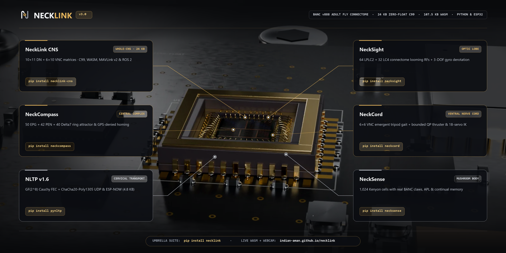

<div align="center">

<picture>
  <source media="(prefers-color-scheme: dark)" srcset="https://raw.githubusercontent.com/indian-aman/necklink/main/assets/logo/necklink-logo-dark.png">
  <source media="(prefers-color-scheme: light)" srcset="https://raw.githubusercontent.com/indian-aman/necklink/main/assets/logo/necklink-logo-light.png">
  
</picture>

### Fruit-fly connectome circuits compiled into edge controllers, in Python, WebAssembly and zero-heap ANSI C99

**Six open-source libraries. Five of them run weight matrices compiled from the `157,789`-neuron adult *Drosophila* `BANC v888` connectome inside hand-designed dynamics — including a 4-organ reflex controller plus `MAVLink v2` in `24 KB` of zero-float ANSI C99 RAM (`107.5 KB` standalone WASM) — tested against degree-preserving shuffled wiring. Plus loss-healing `NLTP` transport. Research beta.**

[](https://indian-aman.github.io/necklink/)
[](https://indian-aman.github.io/necklink/nltp/)
[](https://pypi.org/project/pynltp/)
[](https://pypi.org/project/necklink/)
[](https://pypi.org/project/necklink-cns/)
[](https://pypi.org/project/neckcompass/)
[](https://pypi.org/project/necksight/)
[](https://pypi.org/project/neckcord/)
[](https://pypi.org/project/necksense/)
[](#v300-what-the-connectome-does-and-what-we-measured)
[](https://github.com/indian-aman/necklink/blob/main/LICENSE)

[**Launch NLTP v1.6.1 Wire Lab ↗**](https://indian-aman.github.io/necklink/nltp/) ·
[**NeckLink CNS Web & WASM Sim ↗**](https://indian-aman.github.io/necklink/) ·
[**Products**](#products) ·
[**v3.0.0 results**](#v300-what-the-connectome-does-and-what-we-measured) ·
[**Install**](#install) ·
[**Repository layout**](#repository-layout) ·
[**Development**](#development)

</div>

<p align="center">
  
</p>

---

## Products

Each product takes one subsystem of the adult fruit-fly nervous system (`BANC v888`: `157,789` proofread neurons, `23.55M` synapses) and compiles its circuit into weight matrices for a standalone library. `NeckLink CNS` combines the four sensory-motor organs into one `24 KB` reflex controller. Every product ships on PyPI with a zero-heap, zero-float ANSI C99 core and an Arduino/`ESP32`/`ESP8266`/`AVR` library (strict `-Werror` verified across ESP32, ESP8266, and ATmega2560; bench-tested on real `ESP8266EX @ 160 MHz` and `ATmega2560 @ 16 MHz` silicon alongside live encrypted Wi-Fi `NLTP`). Every connectome-driven class also offers `connectome_weights="v2_analytic"`, the earlier hand-tuned symmetric model.

| Product | Fly circuit (`BANC v888`) | What it does | Package |
| :--- | :--- | :--- | :--- |
| **[NeckLink CNS](https://github.com/indian-aman/necklink/tree/main/packages/necklink_cns)** (`v3.0.1`) | Brain → descending neurons → leg motor pools (`10×11`, `6×10`) | 4-organ reflex controller whose decision layer is matrix multiplication through connectome weights, plus **MAVLink v2** & **ROS 2** bridges. `24,024 B` C99 state, `107.5 KB` WASM. Closed-loop boat sim: `66.7%` safe arrival vs `4.6%` with shuffled wiring and `0%` for a classical stack — and `80.0%` with the analytic model. | [`necklink-cns`](https://pypi.org/project/necklink-cns/) |
| **[NLTP](https://indian-aman.github.io/necklink/nltp/)** ([`packages/nltp`](https://github.com/indian-aman/necklink/tree/main/packages/nltp), `v1.6.1`) | Cervical connective (name only) | Loss-healing `GF(2^8)` Cauchy FEC file & priority-command transport with `X25519 + PSK` forward-secret `ChaCha20-Poly1305`, zero-dependency `LZ4`, and a `4.76 KB` MCU profile over UDP or ESP-NOW, in Python, C99, JS/TS, Java and Arduino (`248/248` cross-language checks; hardware-tested on `ESP32`/`ESP8266`). [**Live Browser Wire Lab ↗**](https://indian-aman.github.io/necklink/nltp/) | [`pynltp`](https://pypi.org/project/pynltp/) |
| **[NeckSight](https://github.com/indian-aman/necklink/tree/main/packages/necksight)** (`v3.0.1`) | Optic lobe (`64` `LPLC2`, `32` `LC4`) | Collision and thin-obstacle looming reflex with 3-DOF gyro derotation; receptive fields compiled from the connectome. Wiring helps on thin poles/wires but misses the strict shuffle threshold; the analytic model and gyro-derotated Farneback do better overall. | [`necksight`](https://pypi.org/project/necksight/) |
| **[NeckCompass](https://github.com/indian-aman/necklink/tree/main/packages/neckcompass)** (`v3.0.1`) | Central complex (`EPG`, `PEN`, `Delta7`, `PFL3`, `PFL2`) | 9-axis ring-attractor heading and GPS-denied homing on connectome matrices. Shuffled wiring breaks it (homing `100%` → `4.7%`), but the real wiring drifts and is far less accurate than the analytic model or an EKF. | [`neckcompass`](https://pypi.org/project/neckcompass/) |
| **[NeckCord](https://github.com/indian-aman/necklink/tree/main/packages/neckcord)** (`v3.0.1`) | VNC leg-to-leg inhibition (`6×6`), DN → leg pools | Six-leg gait whose tripod pattern emerges from the connectome inhibition matrix (`0.855` vs `0.411` shuffled), plus engineering allocator, ESC observer and 18-servo IK. | [`neckcord`](https://pypi.org/project/neckcord/) |
| **[NeckSense](https://github.com/indian-aman/necklink/tree/main/packages/necksense)** (`v3.0.1`) | Mushroom body (`1,024` Kenyon cells, real claws) | Integer novelty detection and continual memory. Shuffled wiring performs the same as real wiring, and classical baselines win on real UCI gas data. | [`necksense`](https://pypi.org/project/necksense/) |

---

## v3.0.0: what the connectome does, and what we measured

### What comes from the connectome

[`necklink_cns.connectome.extract`](https://github.com/indian-aman/necklink/blob/main/packages/necklink_cns/necklink_cns/connectome/extract.py) pulls circuits out of `BANC v888` and compiles them into small weight tables (shipped as `data/*.npz` and C headers `*_banc_weights.h`):

| Organ | Circuit taken from `BANC v888` | Numbers kept | Hand-designed around it |
| :--- | :--- | :---: | :--- |
| NeckCompass | `50` EPG, `42` PEN, `40` Delta7, `25` PFL3, `12` PFL2 → `16` wedges | ~`3,900` | Rate dynamics, gains, wedge mapping, magnetometer gate |
| NeckSight | `64` of `181` LPLC2, `32` of `114` LC4 receptive fields (retinotopy *inferred* from connectivity) | ~`18,700` | Retina, `T4/T5` motion detectors, thresholds |
| NeckSense | `1,024` of `4,122` Kenyon cells with real projection-neuron claws, `APL`, `MBON` | ~`10,000` | Sensor → glomerulus mapping (arbitrary), learning rules |
| NeckCord | `6×6` VNC leg-to-leg inhibition, `6×10` DN → leg pools | `96` | Oscillator dynamics, IK, allocator |
| NeckLink CNS | `11` brain populations → `10` DNs (`10×11`) | `110` | Sensor → population drive, `DNa02` response curve, `MDN` inhibition |

So roughly **33,000 numbers** from 23.5 million synapses drive the computation; everything else is engineering. Non-biological layers (allocator, ESC observer, IK, retina, vibration front-end, MAVLink, ROS 2) are labelled `PROVENANCE = "engineering"` in code.

### How it was tested

- **Shuffled-wiring control:** `K = 100` Maslov–Sneppen degree-preserving rewirings of the *raw neuron-to-neuron* matrices (every neuron keeps its in-degree, out-degree and synapse-weight multiset; verified for all `39` matrices), compiled by the identical pipeline with no per-shuffle tuning.
- **Statistic:** one-sided permutation `p = (1 + r) / (K + 1)`, `r` = shuffles at least as good as the real wiring. Pre-registered pass: `p ≤ 0.01` and `z ≥ 2` (which requires `r = 0`).
- **Baselines:** the v2 analytic model and classical methods (χ²-gated EKF, Madgwick, gyro-derotated Farneback/Lucas–Kanade, One-Class SVM, Isolation Forest, nearest centroid, SciPy bounded QP, …) with identical inputs and preprocessing. Real public data (UCI gas drift, CWRU bearings) uses strict chronological / cross-load splits.
- **Scale:** `N = 30` seeds, 3D MuJoCo (EGL) where relevant, run on Google Colab (NVIDIA RTX PRO 6000 Blackwell, 48 vCPUs). An independent audit checked the code for rigging, leakage and shuffle validity before release. Code, raw JSON and reproduction steps: [`benchmarks/v3/`](https://github.com/indian-aman/necklink/tree/main/benchmarks/v3).

### Results

| Organ | Task | Real wiring | Shuffled (mean) | `r / 100` | `p` | Verdict | Best method |
| :--- | :--- | :---: | :---: | :---: | :---: | :---: | :--- |
| NeckCompass | Heading under waves + `125°` magnetic spikes (RMS) | `12.84°` | `62.82°` | `0` | `0.0099` | **pass** | EKF `0.81°`, analytic `0.99°` |
| NeckCompass | Heading after 10 s of darkness (RMS) | `73.6°` | `85.6°` | `31` | `0.32` | fail | Gyro integration `0.53°` |
| NeckCompass | Closed-loop homing (arrival) | `100%` | `4.7%` | `0` | `0.0099` | **pass** | Analytic: `100%`, closer |
| NeckCord | Emergent tripod gait (order) | `0.855` | `0.411` | `0` | `0.0099` | **pass** | Analytic table `1.000` |
| NeckCord | Turning in MuJoCo (yaw in 5 s) | `+4.13 rad` | `+2.05 rad` | `1` | `0.020` | marginal | — |
| NeckCord | Walking after leg loss (MuJoCo) | `0.84 m` | `0.79 m` | `15` | `0.16` | fail | Analytic `0.87 m` |
| NeckLink CNS | Closed-loop boat mission (safe arrival) | `58.3%` (`66.7%` over 30 seeds) | `4.6%` | `2` | `0.030` | marginal | Analytic `80.0%` |
| NeckSight | Collision detection, all obstacles (AUROC) | `0.806` | `0.763` | `7` | `0.079` | fail | Analytic `0.890` |
| NeckSight | Thin poles and wires (AUROC) | `0.755` | `0.672` | `3` | `0.040` | marginal | Analytic `0.987` |
| NeckSense | UCI gas novelty (AUROC) | `0.666` | `0.672` | `74` | `0.74` | fail | One-Class SVM `0.698` |
| NeckSense | UCI gas 5-shot continual (accuracy) | `42.7%` | `43.2%` | `65` | `0.65` | fail | Nearest centroid `60.1%` |
| NeckSense | CWRU bearing faults (AUROC) | `0.9995` | `0.99998` | `100` | `1.00` | fail (ceiling) | Several at `1.000` |

**Plain summary:**
1. **Wiring structure matters where the circuit's job is geometry** — the compass ring, homing, gait coordination and the whole controller. Scrambling it (same degrees, same weights) breaks those behaviours.
2. **It does not matter in the mushroom body:** any sparse random projection with the same degree distribution does as well (consistent with Dasgupta et al., *Science* 2017).
3. **The real wiring is never the most accurate option.** The hand-tuned symmetric model or a classical method wins every head-to-head. Real circuits carry left/right asymmetries (for example, the compass bump drifts up to `~10°/s` with no input).

**Caveats you should weigh:**
- The pipeline was developed while looking at real-wiring results, so the shuffle comparison is biased toward the real wiring.
- No correction for testing many things at once; with `K = 100` no result can clear a corrected threshold. The large effects (homing, tripod, whole controller) are robust; `p = 0.02–0.04` results are not convincing.
- Some shuffle comparisons use `6`–`12` seeds per shuffle; the NeckSight test has `56` rendered episodes.
- All mission and closed-loop vehicle benchmarks remain simulation (no live boat/drone/hexapod field trials yet). **Bench-in-the-loop microcontroller execution has now been measured on real silicon** (`ESP8266EX @ 160 MHz` + `ATmega2560 @ 16 MHz`, WeMos MEGA + WiFi R3 — see table below; desktop C99: `~166 µs` per full controller tick).

### Bench-in-the-loop microcontroller verification (`ESP8266EX` + `ATmega2560`)

Pure-upstream C99 cores (with `43.4 KB` of `BANC v888` weights placed in ESP8266 `PROGMEM` flash, `0 B` `.bss`, peak `nl_cns_step` stack `2,896 B` for 4 KB-stack MCUs, and 16-bit AVR integer overflow fixes in `neckcord.c`) were flashed and timed on a WeMos MEGA + WiFi R3 (`ESP8266EX @ 160 MHz` + `ATmega2560 @ 16 MHz`), with deterministic synthetic sensor vectors, real `A0..A15` AVR ADC reads, and live 2.4 GHz Wi-Fi UDP (`NLTP v1.6.1`). Raw JSON: [`benchmarks/v3/artifacts/wemos_esp8266_atmega2560_silicon.json`](benchmarks/v3/artifacts/wemos_esp8266_atmega2560_silicon.json).

| Target & workload | `banc_v888` | `v2_analytic` | Footprint / notes |
| :--- | :---: | :---: | :--- |
| **ESP8266EX @ 160 MHz** — full 4-organ CNS (no cam) | `16.63 ms` (`60 Hz`) | `6.33 ms` (`158 Hz`) | `nl_cns_t = 23,968 B`, `43.4 KB` weights in Flash `PROGMEM` |
| **ESP8266EX @ 160 MHz** — full 4-organ CNS + `32×32` cam | `47.98 ms` (`20 Hz`) | `29.63 ms` (`33 Hz`) | `65,324 / 80,192 B` DRAM (`14,472 B` free idle; `8,344 B` with Wi-Fi + NLTP) |
| **ESP8266EX @ 160 MHz** — live `NLTP v1.6.1` Wi-Fi (`20%` drop) | `209.9 ms` file / `4.8 ms` reflex ACK | — | `X25519` `439.3 ms` (`rfc7748_ok=1`, `1,520 B` stack); `4/4` files `SHA-256` verified (`15–20%` loss) |
| **ATmega2560 @ 16 MHz** — 4-byte wire + CPG + alloc + ESC + IK + MAVLink + `buoy16` | `38.8 ms` CPG / `13.7 ms` alloc / `6.6 ms` ESC / `9.5 ms` IK / `75 µs` MAVLink | `24.3 ms` CPG | `3,719 / 8,192 B` SRAM (`4,437 B` free), `75,282 B` flash; live broken-prop + limb-park verified |

*3-ISA parity:* `33/33` sampled 4-byte `cervical_wire_4b` frames from ESP8266EX decoded cleanly in desktop Python `neckcord` (`0` CRC-4 errors); ESP8266EX fixed-point `banc_v888` heading matched desktop `float64` Python within `0.19°` (`-9.87°` vs `-10.06°` at tick 39) while rejecting a `+125°` magnetic spike. Caveat: on the specific clone board tested, onboard DIP `SW1` (`Mega TX3 → ESP RX`) was physically open and `SW2` (`ESP TX → Mega RX3`) had `>15–40 kΩ` oxidized contact resistance, so cross-chip `Serial3` execution (`13` live VNC ticks including Phase 4 fault injection) was verified one-way at adaptive `1200 bps` rather than `115200 bps` bidirectional RTT.

<a id="earlier-corrections-v201"></a>

<details>
<summary><b>Earlier corrections (v2.0.1, 14 November 2026): withdrawn v2.0.0 claims</b></summary>

An independent audit of the v2.0.0 benchmark suite found:
- **Not measured:** the "250-episode survival gauntlet" (`100%` vs `77.2%` vs `1.2%` vs `0%`) never ran NeckLink code — every controller was hand-scripted. The hexapod leg-loss result (`2.07×`) came from a leg posture hard-coded in the benchmark.
- **Unfair or leaky:** NeckSight `0.984` AUROC / `85.7%` thin-pole recall (baselines denied gyro correction; negatives were 3 sequences copied 14×); CWRU bearing `1.000` AUROC (normal data scaled 4.5×, baselines denied normalisation); continual gas `93.4%` (test set contained training rows); compass `2.48 s` upset recovery (equals a parameter the benchmark set).
- **Mislabelled:** the `BANC v888` "specificity" test used random node sets, not a degree-preserving null. In v2 the libraries used the connectome only for names and a few constants.

v3.0.0 replaces those benchmarks with the suite described above.

</details>

### Release notes

> **v3.0.1 & NLTP v1.6.1 (November 2026) — real-silicon `ESP8266EX` + `ATmega2560` MCU fixes:**
> - Moved `43,438 B` of `BANC v888` C99 weight tables to `PROGMEM` on Harvard MCUs (`extract.py` + all organ headers) and cut `necksight.c` / `necksense.c` stack frames so the full 4-organ CNS runs inside the `ESP8266` 4 KB stack (`2,896 B` peak, `0 B` `.bss`).
> - Fixed 6 silent 16-bit AVR integer overflows in `neckcord.c` (`INT32_C`) and verified the split CNS on real `ESP8266EX @ 160 MHz` + `ATmega2560 @ 16 MHz` silicon ([`wemos_esp8266_atmega2560_silicon.json`](benchmarks/v3/artifacts/wemos_esp8266_atmega2560_silicon.json)).
> - `NLTP` (`pynltp` / `NLTP-Arduino` / PlatformIO / Espressif ESP-IDF Component Registry **`1.6.1`**): 4-temp Montgomery `X25519` (`439.3 ms`, `7.1%` faster, `1,520 B` stack, `rfc7748_ok=1`) + `ESP8266` watchdog yields.
>
> **v3.0.0 (November 2026) — `necklink`, `necklink-cns`, `necksight`, `neckcompass`, `neckcord`, `necksense`:**
> - Connectome-derived weights by default in all five packages (`connectome_weights="banc_v888"`), in Python and zero-float C99, with the earlier models kept as `connectome_weights="v2_analytic"`.
> - New `necklink_cns.connectome` extraction + Maslov–Sneppen shuffling tools (`pip install "necklink-cns[connectome]"`).
> - New audited benchmark suite with shuffled-wiring controls ([`benchmarks/v3/`](https://github.com/indian-aman/necklink/tree/main/benchmarks/v3)).
> - Fixes from the independent audit: the C99/WASM controller now uses the connectome compass weights; WASM singletons excluded from MCU builds (`0 B` `.bss`); importing `necklink_cns` no longer needs SciPy/pandas; engineering classes carry `PROVENANCE` labels.
> - All five Arduino libraries compiled for `esp32dev` with the ESP32 (Xtensa) toolchain.
> - `NLTP` (`pynltp` `1.6.0`) is unchanged.

---

## Install

```bash
pip install --upgrade necklink
# or install individual modules:
pip install --upgrade necklink-cns pynltp neckcompass necksight neckcord necksense
# connectome extraction + shuffling tools (needs the raw BANC v888 dataset):
pip install --upgrade "necklink-cns[connectome]"
```

Every package supports Python 3.9+ and depends only on NumPy at runtime (`pynltp` also uses `cryptography`). Each package's C99 core (`csrc/`) and Arduino library (`arduino/`) are self-contained with zero external C dependencies.

### Run the unified controller & encrypted NLTP reflex mission

```bash
necklink-cns demo                  # 4-organ reflex controller + MAVLink v2 demo
necklink-cns priors                # BANC v888 connectome summary statistics
necklink products                  # List all installed NeckLink packages and versions
necklink suite-demo --loss 0.15    # Closed-loop reflex mission over encrypted, lossy NLTP UDP
```

```python
import numpy as np
from necklink_cns import NeckLinkCNS

cns = NeckLinkCNS(vehicle="hexacopter", grid_size=32)   # connectome_weights="banc_v888" by default
out = cns.step(
    dt=0.02,
    speed_m_s=1.8,
    gyro_xyz=np.array([0.02, -0.01, 0.05]),
    accel_xyz=np.array([0.2, -0.1, 9.80]),
    mag_xyz=np.array([0.45, 0.05, 0.89]),
    camera_frame=np.full((32, 32), 160.0),
)
print(out.descending.behavior_mode, len(out.cervical_wire_4b), hex(out.mavlink_manual_pkt[0]))
```

---

## Repository layout

```text
necklink/
├── packages/
│   ├── necklink_cns/  4-organ controller, connectome extraction/shuffling, MAVLink v2, ROS 2, WASM (v3.0.1)
│   ├── nltp/          NLTP wire protocol (v1.6.1): Python, C99, JS/TS (Node.js), Java 11+, Arduino, ESP32/ESP8266
│   ├── neckcompass/   Ring-attractor compass, plastic ring & homing on connectome matrices (v3.0.1)
│   ├── necksight/     LPLC2 + LC4 looming on connectome receptive fields, 3-DOF derotation (v3.0.1)
│   ├── neckcord/      Connectome gait coupling, allocator, ESC observer, 18-servo IK, 4-byte codec (v3.0.1)
│   └── necksense/     Connectome Kenyon-cell projection, novelty & continual memory (v3.0.1)
├── benchmarks/v3/     Audited v3.0.0 benchmark suite, silicon artifacts, raw subgraphs and results JSON
├── umbrella/          The `necklink` PyPI meta-package (v3.0.1) that installs all six packages
├── web/               Live C99 WebAssembly + webcam website (deployed to gh-pages)
└── assets/            NeckLink logo, brand banner and figures
```

Every folder under `packages/` is a self-contained project with its own `pyproject.toml`, tests, zero-float ANSI C99 core, Arduino library, README and MIT licence, and is released independently to PyPI (`import necklink_cns`, `import nltp`, `import neckcompass`, `import necksight`, `import neckcord`, `import necksense`).

---

## Development

Work inside the package you are changing:

```bash
cd packages/necklink_cns
pip install -e . pytest
python -m pytest                         # unit tests, MAVLink v2, Arduino parity
make -C csrc clean all test sanitize     # zero-heap/zero-float C99 controller (< 24 KB) + ASan/UBSan
```

CI ([`.github/workflows/packages-ci.yml`](https://github.com/indian-aman/necklink/blob/main/.github/workflows/packages-ci.yml)) runs on Python 3.9 and 3.13 across `NeckLink CNS`, `NeckCompass`, `NeckCord`, `NeckSense`, `NeckSight`, and `NLTP` (including `-Werror` + ASan/UBSan C99 checks, Arduino `SHA-256` mirror parity, Node.js 20, Java 21, and `248/248` 4-language wire interop):
- builds each package's wheel and installs it outside the source tree;
- runs its CLI smoke checks;
- executes all unit tests and every README Python example;
- compiles its zero-heap ANSI C99 core with `-std=c99 -Wall -Wextra -pedantic -Werror` and runs its self-tests.

### History

NeckCompass, NeckSight, NeckCord and NeckSense started in their own repositories and were merged here with their full commit history on 4 November 2026. The old repositories are archived and read-only.

---

## License

Released under the [MIT License](https://github.com/indian-aman/necklink/blob/main/LICENSE). Copyright (c) 2026 Amandeep Singh Bains.

The `BANC v888` connectome data used to compile the weight tables comes from the Brain-and-Nerve-Cord project (Bates et al., 2025); please cite it if you use the connectome-derived weights.
