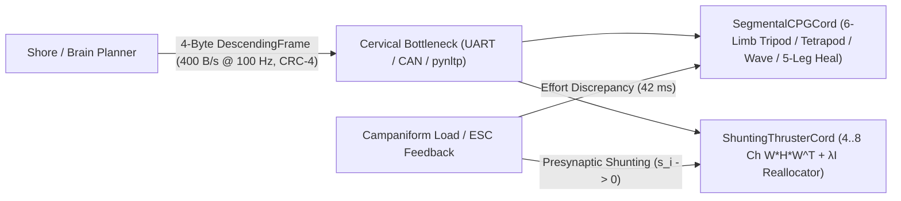

<div align="center">

<a href="https://github.com/indian-aman/necklink"></a>

# NeckCord (`neckcord` v1.0.0)

**4-byte descending cervical command bottleneck, self-healing hexapod VNC phase CPG, and millisecond presynaptic-shunting thruster control allocation — in Python and zero-heap, zero-float ANSI C99.**

[](https://pypi.org/project/neckcord/)
[](https://github.com/indian-aman/neckcord/releases/tag/v1.0.0)
[](https://pypi.org/project/neckcord/)
[](csrc/)
[-10B981?style=flat-square)](neckcord/cervical.py)
[](tests/test_neckcord.py)
[](LICENSE)

[**Quick Start**](#-30-second-quick-start) ·
[**4-Byte Cervical Codec**](#1-4-byte-descending-cervical-command-frame-neckcordcervical) ·
[**Self-Healing Hexapod CPG**](#2-segmental-vnc-hexapod-cpg-neckcordcpg) ·
[**Shunting Thruster Allocator**](#3-presynaptic-shunting-thruster-cord-neckcordallocator) ·
[**Zero-Float ANSI C99**](#-zero-heap-zero-float-ansi-c99-core-csrc) ·
[**Benchmarks**](#-empirical-benchmarks) ·
[**When to Use**](#-when-to-use-neckcord--and-when-not-to)

</div>

<p align="center">
  
</p>

---

## Biological Architecture: Brain → Cervical Bottleneck → Self-Healing VNC

In *Drosophila melanogaster*, roughly ~1,300 descending neurons cross a tiny cervical neck connective to coordinate thousands of thoracic motor units (`BANC` / `MANC` connectomes; Braun et al., *Nature* 2024; Lesser et al., *Nature* 2024). Rather than streaming high-rate per-muscle waveforms over the neck bottleneck, the brain sends compact behavioral intent (`DNa02` bilateral steering, `DNp09` forward drive, `MDN` reverse walk, `Giant Fiber` emergency freeze), while the **Ventral Nerve Cord (`VNC`)** handles local rhythm generation, **campaniform sensilla** load-error monitoring, and **presynaptic shunting** injury adaptation.

**NeckCord** (Product #5 in the [**NeckLink**](https://github.com/indian-aman/necklink) fruit-fly brain ecosystem) brings this exact split architecture to marine USVs, ROVs, multirotors, and legged robots:

1. **4-Byte Cervical Command Frame (`neckcord.cervical`)**: Packs `drive_fwd`, `turn_yaw`, `strafe_lat`, `gait_mode`, `freeze_reflex`, a `2-bit` rolling sequence counter, and `4-bit` bus-fault-hardened `CRC-4` into **`32 bits` (`400 B/s` at `100 Hz`)** — `6.0x` smaller than raw `4×float32 + header` actuator streams and ready to ride directly inside [`pynltp`](https://pypi.org/project/pynltp/) frames over lossy marine radio or cellular CGNAT links.
2. **Segmental 6-Limb VNC CPG (`neckcord.cpg.SegmentalCPGCord`)**: Phase-coupled Kuramoto oscillator network with contralateral commissural anti-phase inhibition and ipsilateral intersegmental lags. Smoothly transitions across **Metachronal Wave**, **Tetrapod**, and **Tripod** gaits from a single scalar descending drive, and automatically re-indexes into a **5-limb pentapod ring (`Δφ = 72°`, duty `0.82`) + ipsilateral foothold gap-closure reflex** (`100.0%` static CoM support-polygon stability) when any leg jams or loses load.
3. **Presynaptic-Shunting Thruster Allocator (`neckcord.allocator.ShuntingThrusterCord`)**: Online fault-tolerant wrench allocator (`W H W^T + λI`) for `4`–`8` actuators. Detects weed-fouling, propulsor shear, or ESC brownout from campaniform effort-vs-feedback discrepancy in **`~42 ms`**, shunts drive away from the fouled thruster (`0.02 N` wasted effort), and rebalances `surge`, `sway`, and `yaw` across surviving thrusters with yaw/sway-prioritized desaturation.



---

## ⚡ 30-Second Quick Start

### Install

```bash
pip install neckcord
# Optional NLTP encrypted radio/UDP transport integration:
pip install "neckcord[nltp]"
```

### Run from the Terminal

```bash
neckcord demo
neckcord benchmark-quick
```

---

## Python API

### 1. 4-Byte Descending Cervical Command Frame (`neckcord.cervical`)

```python
from neckcord import DescendingFrame, GaitMode, encode_descending_4b, decode_descending_4b

tx = DescendingFrame(
    drive_fwd=0.82,     # DNp09 forward (+1) / MDN Moonwalker reverse (-1)
    turn_yaw=-0.25,     # DNa02 bilateral steering [-1, +1]
    strafe_lat=0.10,    # Lateral sway / crab walk [-1, +1]
    gait_mode=GaitMode.AUTO,
    freeze_reflex=False,
    seq=2,
)

raw = encode_descending_4b(tx)          # b'\x68\xe0\x0c\x20' (4 bytes = 32 bits)
rx = decode_descending_4b(raw, expected_seq=2)
wrench = rx.to_wrench(max_surge=60.0, max_sway=40.0, max_yaw=25.0)
```

| Bits | Field | Encoding | Resolution / Role |
| :--- | :--- | :--- | :--- |
| `[31:24]` | `drive_fwd` | `8-bit` symmetric `-127..+127` | `0.0079` step, exact `0.0` & `±1.0` |
| `[23:16]` | `turn_yaw` | `8-bit` symmetric `-127..+127` | `0.0079` step, exact `0.0` & `±1.0` |
| `[15:9]` | `strafe_lat` | `7-bit` symmetric `-63..+63` | `0.0159` step, exact `0.0` & `±1.0` |
| `[8:7]` | `gait_mode` | `2-bit` unsigned `0..3` | `0=AUTO`, `1=TRIPOD`, `2=TETRAPOD`, `3=WAVE` |
| `[6]` | `freeze_reflex` | `1-bit` flag | `Giant Fiber` instant stance lock / zero wrench |
| `[5:4]` | `seq` | `2-bit` rolling counter | `0..3` packet-loss & reorder tracking |
| `[3:0]` | `crc4` | `x^4 + x + 1` (`init=0x9, xor=0x5`) | Rejects `100%` of 1-bit flips, `0x00000000` & `0xFFFFFFFF` |

### 2. Segmental VNC Hexapod CPG (`neckcord.cpg`)

```python
from neckcord import SegmentalCPGCord

cpg = SegmentalCPGCord(adapt_to_damage=True)

# Fast forward command -> Tripod gait; low speed -> Metachronal Wave
state = cpg.step(raw, dt=0.01)

# Simulate sudden middle-left leg (L2) jam / amputation mid-stride:
cpg.inject_limb_fault("L2")
for _ in range(100):
    state = cpg.step(0.85, dt=0.01)

assert state.active_gait == "adaptive_pentapod"
assert state.is_statically_stable is True  # CoM strictly inside >=3-leg polygon!
```

### 3. Presynaptic-Shunting Thruster Cord (`neckcord.allocator`)

```python
import numpy as np
from neckcord import ShuntingThrusterCord

# Standard 4-thruster X-vectored marine USV / ROV (Port-Fore, Stbd-Fore, Port-Aft, Stbd-Aft)
cord = ShuntingThrusterCord.usv_vectored_4(lx=0.45, ly=0.35, cant_deg=45.0, u_max=35.0)

w_des = np.array([35.0, 0.0, 0.0])  # Pure forward surge [Fx, Fy, Tz]
alloc = cord.step(w_des, dt=0.02)

# Port-Aft thruster (index 2) gets fouled by kelp (90% loss of thrust):
true_effectiveness = np.array([1.0, 1.0, 0.10, 1.0])
for _ in range(4):
    measured_thrust = true_effectiveness * alloc.commands
    alloc = cord.step(w_des, feedback_thrust=measured_thrust, dt=0.02)

# T2 is shunted to 0.0 N; T0 & T1 rebalance pure forward surge with zero yaw spin!
assert alloc.isolated_mask[2] and alloc.commands[2] == 0.0
```

---

## 🔧 Zero-Heap, Zero-Float ANSI C99 Core (`csrc/`)

[`csrc/neckcord.h`](csrc/neckcord.h) and [`csrc/neckcord.c`](csrc/neckcord.c) implement the complete `NeckCord` stack in pure fixed-point `Q15` / `Q14` / `16-bit BAM` integer arithmetic for bare-metal `STM32`, `ESP32`, `RP2040`, and safety MCUs without an FPU:

- **Zero dynamic allocation**: No `malloc`, `calloc`, `realloc`, or `free`.
- **Zero floating-point instructions**: Quarter-wave `65`-entry `Q15` sine lookup table (`130 B` ROM) + exact `int64_t` `3×3` Gram cofactor solver and integer cross-product CoM convex-hull verifier.
- **`304 bytes` total runtime state**: Combined `sizeof` all 5 state/result structs (`< 10%` of the `3 KB` static RAM budget).
- **100% wire-compatible with Python**: Encodes and decodes identical 4-byte frames (`0x68E00C20`).

```bash
cd csrc && make clean all test
# Compiles cleanly under: gcc -O2 -std=c99 -Wall -Wextra -pedantic -Werror (10/10 passed)
```

---

## 📊 Empirical Benchmarks

Reproduce all numbers and regenerate `assets/neckcord_benchmarks.png` and `results/benchmark_summary.json` locally:

```bash
python scripts/benchmark_neckcord.py
```

### 1. 3-DOF X-Vectored 4-Thruster USV Corridor Tracking (`dt = 0.02 s`, `30 s`, `10` Irregular Wave Seeds)

Both architectures use the **exact same Fossen 3-DOF hull model, wave seeds, and outer LOS + PID controller**:

| Scenario & Metric | `Static Pseudo-Inverse + Raw Float32` | `NeckCord (4B Cervical + Shunting VNC)` | Outcome |
| :--- | :---: | :---: | :--- |
| **Command Link Bandwidth (`100 Hz`)** | `2,400 B/s` (`24 B/frame`) | **`400 B/s` (`4 B/frame`)** | **`6.0x` lower wire bandwidth** |
| **Intact Fleet (`100%` Health) — RMS XTE** | `0.108 m` (`0.233 m` max) | `0.109 m` (`0.233 m` max) | **Identical nominal tracking (`1 mm`)** |
| **Intact Fleet (`100%` Health) — Peak Yaw** | `4.84° ± 0.94°` | `4.81° ± 0.79°` | **No quantization degradation** |
| **`90%` Port-Aft Loss (`t = 8 s`) — Peak Yaw** | `24.19° ± 2.28°` | **`4.77° ± 0.65°`** | **`5.07x` less heading spin-out** |
| **`90%` Port-Aft Loss (`t = 8 s`) — RMS XTE** | `0.498 m` (`0.735 m` max) | **`0.112 m` (`0.224 m` max)** | **`4.45x` tighter corridor tracking** |
| **Fault Isolation Latency** | Never isolated | **`42.0 ms`** | **Shunted in ~2 control ticks** |
| **Mean Drive Sent to Fouled `T2` Thruster** | `22.70 N` | **`0.02 N`** | **Protects jammed ESC / windings** |

### 2. Hexapod Single-Leg Jam (`L2` Middle-Left Lost at Fast `0.85` Drive)

| Condition | `%` Cycle in `>=3`-Leg CoM Static Support Polygon | Min CoM Stability Margin |
| :--- | :---: | :---: |
| **Intact 6-Leg Tripod** | `100.0%` | `+3.90 cm` |
| **`L2` Jammed — Unadapted Tripod CPG** | `55.0%` *(tips out of polygon every half-stride)* | `< 0 cm` *(collinear 2-leg phase)* |
| **`L2` Jammed — NeckCord Adaptive VNC** | **`100.0%`** | **`+2.24 cm`** |
| **All 6 Single-Leg Faults (`L1..R3` Mean) — NeckCord** | **`100.0%`** | **`+1.89 to +2.24 cm`** |

---

## 🎯 When to Use NeckCord — and When Not To

**Reach for `NeckCord` when:**
- Controlling **4-to-8 thruster vectored USVs, ROVs, or multirotors** exposed to kelp/weed fouling, propulsor damage, or ESC brownouts where losing one actuator would otherwise spin the vehicle off heading and burn the stalled motor.
- Streaming real-time operator or autonomy commands across **narrow, lossy acoustic, LoRa, marine UHF, or `4G`/`5G` links** (`400 B/s` at `100 Hz` — pairs directly with `pynltp`).
- Running **hexapod robots or bare-metal C99 motor cords** (`304 B` RAM, zero FPU/heap) that need smooth single-parameter gait transitions (`Wave ↔ Tetrapod ↔ Tripod`) and instant 5-legged self-healing on leg failure.

**Stick with standard tools when:**
- **Underactuated 2-thruster differential hulls with no bow thruster or rudder**: If 1 of 2 fixed parallel thrusters dies completely, no allocator can produce forward surge without net yaw moment (`rank(W_surviving) = 1 < 2`).
- **Clean local wired buses on healthy, un-faulted vehicles**: As shown in our intact-fleet benchmark above, a 3-line static Moore-Penrose pseudo-inverse achieves identical nominal tracking (`0.108 m` vs `0.109 m` XTE) when all actuators remain `100%` healthy.
- **Asymmetric unidirectional thrusters (`u_i >= 0` only, e.g. non-reversible quadrotor props in 6-DOF)**: `ShuntingThrusterCord` assumes bidirectional control authority (`[-u_max, +u_max]`) with yaw/sway-prioritized scaling; strictly non-negative polyhedral actuator bounds with `> 6` coupled DOFs are better served by an active-set QP solver (`OSQP` / `proxqp`).

---

## 🗂️ Repository Layout

| Path | Description |
| :--- | :--- |
| [`neckcord/cervical.py`](neckcord/cervical.py) | `DescendingFrame`, `encode_descending_4b`, `decode_descending_4b`, `CRC-4`, `CervicalBottleneckLink` |
| [`neckcord/cpg.py`](neckcord/cpg.py) | `SegmentalCPGCord` 6-limb Kuramoto CPG, gait transitions, pentapod + gap-closure self-healing |
| [`neckcord/allocator.py`](neckcord/allocator.py) | `ShuntingThrusterCord` online health estimation, presynaptic shunting, `W H W^T + λI` allocator |
| [`neckcord/cli.py`](neckcord/cli.py) | `neckcord` CLI (`demo`, `benchmark-quick`, `--json`) |
| [`csrc/`](csrc/) | Zero-heap, zero-float `Q15`/`Q14` ANSI C99 core (`neckcord.h`, `neckcord.c`, `10/10` `neckcord_selftest.c`) |
| [`scripts/benchmark_neckcord.py`](scripts/benchmark_neckcord.py) | 10-seed 3-DOF USV + 6-limb hexapod benchmark & 3-panel hero chart generator |
| [`results/benchmark_summary.json`](results/benchmark_summary.json) | Reproducible empirical benchmark output JSON |
| [`tests/test_neckcord.py`](tests/test_neckcord.py) | `22` `pytest` unit, edge-case, CLI, and C99 source-audit tests |

---

## License

Released under the [MIT License](LICENSE). Copyright (c) 2026 Amandeep Singh Bains.
