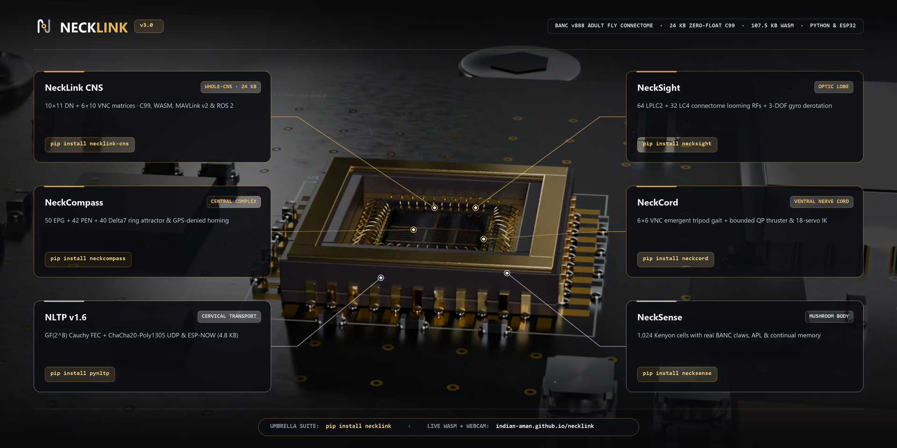

<div align="center">

<picture>
  <source media="(prefers-color-scheme: dark)" srcset="https://raw.githubusercontent.com/indian-aman/necklink/main/assets/logo/necklink-logo-dark.png">
  <source media="(prefers-color-scheme: light)" srcset="https://raw.githubusercontent.com/indian-aman/necklink/main/assets/logo/necklink-logo-light.png">
  
</picture>

### Fruit-fly brain edge autonomy, in Python and zero-heap ANSI C99

**Five open-source modules modelled on the adult *Drosophila* central nervous system, built for lossy radios, GPS-denied vehicles, micro-drones and low-cost microcontrollers.**

[](https://indian-aman.github.io/necklink/)
[](https://pypi.org/project/necklink/)
[](https://pypi.org/project/pynltp/)
[](https://pypi.org/project/neckcompass/)
[](https://pypi.org/project/necksight/)
[](https://pypi.org/project/neckcord/)
[](https://pypi.org/project/necksense/)
[](https://github.com/indian-aman/necklink/blob/main/LICENSE)

[**Website**](https://indian-aman.github.io/necklink/) ·
[**Products**](#products) ·
[**Install**](#install) ·
[**Repository layout**](#repository-layout) ·
[**Development**](#development)

</div>

<p align="center">
  
</p>

---

## Products

NeckLink is the brand; each product translates one subsystem of the fruit-fly nervous system into a standalone library. Every product has a Python package on PyPI and a zero-heap, zero-float ANSI C99 core for microcontrollers (hardware-tested on `ESP32` and `ESP8266EX`; portable ANSI C99 for other targets), and each one is benchmarked against a strong classical baseline, including where the baseline still wins.

| Product | Fly circuit | What it does | Package |
| :--- | :--- | :--- | :--- |
| **[NLTP](https://github.com/indian-aman/necklink/tree/main/packages/nltp)** (`v1.4.0`) | Cervical connective | Loss-healing `GF(2^8)` Cauchy FEC file & priority-command transport with `ChaCha20-Poly1305` per-session encryption over UDP (incl. 4G CGNAT traversal) or routerless ESP-NOW across `ESP32` & `ESP8266`, in Python, C99, JS/TS (`Node.js`), Java 11+, and Arduino (`216/216` cross-language checks + `100%` `SHA-256` @ `35%` RF loss verified) | [`pynltp`](https://pypi.org/project/pynltp/) |
| **[NeckCompass](https://github.com/indian-aman/necklink/tree/main/packages/neckcompass)** (`v1.1.0`) | Central complex (`E-PG` / `CPU4`) | Ring-attractor compass that rejects `70°–150°` magnetometer spikes as well as a 3σ-gated EKF (`0.44°` vs `0.41°` RMSE), re-anchors after a 90° heading upset where the gated EKF stays stuck, and homes without GNSS (`324 B` RAM in C99) | [`neckcompass`](https://pypi.org/project/neckcompass/) |
| **[NeckSight](https://github.com/indian-aman/necklink/tree/main/packages/necksight)** (`v1.1.0`) | Optic lobe (`T4/T5` + `LPLC2`) | Glare-adapted motion detection and a four-quadrant looming reflex: `0.9988` AUROC on synthetic clutter vs `0.875` for compensated pyramidal Lucas-Kanade, gyro derotation so obstacles are still caught during fast turns, ~12,000 FPS at 32×32 in C99 (desktop) | [`necksight`](https://pypi.org/project/necksight/) |
| **[NeckCord](https://github.com/indian-aman/necklink/tree/main/packages/neckcord)** (`v1.1.0`) | Ventral nerve cord (`BANC` / `MANC`) | 4-byte motor command frame, self-healing six-leg gait generator, and a fault-tolerant thruster allocator that isolates a failed thruster in ~`42 ms` (on par with pseudo-inverse + threshold FDI) and can return it to service (`322 B` in C99) | [`neckcord`](https://pypi.org/project/neckcord/) |
| **[NeckSense](https://github.com/indian-aman/necklink/tree/main/packages/necksense)** (`v1.1.0`) | Antennal lobe & mushroom body | Concentration-invariant normalisation, multiplication-free FlyHash, one-shot novelty detection (`0.994` AUROC in 4 KB) and one-shot classification, with `Q16.16` C99 that is bit-identical to Python | [`necksense`](https://pypi.org/project/necksense/) |

Each product's README has its full benchmarks, its API and a "when not to use it" section. Each benchmark compares against the strongest simple classical baseline we could build: a gated EKF, threshold FDI, baseline-corrected k-NN, or compensated pyramidal optical flow. Where that baseline ties or wins, the README says so.

> **November 2026 release notes (`NLTP v1.4.0` + `v1.1.0` organ suite — all live on PyPI):**
> - **NLTP `1.4.0` (`pynltp`, security release)**: Encrypted sessions now derive fresh per-session directional keys via a 1-RTT `HELLO` / `HELLO_ACK` handshake (`HMAC-SHA256` + `ChaCha20-Poly1305`), eliminating replay after receiver restarts and nonce reuse across reboots, with automatic `NO_SESSION` recovery. Encrypted `1.4` and `1.3.x` endpoints do not interoperate, so upgrade them together; see the [NLTP security model](https://github.com/indian-aman/necklink/tree/main/packages/nltp#24-encrypted-sessions--security-model-v14).
> - **Confirmed reflex lane & ESP-NOW mesh (`1.3.2`–`1.4.0`)**: Priority out-of-band reflex delivery (`PT_REFLEX_ACK`), C/ESP mid-stream anti-stall takeover guard, hardened multi-peer `ESP-NOW` hub (valid-`HELLO` slot gate + LRU 20-peer table), and live off-Wi-Fi `ESP32` (`~7 Mbps` typical, `17.75 Mbps` best) + cross-chip `ESP8266EX` (`NodeMCU`) 3-board mesh verification.
> - **Organ Suite `1.1.0` (`neckcompass`, `necksight`, `neckcord`, `necksense`) + `necklink 1.4.0` umbrella**: All five modules and the `necklink` meta-package are live on PyPI, audited against strong classical baselines (`NeckCompass` sensor-noise re-anchoring, `NeckSight` gyro derotation + Python 3.9 support, `NeckCord` thruster recovery probing, and `NeckSense` 2%-sparse novelty codes).

---

## Install

```bash
pip install --upgrade necklink
# or install individual modules:
pip install --upgrade pynltp neckcompass necksight neckcord necksense
```

Every package supports Python 3.9+ and depends only on NumPy (`pynltp` also uses `cryptography`). Each one's C99 core is self-contained inside `csrc/` so you can copy it directly into firmware.

### Run all five together

The `necklink` command ships with `pynltp`. With all five packages installed:

```bash
necklink products                  # List the installed NeckLink products and versions
necklink suite-demo --loss 0.15    # Closed-loop five-module reflex mission over encrypted, lossy UDP
```

```python
from necklink import run_autonomous_reflex_demo

report = run_autonomous_reflex_demo(loss=0.15)
print(report)
```

---

## Repository layout

```text
necklink/
├── packages/
│   ├── nltp/          NLTP wire protocol (v1.4.0): Python, C99, JS/TS (Node.js), Java 11+, Arduino, ESP32/ESP8266
│   ├── neckcompass/   Central-complex compass and path integrator (v1.1.0)
│   ├── necksight/     Optic-lobe motion and looming reflex (v1.1.0)
│   ├── neckcord/      Ventral-nerve-cord motor codec and thruster allocator (v1.1.0)
│   └── necksense/     Antennal-lobe and mushroom-body odour engine (v1.1.0)
├── umbrella/          The `necklink` PyPI meta-package (v1.4.0) that installs all five
├── web/               Source of the website (deployed to the gh-pages branch)
└── assets/            NeckLink logo, brand banner and shared images
```

Every folder under `packages/` is a self-contained project with its own `pyproject.toml`, tests, C99 core, benchmarks, README and licence, and is released to PyPI on its own. Python import names are `import nltp`, `import neckcompass`, `import necksight`, `import neckcord`, and `import necksense`.

---

## Development

Work inside the package you are changing:

```bash
cd packages/neckcompass
pip install -e . pytest
python -m pytest                     # unit tests, plus every README example
make -C csrc clean all test          # zero-heap C99 core and its self-tests
python scripts/benchmark_neckcompass.py   # regenerates results/ and the chart (needs matplotlib)
```

CI ([`.github/workflows/packages-ci.yml`](https://github.com/indian-aman/necklink/blob/main/.github/workflows/packages-ci.yml)) runs the following on Python 3.9 and 3.13 for NeckCompass, NeckCord, NeckSense and NeckSight:
- builds each package's wheel and installs it;
- runs its CLI;
- runs its tests, including the README examples;
- builds the C core with `-Werror` and runs its self-tests.

NLTP also has JavaScript (`packages/nltp/js`), Java 11+ (`packages/nltp/java`) and ESP32/ESP8266 (`packages/nltp/arduino`, `packages/nltp/esp32`, `packages/nltp/esp32_mesh`) SDKs; see [its README](https://github.com/indian-aman/necklink/tree/main/packages/nltp#readme).

### History

NeckCompass, NeckSight, NeckCord and NeckSense started in their own repositories and were merged here with their full commit history on 4 November 2026. The old repositories are archived and read-only.

---

## License

Released under the [MIT License](https://github.com/indian-aman/necklink/blob/main/LICENSE). Copyright (c) 2026 Amandeep Singh Bains.
