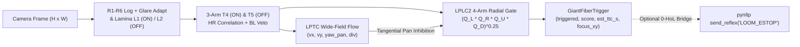

<div align="center">

# NeckSight (`necksight` v1.0.0)

***Drosophila* Optic-Lobe `T4`/`T5` Motion & `LPLC2` 4-Quadrant Looming Collision-Reflex Engine — in Python (`NumPy`) and Zero-Heap, Zero-Float ANSI C99 (`< 15 KB` RAM, `> 12,000 FPS`).**

[](https://pypi.org/project/necksight/)
[](https://github.com/indian-aman/necksight/releases/tag/v1.0.0)
[](https://pypi.org/project/necksight/)
[](csrc/)
[](csrc/necksight.h)
[-10B981?style=flat-square)](results/benchmark_summary.json)
[](https://github.com/indian-aman/necklink)
[](LICENSE)

[**30-Second Quick Start**](#-30-second-quick-start) ·
[**Biophysical Circuit**](#-how-the-optic-lobe-circuit-works) ·
[**ANSI C99 / ESP32-S3**](#-zero-heap-zero-float-ansi-c99-core-esp32-s3-ready) ·
[**Benchmarks**](#-empirical-benchmarks-n--60-cluttered-sequences) ·
[**When to Use (and When Not To)**](#-when-to-use-necksight--and-when-not-to)

</div>

<p align="center">
  
</p>

---

## Why NeckSight?

Conventional lightweight collision triggers fail outdoors on moving robots, autonomous surface vessels (USVs), and micro-drones:
- **Frame-differencing** explodes on sudden cloud-to-sunlight glare steps (`10x`–`100x` lux jumps) and violent wave/wind camera turns (`100%` false-alarm rate on yaw/glare).
- **Spatial-gradient optical flow divergence (`Lucas-Kanade`)** breaks brightness constancy under rapid illumination flashes and suffers aperture/aliasing spikes during fast `3–4 px/frame` snap-pans across cluttered horizons (`55.6%` false-alarm rate at `95%` TPR).
- **Linear un-gated motion divergence** fires whenever a high-contrast foreground edge sweeps into view against open sky or water (`55.6%` false-alarm rate).

**NeckSight** (`Product #4` in the **NeckLink** fruit-fly brain stack) solves pre-collision reflex gating the way *Drosophila melanogaster* flies through cluttered canopies at high angular turn rates without flinching at its own turns:

1. **`R1–R6` Log/Naka-Rushton Photoreceptor Adaptation + Wide-Field Glare Cancellation (`RetinaLaminaPreproc`)**: Compresses arbitrary `H×W` camera frames onto `32×32` or `64×64` grids, cancels `100x` global sunlight/auto-exposure jumps in a single frame without blinding recovery lag, and splits transients into parallel **`L1` (`ON` brightening)** and **`L2` (`OFF` darkening)** channels.
2. **4-Cardinal 3-Arm `T4` (`ON`) & `T5` (`OFF`) Elementary Motion Detectors (`T4T5MotionEngine`)**: Combines preferred-arm Hassenstein-Reichardt correlation (`delayed_back * center` with `Mi4`-like center adaptation) and null-arm Barlow-Levick divisive shunting inhibition (`center / (1 + g * delayed_front)`), completely rejecting stationary contrast flicker while feeding wide-field **`LPTC`** tangential ego-motion cells.
3. **`LPLC2` 4-Quadrant Radial Symmetry Gate -> `Giant Fiber` Reflex (`LPLC2LoomingReflex`)**: Evaluates outward centrifugal motion minus local `LPi` inward opponency across all four cruciform arms (`Q_L, Q_R, Q_U, Q_D`) via `O(1)` Summed-Area Tables and applies a **4-quadrant geometric-mean gate** `(Q_L * Q_R * Q_U * Q_D)^0.25` suppressed by wide-field `LPTC` pan flow. During fast camera yaw/pitch turns, receding motion, or passing cross-traffic, at least one opposing arm sees inward motion (`Q_opposing == 0`), collapsing false alarms to **`0.0%` at `95%` TPR** (`AUROC = 0.9988`).



---

## ⚡ 30-Second Quick Start

### 1. Install

```bash
pip install necksight
# Optional: include pynltp for encrypted UDP Giant-Fiber reflex dispatch
pip install "necksight[nltp]"
```

### 2. End-to-End Python Looming Reflex (`NeckSightPipeline`)

```python
import numpy as np
from necksight import NeckSightPipeline

pipe = NeckSightPipeline(grid_size=64, threshold=0.045)

# Feed arbitrary HxW grayscale (or HxWx3 RGB) frames at 60 Hz
for frame in camera_frames:
    trig = pipe.step(frame, dt=1.0 / 60.0)
    if trig.triggered:
        print(
            f"COLLISION WARNING! score={trig.looming_score:.3f}, "
            f"TTC={trig.est_ttc_s:.3f}s, focus={trig.focus_xy}"
        )
```

### 3. Stage-by-Stage Optic-Lobe Inspection + `pynltp` Out-of-Line Reflex Bridge

When paired with [`pynltp`](https://pypi.org/project/pynltp/) (`NeckLink` v1.2+), `attach_nltp_reflex` dispatches an urgent out-of-line `send_reflex("LOOM_ESTOP")` datagram with zero head-of-line blocking even while bulk telemetry/files are mid-transfer:

```python
from necksight import (
    RetinaLaminaPreproc,
    T4T5MotionEngine,
    LPLC2LoomingReflex,
    attach_nltp_reflex,
)

retina = RetinaLaminaPreproc(grid_size=64)
emd = T4T5MotionEngine(grid_size=64)
lplc2 = LPLC2LoomingReflex(grid_size=64)

# Bind any pynltp NLTPClient (or compatible object exposing .send_reflex(msg))
attach_nltp_reflex(nltp_client, msg="LOOM_ESTOP", detector=lplc2)

lamina_out = retina.step(frame, dt=1 / 60)
motion_out = emd.step(lamina_out)
vx, vy, yaw_pan, radial_div = motion_out.lptc
trigger = lplc2.step(motion_out, dt=1 / 60)
```

### 4. Command-Line Interface (`necksight`)

```bash
# Run 4 synthetic optic-lobe scenarios (grating, fast yaw pan, 100x glare, looming)
necksight demo

# Run a quick multi-sequence accuracy, lead-time, and FPS benchmark
necksight benchmark-quick --json
```

---

## 🔧 Zero-Heap, Zero-Float ANSI C99 Core (`ESP32-S3` Ready)

[`csrc/necksight.h`](csrc/necksight.h) and [`csrc/necksight.c`](csrc/necksight.c) implement the complete `32×32` pipeline using **pure fixed-point integers (`int32_t` / `uint16_t` / `uint8_t`)**:

- **`0` heap allocations**: Zero `malloc` / `calloc` / `free` anywhere in the codebase.
- **`0` floating-point instructions**: Integer `Q8` `log2` lookup, 64-point lattice median glare filter, integer `33×33` Summed-Area Table, and bit-shift integer `isqrt` (`(Q_L * Q_R * Q_U * Q_D)^0.25 = isqrt(isqrt(Q_L * Q_R) * isqrt(Q_U * Q_D))`).
- **`14,616` bytes (`14.27 KB < 16 KB`) total static state**: Enforced at compile time (`necksight_state_under_16kb_check`), keeping FreeRTOS task stack usage under `1 KB`.
- **Direct `ESP32-S3` `OV2640` / `OV5640` camera support**: `necksight_step_frame_u8()` box-downsamples arbitrary `QVGA` (`240×320`) or `VGA` (`480×640`) `uint8_t` buffers into `Q4` `32×32` precision in a single call.

```c
#include "necksight.h"

static necksight_state_t optic_lobe;

void setup_vision(void) {
    necksight_init(&optic_lobe);
}

void on_camera_frame(const uint8_t *fb_buf, uint16_t h, uint16_t w) {
    necksight_result_t res;
    necksight_step_frame_u8(&optic_lobe, fb_buf, h, w, w, 16U, &res);
    if (res.triggered) {
        /* Trigger hardware estop or dispatch NLTP reflex packet */
        trigger_evasive_maneuver(res.focus_x, res.focus_y, res.est_ttc_ms);
    }
}
```

Build and run the strict ANSI C99 self-test (`-O2 -std=c99 -Wall -Wextra -pedantic -Werror`):

```bash
cd csrc && make clean all test
```

---

## 📊 Empirical Benchmarks (`N = 60` Cluttered Sequences)

Reproduce the full benchmark JSON ([`results/benchmark_summary.json`](results/benchmark_summary.json)) and 3-panel chart ([`assets/necksight_benchmarks.png`](assets/necksight_benchmarks.png)) via [`scripts/benchmark_necksight.py`](scripts/benchmark_necksight.py):

```bash
python scripts/benchmark_necksight.py
```

### 1. Looming Collision Selectivity vs. Hard Negatives (`64×64`, `60 Hz`)

Evaluated across `24` approaching obstacles (dark, bright, textured, and off-center on drifting cluttered backgrounds) vs. `36` hard negatives (`12` fast `1.8–4.2 px/frame` camera yaw/pitch snap-pans across clutter & masts, `12` sudden `15x–100x` sunlight glare flashes & water glints, and `12` receding / lateral cross-traffic objects):

| Detector | Overall AUROC (`↑`) | Looming vs Yaw/Glare AUROC (`↑`) | False-Alarm Rate @ 95% TPR (`↓`) | Yaw/Glare FAR @ 95% TPR (`↓`) | Mean Warning Lead Time (`↑`) | CPU Speed (`FPS`) | State RAM (`KB`) |
| :--- | :---: | :---: | :---: | :---: | :---: | :---: | :---: |
| **NeckSight (`T4/T5 + LPLC2`, C99 `32×32`)** | — | — | **`0.0%`** (selftest) | **`0.0%`** | Pre-impact | **`12,463` FPS** | **`14.27 KB`** |
| **NeckSight (`T4/T5 + LPLC2`, Python `64×64`)** | **`0.9988`** | **`0.9983`** | **`0.0%`** | **`0.0%`** | **`402.9 ms`** | `512`–`750` FPS | `48.0 KB` |
| **Naive Un-gated EMD** *(no `LPLC2` gate)* | `0.6100` | `0.5955` | `55.6%` | `50.0%` | `342.8 ms` | `861` FPS | `48.0 KB` |
| **Lucas-Kanade Divergence** *(`5×5` tensor)* | `0.5220` | `0.2830` | `55.6%` | `83.3%` | `186.2 ms` | `1,154` FPS | `96.0 KB` |
| **Frame-Difference Motion Energy** | `0.3530` | `0.0295` | `66.7%` | `100.0%` | `215.2 ms` | `62,769` FPS | `16.0 KB` |

### 2. Honest Sub-Pixel Odometry Check (`0.05 – 0.35 px/frame` Slow Drift)

| Task (`64×64`, Varying Scene Contrast `0.45x – 1.0x`) | Spatial-Gradient Lucas-Kanade | NeckSight `T4/T5` Correlational `LPTC` | Winner |
| :--- | :---: | :---: | :---: |
| **Fine Sub-Pixel Translational Velocity MAE (`↓`)** | **`0.0549 px/frame`** | `0.1325 px/frame` | **Lucas-Kanade (`2.4x` lower error)** |

---

## 🧭 When to Use NeckSight — and When Not To

### Use NeckSight When:
- **You need an ultra-reliable, zero-GPU collision reflex on moving platforms**: Micro-drones, USVs, rovers, and mast cameras that pitch, roll, and snap-yaw violently across high-contrast scenery where standard motion or optical-flow divergence triggers constant false e-stops.
- **Outdoor lighting is harsh and unpredictable**: Sudden `20x`–`100x` sunlight glare steps, cloud breaks, specular water glints, or tunnel exits.
- **RAM, power, and latency budgets are tiny**: Runs in `< 15 KB` static SRAM with zero `malloc` and zero floats on `ESP32-S3`, `STM32`, `RP2040/RP2350`, or alongside heavy workloads on Raspberry Pi / Jetson CPU cores (`< 2 ms` per frame in Python, `< 0.1 ms` in C99).

### Do NOT Use NeckSight When:
- **You need metric sub-pixel translational visual odometry**: Biophysical `T4/T5` Hassenstein-Reichardt correlators couple velocity with pattern contrast and spatial frequency (`MAE = 0.1325 px/frame` across varying contrast vs. **`0.0549 px/frame` for windowed Lucas-Kanade**). Use `Lucas-Kanade` or feature-based VIO for metric speed estimation.
- **You need semantic object recognition or static obstacle mapping**: Stationary obstacles on a stationary camera produce zero retinal temporal transients (`L1 = L2 = 0`). Pair `NeckSight` as a fast `>60 Hz` reflex safety layer alongside stereo depth, LiDAR, or a CNN/ViT semantic detector.
- **Obstacles approach purely along a 1D thin wire `< 1` ommatidium wide**: Because `LPLC2` requires outward expansion across all 4 cruciform quadrants, a thin horizontal wire expanding only vertically (`Q_L = Q_R = 0`) will not fire the radial 4-quadrant gate.

---

## 📚 Neuroscience & Algorithmic References

1. **Maisak, M. S. et al.** (2013). *A directional tuning map of Drosophila elementary motion detectors.* **Nature**, 500, 212–216.
2. **Haag, J., Mishra, A., & Borst, A.** (2017). *A common directional tuning mechanism of Drosophila motion-sensing neurons in the ON and in the OFF pathway.* **eLife**, 6, e29044.
3. **Klapoetke, N. C. et al.** (2017). *Ultra-selective looming detection from radial motion opponency.* **Nature**, 551, 237–241.
4. **Ache, J. M. et al.** (2019). *Neural basis for looming size and velocity encoding in the Drosophila giant fiber escape pathway.* **Current Biology**, 29(6), 1073–1081.

---

## License

Released under the [MIT License](LICENSE). Copyright (c) 2026 Amandeep Singh Bains.
