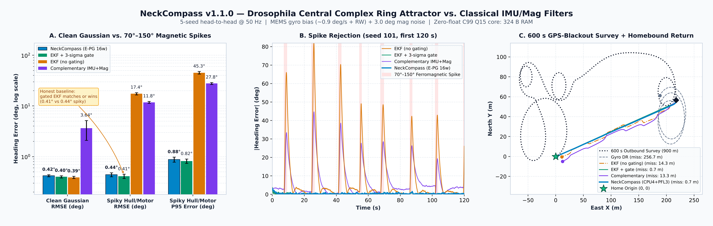
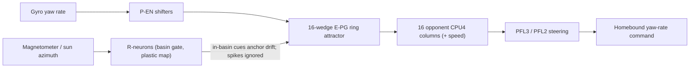

<div align="center">

<a href="https://github.com/indian-aman/necklink"></a>

# NeckCompass (`neckcompass` v1.1.0)

**A *Drosophila* central-complex ring-attractor compass and GPS-denied path integrator that rejects magnetometer spikes and recovers from heading upsets, in Python and zero-heap, zero-float ANSI C99 (`324 B` state RAM, ~`1 us`/step on a desktop core).**

[](https://pypi.org/project/neckcompass/)
[](https://pypi.org/project/neckcompass/)
[](csrc/)
[](csrc/tools/neckcompass_selftest.c)
[](tests/test_neckcompass.py)
[](LICENSE)

[**Quick start**](#quick-start) ·
[**C99 core**](#zero-heap-zero-float-ansi-c99-core-csrc) ·
[**Benchmarks**](#benchmarks-5-seeds-50-hz) ·
[**When to use it**](#when-to-use-neckcompass-and-when-not-to) ·
[**Changelog**](#changelog)

</div>

<p align="center">
  
</p>

---

## What it is

Boats, rovers and drones that work near steel hulls, sheet-pile docks, motor leads or buried cables see short magnetometer spikes of `70°–150°` lasting `0.5–2 s`. A textbook Kalman filter feeds those spikes into its heading and gyro-bias states; a complementary filter follows them.

NeckCompass ports the fruit-fly central complex into a small heading and homing library:

1. **`RingCompass`: E-PG ring attractor.** A 16-wedge (or 32-wedge) activity bump is rotated by the gyro (`P-EN` shifters). Magnetometer or sun cues pull the bump only when they fall inside a narrow *attractor basin* around the current estimate: half-width `4° + cue_noise_deg`, so 7° with the default 3° noise. Spikes outside the basin are ignored. A slow homeostatic loop learns the gyro bias. If a cue sits *consistently* outside the basin for `reanchor_seconds` (default 10 s), it is a real heading upset rather than a spike, and the bump re-anchors onto the averaged cue.
2. **`PlasticLandmarkRing`: R-neuron → E-PG plasticity.** Learns a repeatable soft-iron or hard-iron warp of the magnetometer online, either from a reference heading (sun, visual or GNSS course) or self-supervised from the gyro while turning.
3. **`FanBodyNavigator`: CPU4 path integrator with PFL3/PFL2 steering.** Integrates speed along the compass heading in 16 opponent columns and produces a bounded yaw-rate command that steers back to the start point when GNSS is unavailable.
4. **C99 core (`csrc/`).** The compass and navigator in `Q15` / `int32` / `int64` fixed point: 324 bytes of state, 260 bytes of lookup tables, no `malloc` and no floating point.

**What the benchmarks below show.** NeckCompass is as accurate as a properly gated EKF (within about 0.05°) on spiky magnetometer data, both in Python and in the C99 core. It does **not** beat a gated EKF on accuracy. Its practical advantages are:
- it re-anchors after a large heading upset, where a gated EKF can lock itself out;
- its compass and homing core needs 324 B of RAM and no FPU.



---

## Quick start

```bash
pip install neckcompass
# or from this repository:
pip install "git+https://github.com/indian-aman/necklink.git#subdirectory=packages/neckcompass"
```

### 1. Compass and homing

```python
import math
from neckcompass import RingCompass, FanBodyNavigator

compass = RingCompass(n_wedges=16, initial_heading_rad=0.0, cue_noise_deg=3.0)  # your magnetometer's 1-sigma noise
nav = FanBodyNavigator(n_columns=16, compass=compass)

# One 50 Hz step (dt = 0.02 s). Feed raw gyro yaw rate, speed and magnetometer heading.
# A 125 deg hull spike lies outside the attractor basin, so it is ignored.
heading_rad, dist_m, home_bearing_rad = nav.step_with_compass(
    omega_rad_s=0.15,
    speed_m_s=1.5,
    dt=0.02,
    mag_heading_rad=math.radians(125.0),
)
print(f"heading={math.degrees(heading_rad):.2f} deg, gate={compass.diagnostics().mag_gate:.3f}")

# During a GPS blackout: bounded yaw-rate command that steers back to the start point.
yaw_rate_cmd = nav.steering_cmd(max_turn_rate=0.8)
```

Set `cue_noise_deg` to the 1-sigma noise of your *calibrated* magnetometer. The basin then has the right width: too narrow and genuine readings get rejected, too wide and the edges of each spike leak in.

### 2. Learning a harbor or soft-iron warp online (`PlasticLandmarkRing`)

Self-supervised, using only a biased gyro and a warped, noisy magnetometer:

```python
import math
import numpy as np
from neckcompass import PlasticLandmarkRing, wrap_angle

def harbor_warp(psi):  # repeatable soft-iron distortion around a steel slip (up to 31 deg)
    return float(wrap_angle(psi + math.radians(20) * math.sin(psi) + math.radians(16) * math.sin(2 * psi)))

plastic = PlasticLandmarkRing(n_wedges=16, n_ring_neurons=32)
rng = np.random.default_rng(0)
dt, psi = 0.02, 0.0
for k in range(int(240 / dt)):  # 4 minutes of ordinary turning, no external reference
    omega = 0.6 + 0.3 * math.sin(0.05 * k * dt)                  # true yaw rate (rad/s)
    psi = float(wrap_angle(psi + omega * dt))
    gyro = omega + math.radians(0.9) + rng.normal(0, math.radians(1.5))  # biased, noisy gyro
    raw_mag = harbor_warp(psi) + rng.normal(0, math.radians(2.0))     # warped, noisy magnetometer
    heading = plastic.update(gyro, dt, raw_mag_heading_rad=raw_mag, learn=True)

grid = np.linspace(-math.pi, math.pi, 72, endpoint=False)
err = [abs(math.degrees(float(wrap_angle(plastic.map_raw_heading(harbor_warp(a))[0] - a)))) for a in grid]
print(f"learned un-warp error: mean {np.mean(err):.1f} deg, max {max(err):.1f} deg")
```

This prints `learned un-warp error: mean 2.3 deg, max 6.2 deg` (the raw warp is up to 31°). If you have an absolute reference (sun sensor, camera, GNSS course over ground), pass it as `reference_heading_rad=`. In supervised mode the test suite reaches < 2° RMSE after two turns. Self-supervised learning cannot observe a constant rotation of the whole map, so it keeps the learned correction zero-mean around the circle. Any constant offset, such as magnetic declination or a mounting error, has to come from a reference.

### 3. Command line

```bash
neckcompass demo               # 90 s GPS-denied survey + return home, with two 118-136 deg spikes
neckcompass benchmark-quick    # 120 s head-to-head against gated/ungated EKF, complementary, gyro-only
neckcompass benchmark-quick --json
```

---

## Zero-heap, zero-float ANSI C99 core (`csrc/`)

Copy [`csrc/neckcompass.h`](csrc/neckcompass.h) and [`csrc/neckcompass.c`](csrc/neckcompass.c) into your firmware. They compile cleanly with `-std=c99 -Wall -Wextra -pedantic -Werror` and need no FPU and no heap.

```bash
make -C csrc clean all test      # builds and runs the 7 self-tests
```

```c
#include "neckcompass.h"

static nc_compass_t   comp;
static nc_navigator_t nav;

void autopilot_init(void) {
    nc_compass_init(&comp);                    /* defaults: 3.00 deg cue noise, 10 s re-anchor */
    nc_compass_set_cue_noise(&comp, 300);      /* your magnetometer's 1-sigma noise, centidegrees */
    nc_compass_reset(&comp, nc_cdeg_to_bam(0));
    nc_navigator_init(&nav, 1500);             /* 1.5 m arrival taper */
}

/* 50 Hz loop: gyro in centideg/s, magnetometer in centideg, speed in mm/s */
int32_t autopilot_step_50hz(int32_t gyro_cdeg_s, int32_t mag_cdeg, int32_t speed_mm_s) {
    nc_bam_t heading = nc_compass_update(
        &comp,
        nc_cdeg_to_bam(gyro_cdeg_s),           /* BAM/s */
        20u,                                   /* dt = 20 ms */
        nc_cdeg_to_bam(mag_cdeg), 1u, NC_Q15_ONE,
        0, 0u, 0                               /* optional sun / sky cue */
    );
    nc_navigator_update(&nav, speed_mm_s, 20u, heading);
    return nc_navigator_steering_cmd(&nav, heading, nc_cdeg_to_bam(4500)); /* BAM/s yaw command */
}
```

| Measured on the C99 core | Value | Source |
| :--- | :---: | :--- |
| State RAM (`sizeof(nc_compass_t) + sizeof(nc_navigator_t)`) | `60 + 264 = 324 B` | self-test `[1/7]` |
| Lookup tables in flash (`sin` + `atan`) | `260 B` | `csrc/neckcompass.c` |
| Compass + navigator + steering step | ~`0.7–1.1 us` | self-test `[6/7]`, desktop x86-64 at `-O2` |
| Spiky-magnetometer heading RMSE (scenario B below) | `0.49° ± 0.03°` | benchmark, C core driven via `ctypes` |
| Recovery from a 90° upset (scenario D below) | `0.47° ± 0.06°` RMSE | same |

> [!NOTE]
> Timing has only been measured on a desktop CPU. MCU cycle counts (ESP32, STM32, RP2040) have not been measured yet, so no MCU timing is claimed here.

---

## Benchmarks (5 seeds, 50 Hz)

Reproduce every number, plus [`results/benchmark_summary.json`](results/benchmark_summary.json) and the chart, with:

```bash
python scripts/benchmark_neckcompass.py      # ~1 minute; needs matplotlib and a C compiler for the C99 rows
```

All estimators see identical sensor streams (seeds 101–105): MEMS gyro bias (`0.75–1.15°/s` plus `0.08°/s/√s` random walk and `1.5°/s` white noise) and `3°` magnetometer noise. Both EKFs get the true noise covariances. **"EKF + 3σ gate"** is the strong classical baseline: it rejects measurements whose innovation exceeds 3× its predicted standard deviation, as production EKFs do. "EKF (no gating)" is the textbook form, kept to show what ungated filtering does with spikes.

### Heading accuracy: clean vs. `70°–150°` spikes (180 s runs, first 15 s excluded)

| Estimator | Clean RMSE | Clean P95 | Spiky RMSE | Spiky P95 | Spiky max |
| :--- | :---: | :---: | :---: | :---: | :---: |
| NeckCompass (Python) | `0.42° ± 0.02°` | `0.84°` | `0.44° ± 0.04°` | `0.88°` | `1.77°` |
| NeckCompass (C99 `Q15`) | `0.46° ± 0.02°` | `0.90°` | `0.49° ± 0.03°` | `0.97°` | `2.01°` |
| **EKF + 3σ gate** | **`0.40° ± 0.02°`** | **`0.77°`** | **`0.41° ± 0.04°`** | **`0.82°`** | `1.89°` |
| EKF (no gating) | `0.39° ± 0.02°` | `0.77°` | `17.42° ± 0.93°` | `45.28°` | `82.53°` |
| Complementary IMU+Mag (τ = 2.5 s) | `3.64° ± 1.54°` | `5.34°` | `11.80° ± 0.54°` | `27.77°` | `47.45°` |
| Gyro only | `90.22° ± 32.41°` | `141.70°` | `84.80° ± 30.74°` | `139.91°` | `145.98°` |

On accuracy the gated EKF and NeckCompass are within about 0.05° of each other; the gated EKF is marginally better. NeckCompass is 40× better than an *ungated* EKF, but that is not a fair comparison for a production system.

### Scenario D: recovery from a 90° heading upset (60 s, clean magnetometer, RMSE from t = 15 s)

| Estimator | RMSE |
| :--- | :---: |
| NeckCompass (Python) | **`0.43° ± 0.08°`** |
| NeckCompass (C99) | **`0.47° ± 0.06°`** |
| EKF + 3σ gate | `31.89° ± 22.20°` (per seed: `43.5°, 8.8°, 50.3°, 1.7°, 55.2°`: 3 of 5 runs still over 40° off after 60 s) |
| EKF (no gating) | `0.40° ± 0.08°` |

This is where the attractor design earns its keep. A gated EKF that is confidently wrong keeps rejecting the correct readings as outliers. NeckCompass treats a cue that stays consistently off-basin for 10 s as a real upset and re-anchors onto it. Short spikes never qualify, because they last under 2 s.

### Scenario C: 600 s survey with no GNSS, then autonomous return (~1,125 m path)

A `900 m` multi-leg survey at `1.5 m/s` with `2%` speed noise, a biased gyro and spikes every ~20 s. Each estimator then steers its own simulated vehicle home on its own estimate.

| Navigation stack | Miss distance at home | Miss as % of path |
| :--- | :---: | :---: |
| **NeckCompass (`RingCompass` + `FanBodyNavigator`)** | **`0.68 ± 0.16 m`** | **`0.06%`** |
| **EKF + 3σ gate + dead reckoning** | **`0.70 ± 0.07 m`** | **`0.06%`** |
| EKF (no gating) + dead reckoning | `14.29 ± 6.95 m` | `1.28%` |
| Complementary + dead reckoning | `13.31 ± 3.08 m` | `1.19%` |
| Gyro only + dead reckoning | `256.74 ± 52.38 m` | `24.16%` |

The C99 self-test (`[5/7]`) runs a shorter 158.6 m outbound-and-return mission entirely in fixed point and misses by `0.32 m`.

### Compute (desktop x86-64)

| | Per step | Memory |
| :--- | :---: | :---: |
| NeckCompass C99 core | ~`1 us` | `324 B` state + `260 B` tables |
| NeckCompass Python (compass + navigator + steering) | ~`170–200 us` | ~`3.2 KB` |
| 2-state EKF, Python | ~`9–15 us` | ~`5.8 KB` |

Python timings vary between runs; `results/benchmark_summary.json` records the latest values.

---

## When to use NeckCompass, and when not to

**Good fit:**
- **Microcontrollers without an FPU.** The C core is a complete compass, path integrator and homing controller in 324 B of RAM.
- **Heading upsets.** NeckCompass re-anchors after a wrong initial heading, gyro saturation or a magnetometer re-calibration, where a gated EKF can lock itself out.
- **Repeatable local magnetic warp** (docks, robot bays). `PlasticLandmarkRing` learns it online, self-supervised or from a reference.

**Use something else when:**
- **You already run a well-tuned EKF with innovation gating.** On spike rejection alone it is as accurate, and slightly better in our runs.
- **Your sensors are clean and Gaussian.** The EKF is minimum-variance there (0.39–0.40° vs 0.42°).
- **You need a high-rate Python loop.** The Python implementation costs ~170 us per step (≈ 5–6 kHz max). Use the C core, or the EKF (~10 us).
- **You need full 6-DOF pose.** NeckCompass estimates yaw and a 2-D home vector only (`SO(2) + R²`); it is not a VIO or SLAM system.
- **The disturbance is a long, steady offset.** A disturbance lasting longer than `reanchor_seconds` looks like a true heading change and will be adopted, for example parking next to a steel hull for minutes. Raise `reanchor_seconds` (or pass `None`) if your vehicle sits beside steel for long periods.

---

## Repository layout

| Path | Contents |
| :--- | :--- |
| [`neckcompass/ring_attractor.py`](neckcompass/ring_attractor.py) | `RingCompass`, `PlasticLandmarkRing`, `basin_sigma_for_noise` |
| [`neckcompass/path_integrator.py`](neckcompass/path_integrator.py) | `FanBodyNavigator` (CPU4 integrator + PFL3/PFL2 steering) |
| [`neckcompass/cli.py`](neckcompass/cli.py) | `neckcompass demo`, `neckcompass benchmark-quick` |
| [`csrc/`](csrc/) | C99 core (`neckcompass.h`, `neckcompass.c`), `Makefile`, 7 self-tests |
| [`scripts/benchmark_neckcompass.py`](scripts/benchmark_neckcompass.py) | Reproducible benchmark (Python and C core) and chart generator |
| [`tests/`](tests/) | 30 tests (including every README example): wrap-around, spike rejection at 1.5–6° noise, re-anchoring, plasticity, homing, CLI, and C-vs-Python agreement |

---

## Changelog

**1.1.0**
- *Fix:* re-anchoring after a heading upset never fired with realistic magnetometer noise. It compared per-sample `d(mag)/dt` against the gyro, and 3° of noise at 50 Hz looks like ~3.7 rad/s of motion. It now tracks the low-passed off-basin innovation.
- *Fix:* `PlasticLandmarkRing` self-supervised learning drifted. With 2° magnetometer noise the error grew to 56° over 4 minutes, and with a 0.9°/s gyro bias it reached 33°. The map is now kept zero-mean until a reference is seen, and the learning rate is gated by the gyro rather than by raw magnetometer differences.
- *Improvement:* the attractor basin is set from `cue_noise_deg` (half-width `4° + noise`), replacing the fixed ~28° basin. Spiky-magnetometer RMSE improved from `1.70°` to `0.44°`.
- C99 core: matching basin (`nc_compass_set_cue_noise`) and re-anchoring (`nc_compass_set_reanchor_ms`). State grows from 316 B to 324 B.
- Benchmark: added the 3σ-gated EKF baseline, the C99 core (via `ctypes`), scenario D, and local C measurements. The 1.0.0 README compared only against an ungated EKF (its "10.2× lower error" claim), and its C timings were hard-coded rather than measured.

---

## Scientific foundations

1. Seelig, J. D. & Jayaraman, V. (2015). Neural dynamics for landmark orientation and angular path integration. *Nature*, 521, 186–191.
2. Stone, T. et al. (2017). An anatomically constrained model for path integration in the bee brain. *Current Biology*, 27(20), 3069–3085.
3. Turner-Evans, D. et al. (2017). Angular velocity integration in a fly heading circuit. *eLife*, 6, e23496.
4. Fisher, Y. E., Lu, J., D'Alessandro, I. & Wilson, R. I. (2019). Sensorimotor experience remaps visual input to a heading network. *Nature*, 576, 121–125.
5. Kim, S. S., Hermundstad, A. M., Romani, S., Abbott, L. F. & Jayaraman, V. (2019). Generation of stable heading representations in diverse visual scenes. *Nature*, 576, 126–131.
6. Lyu, C., Abbott, L. F. & Maimon, G. (2022). Building an allocentric travelling direction signal via vector computation. *Nature*, 601, 92–97.
7. Westeinde, E. A. et al. (2024). Transforming a head direction signal into a goal-oriented steering command. *Nature*, 626, 819–826.

---

## License

Released under the [MIT License](LICENSE). Copyright (c) 2026 Amandeep Singh Bains.
