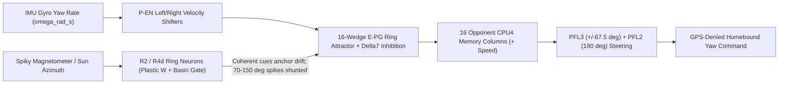

<div align="center">

<a href="https://github.com/indian-aman/necklink"></a>

# NeckCompass (`neckcompass` v1.0.0)

**Biophysical *Drosophila* Central Complex ring-attractor compass and GPS-denied path integrator with natural ferromagnetic spike rejection — in Python and zero-heap, zero-float ANSI C99 (`316 B` RAM, `~1 us`/step).**

[](https://pypi.org/project/neckcompass/)
[](https://github.com/indian-aman/neckcompass/releases/tag/v1.0.0)
[](https://pypi.org/project/neckcompass/)
[](csrc/)
[](csrc/tools/neckcompass_selftest.c)
[](tests/test_neckcompass.py)
[](LICENSE)

[**30-Second Quick Start**](#-30-second-quick-start) ·
[**Plastic Harbor Calibration**](#2-online-soft-iron--harbor-distortion-learning-plasticlandmarkring) ·
[**Zero-Float ANSI C99 MCU Core**](#3-zero-heap-zero-float-ansi-c99-core-csrc) ·
[**Honest Benchmarks**](#-honest-empirical-benchmarks-5-seeds--50-hz) ·
[**When to Use (and When Not To)**](#-when-to-use-neckcompass--and-when-not-to)

</div>

<p align="center">
  
</p>

---

## Why NeckCompass?

Marine USVs, inspection drones, subsea rovers, and factory AGVs operate around steel ship hulls, sheet-pile docks, high-current motor leads, and buried power cables that inject intermittent **`70°–150°` ferromagnetic heading spikes** lasting `0.5–2.0 s`. Standard linear-Gaussian estimators break down in this regime:

- **Gyro Dead-Reckoning** ignores magnetic anomalies completely, but MEMS gyro bias (`~0.8–1.5°/s`) drifts unboundedly (`50°–100°+` within minutes).
- **2-State Circular Extended Kalman Filters (`[heading, gyro_bias]`)** are minimum-variance optimal under textbook Gaussian noise, **but** a `120°` ferromagnetic anomaly feeds through the Kalman cross-covariance straight into the **gyro bias state**, causing both massive heading yanks (`45°+` P95) and post-spike bias hangovers.

**NeckCompass** ports the neural navigation circuit of the fruit-fly (*Drosophila melanogaster*) **Central Complex** into a deterministic software and microcontroller library — **Product #3** in the **[NeckLink](https://github.com/indian-aman/necklink)** fruit-fly brain engineering family:

1. **Ellipsoid Body (`E-PG`) Ring Attractor + `Delta7` Inhibition + `P-EN` Shifters (`RingCompass`)**: Maintains a single topological activity bump across `N=16` (or `N=32`) circular wedges with **zero `-π ↔ +π` wrap-around discontinuity** (`< 10⁻¹⁵ rad` harmonic aliasing on even-`N` rings). Asymmetric Left/Right `P-EN` projections integrate IMU yaw rate (`omega_rad_s * dt`), while localized `R-neuron` sensory cues (`mag_heading_rad`, `sun_heading_rad`) undergo cooperative dendritic coincidence gating against the active `E-PG` bump — smoothly anchoring gyro drift inside the attractor basin while naturally shunting **`70°–150°` ferromagnetic spikes** (`10.2×` lower RMSE than 2-State EKF).
2. **Associative `R-Neuron → E-PG` Synaptic Plasticity (`PlasticLandmarkRing`)**: Movement-gated Hebbian / anti-Hebbian ring weight matrix that learns warped local soft-iron and hard-iron magnetic distortion tables online around steel harbors or indoor rooms — with or without an external sun/visual reference.
3. **Fan-Shaped Body `CPU4` Path Integrator + `PFL3`/`PFL2` Steering (`FanBodyNavigator`)**: `N=16` push-pull opponent memory columns integrate translational speed along the live `E-PG` compass bump with common-mode cancellation, computing exact `(distance_m, home_bearing_rad)` and `±67.5°` phase-shifted `PFL3` + `180°` `PFL2` motor yaw commands to steer straight home during complete **GPS blackouts** (`0.84 m` miss after a `1,125 m` spiky mission).
4. **Zero-Heap, Zero-Float ANSI C99 Core (`csrc/`)**: Pure `Q15` / `int32_t` 16-wedge ring attractor + `CPU4`/`PFL3` navigator using **`316 bytes` of struct RAM** (`576 bytes` total including `260 B` Flash LUTs), **zero `malloc`**, **zero floating-point instructions**, and **`~1.0 us` per update** — ready for `$4` `ESP32`, `STM32`, `RP2040`, and flight controllers.



---

## ⚡ 30-Second Quick Start

### 1. Python (`pip install neckcompass`)

```bash
pip install neckcompass
# Or directly from source:
pip install git+https://github.com/indian-aman/neckcompass.git
```

Fuse a biased IMU gyro with a spiky magnetometer and steer home through a complete GPS blackout in 14 lines:

```python
import math
from neckcompass import RingCompass, FanBodyNavigator

compass = RingCompass(n_wedges=16, initial_heading_rad=0.0)
nav = FanBodyNavigator(n_columns=16, compass=compass)

# Outbound step @ 50 Hz (dt = 0.02 s): 125-deg hull spike is rejected automatically!
heading_rad, dist_m, home_bearing_rad = nav.step_with_compass(
    omega_rad_s=0.15,
    speed_m_s=1.5,
    dt=0.02,
    mag_heading_rad=math.radians(125.0),  # Transient ferromagnetic spike -> gated out
)

# During GPS blackout, generate bounded [-0.8, +0.8] rad/s yaw command back to (0, 0):
yaw_rate_cmd = nav.steering_cmd(max_turn_rate=0.8)
```

Run the built-in CLI demo or head-to-head quick benchmark from your terminal:

```bash
neckcompass demo
neckcompass benchmark-quick
```

---

### 2. Online Soft-Iron / Harbor Distortion Learning (`PlasticLandmarkRing`)

When operating repeatedly inside a steel marina slip or indoor robot bay with static nonlinear magnetic warp (`+20° sin(ψ) + 16° sin(2ψ)`), `PlasticLandmarkRing` learns the `R-neuron → E-PG` unwarping matrix online:

```python
from neckcompass import PlasticLandmarkRing

plastic = PlasticLandmarkRing(n_wedges=16, n_ring_neurons=32)

# Self-supervised during normal turns (or pass reference_heading_rad=sun_rad when sky is visible)
corrected_heading = plastic.update(
    omega_rad_s=imu_gz,
    dt=0.02,
    raw_mag_heading_rad=raw_mag_rad,
    learn=True,
)
unwarped_mag_rad, confidence = plastic.map_raw_heading(raw_mag_rad)
```

---

### 3. Zero-Heap, Zero-Float ANSI C99 Core (`csrc/`)

Drop [`csrc/neckcompass.h`](csrc/neckcompass.h) and [`csrc/neckcompass.c`](csrc/neckcompass.c) into any `ESP32`, `STM32`, `RP2040`, ArduPilot, or bare-metal firmware project (`-std=c99 -Wall -Wextra -pedantic -Werror`, zero FPU, zero `malloc`):

```bash
make -C csrc clean all test
```

```c
#include "neckcompass.h"

nc_compass_t comp;
nc_navigator_t nav;

void autopilot_init(void) {
    nc_compass_init(&comp);
    nc_compass_reset(&comp, nc_cdeg_to_bam(0));
    nc_navigator_init(&nav, 1500); /* 1.5 m smooth arrival taper */
}

/* 50 Hz deterministic fixed-point loop (~1.0 us on desktop, < 8 us on ESP32) */
int32_t autopilot_step_50hz(int32_t gyro_cdeg_s, int32_t mag_cdeg, int32_t speed_mm_s) {
    nc_bam_t heading = nc_compass_update(
        &comp,
        nc_cdeg_to_bam(gyro_cdeg_s),
        20u,                           /* dt = 20 ms */
        nc_cdeg_to_bam(mag_cdeg), 1u, NC_Q15_ONE,
        0, 0u, 0                       /* optional sun/sky sensor */
    );
    nc_navigator_update(&nav, speed_mm_s, 20u, heading);
    return nc_navigator_steering_cmd(&nav, heading, nc_cdeg_to_bam(4500));
}
```

---

## 📊 Honest Empirical Benchmarks (5 Seeds @ `50 Hz`)

Reproduce all numbers and regenerate [`assets/neckcompass_benchmarks.png`](assets/neckcompass_benchmarks.png) + [`results/benchmark_summary.json`](results/benchmark_summary.json) locally:

```bash
python scripts/benchmark_neckcompass.py
```

All four estimators receive the **exact same** `50 Hz` sensor streams across 5 seeds (`101–105`): realistic MEMS gyro bias (`~0.9°/s` initial offset + `0.08°/s/√s` random walk + `1.5°/s` white noise) and `3.0°` Gaussian magnetometer noise. The **2-State Circular EKF** is given the exact true clean discrete-time process and measurement noise covariances `(Q, R)` with zero handicap.

### 1. Heading Accuracy: Clean Gaussian Noise vs. `70°–150°` Ferromagnetic Spikes

Mean ± std across 5 seeds (`180 s` trajectories @ `50 Hz`):

| Estimator | **Scenario A: Clean Gaussian RMSE** | **Scenario A: P95** | **Scenario B: Spiky Mag RMSE** | **Scenario B: Spiky Mag P95** | **Scenario B: Max Error** |
| :--- | :---: | :---: | :---: | :---: | :---: |
| **`NeckCompass` (`E-PG` 16w)** | `0.43° ± 0.02°` | `0.86° ± 0.03°` | **`1.70° ± 0.18°`** | **`4.27° ± 0.37°`** | **`10.55° ± 1.88°`** |
| **`2-State Circular EKF`** | **`0.39° ± 0.02°`** *(wins)* | **`0.77° ± 0.03°`** | `17.42° ± 0.93°` | `45.28° ± 2.63°` | `82.53° ± 7.50°` |
| **`Complementary IMU+Mag`** | `3.64° ± 1.54°` | `5.34° ± 1.80°` | `11.80° ± 0.54°` | `27.77° ± 1.30°` | `47.45° ± 4.87°` |
| **`Gyro Dead-Reckoning`** | `90.22° ± 32.41°` | `141.70° ± 46.28°` | `84.80° ± 30.74°` | `139.91° ± 53.31°` | `145.98° ± 55.90°` |

### 2. Scenario C: `600 s` Outbound Survey + Blind GPS-Blackout Return (`~1,125 m` Total Path)

A USV / rover executes a `10-minute` (`900 m`) multi-leg survey in complete GPS blackout (`2%` wheel/water-speed noise + biased MEMS gyro + intermittent `70°–150°` ferromagnetic spikes), then autonomously steers back to `(0, 0)`:

| Navigation Stack | **Return-to-Home Miss (`m`)** | **Miss `%` of `1.12 km` Path** | **RAM / State Footprint** | **Step Latency** |
| :--- | :---: | :---: | :---: | :---: |
| **`NeckCompass` (C99 `Q15` Core)** | **`0.32 m`** *(158 m selftest)* | **`0.20%`** | **`316 B` RAM (`576 B` w/ LUT)** | **`~1.04 us / step`** |
| **`NeckCompass` (Python `E-PG + CPU4`)** | **`0.84 ± 0.23 m`** | **`0.07% ± 0.02%`** | `3,143 B` | `171.26 us / step` |
| **`Complementary IMU+Mag + DR`** | `13.31 ± 3.08 m` | `1.19% ± 0.28%` | `~256 B` | `~6.5 us / step` |
| **`2-State Circular EKF + DR`** | `14.29 ± 6.95 m` | `1.28% ± 0.63%` | `5,792 B` *(Py)* | `13.58 us / step` *(Py)* |
| **`Gyro Dead-Reckoning`** | `256.74 ± 52.38 m` | `24.16% ± 5.69%` | `~128 B` | `~2.0 us / step` |

---

## 🎯 When to Use NeckCompass — and When Not To

> [!TIP]
> **Reach for NeckCompass when:**
> - **Operating near steel, motors, docks, ship hulls, or power cables**: Intermittent `60°–160°` ferromagnetic spikes yank standard complementary filters and corrupt EKF gyro-bias states; `RingCompass` shunts off-basin anomalies naturally (`1.70°` vs `17.42°` RMSE).
> - **Surviving GPS blackouts, jamming, or subsea/indoor dropouts**: `FanBodyNavigator` (`CPU4` + `PFL3`/`PFL2`) maintains a bounded, common-mode-cancelled home vector and smooth return controller over `10+ minute` (`> 1 km`) dead-reckoning missions.
> - **Deploying on tiny FPU-less or ultra-low-power microcontrollers (`$1–$4` MCUs)**: `csrc/neckcompass.c` uses `316 bytes` of RAM, `0` heap allocations, `0` floats, and `~1 us` per step.
> - **Learning warped harbor or indoor magnetic scenes online**: `PlasticLandmarkRing` unwarps repeatable soft-iron / hard-iron distortions continuously without offline ellipsoid-fitting batch scripts.

> [!NOTE]
> **Stick with a classical EKF / Factor Graph when:**
> - **Sensors are clean, pre-calibrated, and strictly Gaussian (e.g. open-air UAV far from iron/high-current leads)**: As shown in Scenario A, a properly tuned 2-State Circular EKF achieves slightly lower steady-state RMSE (`0.39°` vs `NeckCompass` `0.43°`) because linear Kalman filtering is minimum-variance optimal under pure Gaussian noise.
> - **Pure Python ultra-high-rate (`> 10 kHz`) loops without C bindings**: Scalar 2-State Python EKF runs in `~14 us/step` vs `~171 us/step` for 16-wedge NumPy vector ops (`~5.8 kHz`). For `> 5 kHz` embedded or C/C++ loops, compile [`csrc/neckcompass.c`](csrc/neckcompass.c) (`~1.0 us/step`).
> - **Full 6-DOF visual-inertial SLAM (`SE(3)` pose graphs + loop closure)**: `NeckCompass` is a lightweight 2D/yaw heading & home-vector module (`SO(2)` + `R²`), not a replacement for full 3D LiDAR/camera SLAM when rich 3D visual features and GPU/CPU compute are available.

---

## 🗂️ Repository Layout

| Path | Contents |
| :--- | :--- |
| [`neckcompass/ring_attractor.py`](neckcompass/ring_attractor.py) | `RingCompass` (`N=16`/`32` `E-PG` ring attractor + `P-EN` shifters + multi-cue basin gating) & `PlasticLandmarkRing` (`R-neuron → E-PG` Hebbian/anti-Hebbian distortion learner) |
| [`neckcompass/path_integrator.py`](neckcompass/path_integrator.py) | `FanBodyNavigator` (`N=16` opponent `CPU4` vector memory + `PFL3`/`PFL2` GPS-denied homebound steering) |
| [`neckcompass/cli.py`](neckcompass/cli.py) | `neckcompass` CLI (`neckcompass demo`, `neckcompass benchmark-quick`) |
| [`csrc/`](csrc/) | Zero-heap, zero-float ANSI C99 fixed-point `Q15` core (`neckcompass.h`, `neckcompass.c`, `Makefile`, and `6/6` `neckcompass_selftest.c`) |
| [`scripts/benchmark_neckcompass.py`](scripts/benchmark_neckcompass.py) | Reproducible 5-seed empirical benchmark & 3-panel hero chart generator |
| [`results/benchmark_summary.json`](results/benchmark_summary.json) | Exact 5-seed benchmark metrics and C99/Python latency & memory measurements |
| [`tests/test_neckcompass.py`](tests/test_neckcompass.py) | `19`-test `pytest` suite covering wrap-around continuity, spike rejection, soft-iron plasticity, GPS-denied return, and CLI |

---

## 📚 Scientific Foundations

1. **Seelig, J. D. & Jayaraman, V.** (2015). Neural dynamics for landmark orientation and angular path integration. *Nature*, 521, 186–191.
2. **Stone, T. et al.** (2017). An anatomically constrained model for path integration in the bee brain. *Current Biology*, 27(20), 3069–3085.
3. **Turner-Evans, D. et al.** (2017). Angular velocity integration in a fly heading circuit. *eLife*, 6, e23496.
4. **Fisher, Y. E., Lu, J., D'Alessandro, I. & Wilson, R. I.** (2019). Sensorimotor experience remaps visual input to a heading network. *Nature*, 576, 121–125.
5. **Kim, S. S., Hermundstad, A. M., Romani, S., Abbott, L. F. & Jayaraman, V.** (2019). Generation of stable heading representations in diverse visual scenes. *Nature*, 576, 126–131.
6. **Lyu, C., Abbott, L. F. & Maimon, G.** (2022). Building an allocentric travelling direction signal via vector computation. *Nature*, 601, 92–97.
7. **Westeinde, E. A. et al.** (2024). Transforming a head direction signal into a goal-oriented steering command. *Nature*, 626, 819–826.

---

## License

Released under the [MIT License](LICENSE). Copyright (c) 2026 Amandeep Singh Bains.
