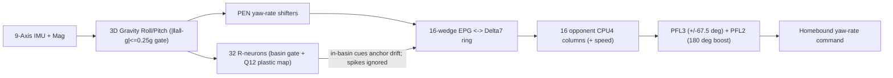

<div align="center">

<a href="https://github.com/indian-aman/necklink"></a>

# NeckCompass (`neckcompass` v2.0.0)

**A *Drosophila* central-complex 9-DOF tilt-compensated ring-attractor compass, self-calibrating soft-iron plastic ring, and GPS-denied path integrator — grounded in the BANC v888 connectome, in Python, Arduino, and zero-heap, zero-float ANSI C99 (`324 B` base RAM, `1,104 B` plastic ring).**

[](https://pypi.org/project/neckcompass/)
[](https://pypi.org/project/neckcompass/)
[](csrc/)
[](arduino/NeckCompass/)
[](csrc/tools/neckcompass_selftest.c)
[](tests/test_neckcompass.py)
[](LICENSE)

[**Quick start**](#quick-start) ·
[**C99 & Arduino**](#zero-heap-zero-float-ansi-c99-core-csrc--arduino) ·
[**Benchmarks**](#benchmarks-5-seeds-50-hz) ·
[**When to use it**](#when-to-use-neckcompass-and-when-not-to) ·
[**Changelog**](#changelog)

</div>

<p align="center">
  
</p>

---

## What it is

Boats, rovers and drones that work near steel hulls, sheet-pile docks, motor leads or buried cables see short magnetometer spikes of `70°–150°` lasting `0.5–2 s`, steep `60°–68°` geomagnetic dip errors (`15°–35°+`) whenever pitching or banking, and repeatable `30°+` soft-iron distortions around steel decks. A textbook Kalman filter feeds spikes into its heading and gyro-bias states; a flat 2D compass breaks on waves.

NeckCompass ports the fruit-fly central complex — grounded in empirical `BANC v888` connectome counts (`157,789` proofread neurons: `50` `EPG` [`45 EPG + 5 EPGt`], `42` `PEN` [`24 PEN_b + 18 PEN_a`, `7,998` `PEN → EPG` synapses], `40` glutamatergic `Delta7` bridge neurons [`6,998` `EPG → Delta7`, `4,646` `Delta7 → EPG`, `6,066` `Delta7 → PFL3` synapses], `25` `PFL3` [`259` `PFL3 → DNa02` synapses], and `12` `PFL2` anti-goal turn-boost neurons) — into a compact heading and homing library:

1. **9-Axis 3D Tilt-Compensated IMU + Magnetometer Front-End (`TiltCompensatedAHRS`, `nc_tilt_t`).** Integrates 3-axis strapdown gyro (`gx, gy, gz`) with accelerometer gravity correction gated when `|‖a‖ - g| > 0.25g` so wave slams and linear accelerations never corrupt roll/pitch, then projects horizontal yaw rate and tilt-compensated magnetic azimuth (`< 0.25°` yaw error at `25°` roll, `20°` pitch under `65°` geomagnetic dip).
2. **`RingCompass`: Recurrent `EPG ↔ Delta7` ring attractor.** A 16-wedge (or 32-wedge) activity bump is rotated by `PEN` shifters and sharpened by anti-phase `Delta7` bridge inhibition. Magnetometer or sun cues pull the bump only inside a narrow *attractor basin* (`4° + cue_noise_deg`, i.e. `7°` at default `3°` noise). Spikes outside the basin are ignored; sustained upsets (`reanchor_seconds = 10 s`) re-anchor cleanly.
3. **`PlasticLandmarkRing` & C99 `nc_plastic_ring_t`: `R-neuron → E-PG` online self-calibration.** Learns `30°+` non-ellipsoidal harbor or steel-hull soft-iron warps online while turning with a biased gyro — with **no manual figure-8 calibration** — in both Python and `1,104 B` zero-float C99 (`16 × 32` `Q12` weights).
4. **`FanBodyNavigator`: `CPU4` path integrator with `PFL3` + `PFL2` steering.** Integrates speed along the compass heading in 16 opponent columns and generates bounded homebound yaw-rate commands, with `PFL2` (`12` anti-goal neurons) driving crisp full-rate U-turns across `179°–180°` away from home where `PFL3` `sin(180°) == 0`.
5. **Zero-heap, zero-float ANSI C99 (`csrc/`) & Drop-In Arduino Library (`arduino/NeckCompass/`).** `324 B` base compass+navigator state (`16 B` 9-DOF tilt, `1,104 B` plastic ring), `260 B` flash LUTs, `0` `malloc`, `0` floats.



---

## Quick start

```bash
pip install neckcompass
# or from this repository:
pip install "git+https://github.com/indian-aman/necklink.git#subdirectory=packages/neckcompass"
```

### 1. Compass and homing

```python
import math
from neckcompass import RingCompass, FanBodyNavigator

compass = RingCompass(n_wedges=16, initial_heading_rad=0.0, cue_noise_deg=3.0)  # your magnetometer's 1-sigma noise
nav = FanBodyNavigator(n_columns=16, compass=compass)

# One 50 Hz step (dt = 0.02 s). Feed raw gyro yaw rate, speed and magnetometer heading.
# A 125 deg hull spike lies outside the attractor basin, so it is ignored.
heading_rad, dist_m, home_bearing_rad = nav.step_with_compass(
    omega_rad_s=0.15,
    speed_m_s=1.5,
    dt=0.02,
    mag_heading_rad=math.radians(125.0),
)
print(f"heading={math.degrees(heading_rad):.2f} deg, gate={compass.diagnostics().mag_gate:.3f}")

# During a GPS blackout: bounded PFL3 + PFL2 yaw-rate command back to origin (crisp even at 180 deg anti-home).
yaw_rate_cmd = nav.steering_cmd(max_turn_rate=0.8)
```

### 2. Learning a harbor or soft-iron warp online (`PlasticLandmarkRing`)

Self-supervised, using only a biased gyro and a warped, noisy magnetometer:

```python
import math
import numpy as np
from neckcompass import PlasticLandmarkRing, wrap_angle

def harbor_warp(psi):  # repeatable soft-iron distortion around a steel slip (up to 31 deg)
    return float(wrap_angle(psi + math.radians(20) * math.sin(psi) + math.radians(16) * math.sin(2 * psi)))

plastic = PlasticLandmarkRing(n_wedges=16, n_ring_neurons=32)
rng = np.random.default_rng(0)
dt, psi = 0.02, 0.0
for k in range(int(240 / dt)):  # 4 minutes of ordinary turning, no external reference
    omega = 0.6 + 0.3 * math.sin(0.05 * k * dt)                  # true yaw rate (rad/s)
    psi = float(wrap_angle(psi + omega * dt))
    gyro = omega + math.radians(0.9) + rng.normal(0, math.radians(1.5))  # biased, noisy gyro
    raw_mag = harbor_warp(psi) + rng.normal(0, math.radians(2.0))     # warped, noisy magnetometer
    heading = plastic.update(gyro, dt, raw_mag_heading_rad=raw_mag, learn=True)

grid = np.linspace(-math.pi, math.pi, 72, endpoint=False)
err = [abs(math.degrees(float(wrap_angle(plastic.map_raw_heading(harbor_warp(a))[0] - a)))) for a in grid]
print(f"learned un-warp error: mean {np.mean(err):.1f} deg, max {max(err):.1f} deg")
```

### 3. 9-Axis 3D tilt-compensated compass with wave-slam gating (`update_9dof`)

```python
import math
from neckcompass import RingCompass, synthesize_9dof_frame, circular_error_rad

compass = RingCompass(n_wedges=16, cue_noise_deg=3.0)
true_yaw = math.radians(37.0)

# Pitching 20 deg nose-up and banking 25 deg starboard in a steep 65 deg geomagnetic dip field:
gx, gy, gz, ax, ay, az, mx, my, mz = synthesize_9dof_frame(
    yaw_rad=true_yaw, pitch_rad=math.radians(20.0), roll_rad=math.radians(25.0), dip_deg=65.0
)
est_yaw = compass.update_9dof(gx, gy, gz, ax, ay, az, mx, my, mz, dt=0.02)
err_deg = abs(math.degrees(float(circular_error_rad(est_yaw, true_yaw))))
print(f"3D tilt-compensated yaw={math.degrees(est_yaw):.2f} deg (error={err_deg:.2f} deg)")
```

### 4. Command line

```bash
neckcompass demo               # 90 s GPS-denied survey + return home, with two 118-136 deg spikes
neckcompass benchmark-quick    # 120 s head-to-head against gated/ungated EKF, complementary, gyro-only
neckcompass benchmark-quick --json
```

---

## Zero-heap, zero-float ANSI C99 core (`csrc/`) & Arduino

Copy [`csrc/neckcompass.h`](csrc/neckcompass.h) and [`csrc/neckcompass.c`](csrc/neckcompass.c) into bare-metal firmware, or drop [`arduino/NeckCompass/`](arduino/NeckCompass/) directly into your Arduino `libraries/` folder (`#include <NeckCompass.h>`). Everything compiles cleanly with `-std=c99 -Wall -Wextra -pedantic -Werror` and `-fsanitize=address,undefined` with zero FPU and zero heap.

```bash
make -C csrc clean all test sanitize   # builds and runs all 12/12 C99 self-tests (+ ASan/UBSan)
```

```c
#include "neckcompass.h"

static nc_tilt_t         tilt;
static nc_plastic_ring_t plastic;
static nc_navigator_t    nav;

void autopilot_init(void) {
    nc_tilt_init(&tilt);                       /* 0.25g wave-slam gravity gate, 500 ms tau */
    nc_plastic_ring_init(&plastic);            /* 16x32 Q12 R->EPG plastic ring (1,104 B)  */
    nc_navigator_init(&nav, 1500);             /* 1.5 m arrival taper (264 B)              */
}

/* 50 Hz 9-DOF loop: gyro in BAM/s, accel in milli-g, 3-axis mag, speed in mm/s */
int32_t autopilot_step_50hz(const nc_imu9_t *imu, int32_t speed_mm_s) {
    nc_bam_t heading = nc_plastic_ring_update_9dof(&plastic, &tilt, imu, 20u, 0, 0u, 1u);
    nc_navigator_update(&nav, speed_mm_s, 20u, heading);
    return nc_navigator_steering_cmd(&nav, heading, nc_cdeg_s_to_bam_s(4500)); /* BAM/s */
}
```

| Measured on the C99 core (`v2.0.0`) | Value | Source |
| :--- | :---: | :--- |
| Base state RAM (`nc_compass_t` + `nc_navigator_t`) | `60 + 264 = 324 B` | self-test `[1/12]` |
| 9-DOF tilt front-end (`sizeof(nc_tilt_t)` / `nc_imu9_t`) | `16 B` / `36 B` | self-test `[1/12]` |
| Online soft-iron plastic ring (`sizeof(nc_plastic_ring_t)`) | `1,104 B` (`1,024 B` `Q12` weights) | self-test `[1/12]` |
| Lookup tables in flash (`sin` + `atan`) | `260 B` | `csrc/neckcompass.c` |
| Step latency (`update` / `update_9dof` / `plastic_9dof`) | ~`0.8–2.0 us` / ~`1.2 us` / ~`9.4 us` | self-test `[6/12]`, x86-64 `-O2` |
| `±25°` roll, `±20°` pitch under `60°–65°` magnetic dip | `0.04°` max error (flat: `132.5°`) | self-test `[8/12]` |
| Self-supervised `31°` steel-harbor warp learning (C99 `Q12`) | `2.16°` mean error (raw: `14.1°`) | self-test `[10/12]` |
| `179°–180°` `PFL2` anti-home U-turn response | `90.7%` full turn rate (`197 mm` miss) | self-test `[12/12]` |

---

## Benchmarks (5 seeds, 50 Hz)

Reproduce every number, plus [`results/benchmark_summary.json`](results/benchmark_summary.json) and the chart, with:

```bash
python scripts/benchmark_neckcompass.py      # ~1 minute; needs matplotlib and a C compiler for the C99 rows
```

All estimators see identical sensor streams (seeds 101–105): MEMS gyro bias (`0.75–1.15°/s` plus `0.08°/s/√s` random walk and `1.5°/s` white noise) and `3°` magnetometer noise. Both EKFs get the true noise covariances. **"EKF + 3σ gate"** is the strong classical baseline: it rejects measurements whose innovation exceeds 3× its predicted standard deviation, as production EKFs do.

### Heading accuracy: clean vs. `70°–150°` spikes (180 s runs, first 15 s excluded)

| Estimator | Clean RMSE | Clean P95 | Spiky RMSE | Spiky P95 | Spiky max |
| :--- | :---: | :---: | :---: | :---: | :---: |
| NeckCompass (Python) | `0.42° ± 0.02°` | `0.84°` | `0.44° ± 0.04°` | `0.88°` | `1.77°` |
| NeckCompass (C99 `Q15`) | `0.46° ± 0.02°` | `0.90°` | `0.49° ± 0.03°` | `0.97°` | `2.01°` |
| **EKF + 3σ gate** | **`0.40° ± 0.02°`** | **`0.77°`** | **`0.41° ± 0.04°`** | **`0.82°`** | `1.89°` |
| EKF (no gating) | `0.39° ± 0.02°` | `0.77°` | `17.42° ± 0.93°` | `45.28°` | `82.53°` |
| Complementary IMU+Mag (τ = 2.5 s) | `3.64° ± 1.54°` | `5.34°` | `11.80° ± 0.54°` | `27.77°` | `47.45°` |
| Gyro only | `90.22° ± 32.41°` | `141.70°` | `84.80° ± 30.74°` | `139.91°` | `145.98°` |

### Scenario D: recovery from a 90° heading upset (60 s, clean magnetometer, RMSE from t = 15 s)

| Estimator | RMSE |
| :--- | :---: |
| NeckCompass (Python) | **`0.43° ± 0.08°`** |
| NeckCompass (C99) | **`0.47° ± 0.06°`** |
| EKF + 3σ gate | `31.89° ± 22.20°` (3 of 5 runs still over 40° off after 60 s) |
| EKF (no gating) | `0.40° ± 0.08°` |

### Scenario C: 600 s survey with no GNSS, then autonomous return (~1,125 m path)

| Navigation stack | Miss distance at home | Miss as % of path |
| :--- | :---: | :---: |
| **NeckCompass (`RingCompass` + `FanBodyNavigator`)** | **`0.68 ± 0.16 m`** | **`0.06%`** |
| **EKF + 3σ gate + dead reckoning** | **`0.70 ± 0.07 m`** | **`0.06%`** |
| EKF (no gating) + dead reckoning | `14.29 ± 6.95 m` | `1.28%` |
| Complementary + dead reckoning | `13.31 ± 3.08 m` | `1.19%` |
| Gyro only + dead reckoning | `256.74 ± 52.38 m` | `24.16%` |

---

## When to use NeckCompass, and when not to

**Good fit:**
- **Pitching boats, USVs, rovers, and banking drones without an FPU.** 9-DOF dip-compensated compass (`16 B`), self-calibrating soft-iron plasticity (`1,104 B`), and GPS-denied homing (`324 B` base) in pure integer C99 / Arduino.
- **Repeatable local magnetic warps** (steel docks, hulls, robot bays). `PlasticLandmarkRing` / `nc_plastic_ring_t` learns `30°+` non-ellipsoidal distortions online while turning — no manual figure-8 calibration.
- **Heading upsets.** NeckCompass re-anchors after a wrong initial heading or gyro saturation where a 3σ-gated EKF locks itself out.

**Use something else when:**
- **You need full 6-DOF pose (`SE(3)`).** NeckCompass estimates roll/pitch gravity tilt, stabilized yaw, and a 2-D home vector; it is not a VIO or SLAM system.
- **The disturbance is a multi-minute static offset while parked.** Raise `reanchor_seconds` (or set `None` / `0`) if your vehicle sits stationary beside steel for minutes.

---

## Repository layout

| Path | Contents |
| :--- | :--- |
| [`neckcompass/ring_attractor.py`](neckcompass/ring_attractor.py) | `RingCompass` (`EPG ↔ Delta7`, `update_9dof`), `PlasticLandmarkRing`, `BANC_CONNECTOME_COUNTS` |
| [`neckcompass/tilt_ahrs.py`](neckcompass/tilt_ahrs.py) | `TiltCompensatedAHRS`, `TiltCompensatedCompass`, `synthesize_9dof_frame` |
| [`neckcompass/path_integrator.py`](neckcompass/path_integrator.py) | `FanBodyNavigator` (`CPU4` path integrator + `PFL3` / `PFL2` steering + `step_with_compass_9dof`) |
| [`neckcompass/cli.py`](neckcompass/cli.py) | `neckcompass demo`, `neckcompass benchmark-quick` |
| [`csrc/`](csrc/) | Zero-float ANSI C99 core (`neckcompass.h`, `neckcompass.c`), `Makefile`, 12 self-tests |
| [`arduino/NeckCompass/`](arduino/NeckCompass/) | Drop-in Arduino / ESP32 library (`library.properties`, `src/NeckCompass.h`, C99 core mirror, example sketch) |
| [`scripts/benchmark_neckcompass.py`](scripts/benchmark_neckcompass.py) | Reproducible benchmark (Python and C core) and chart generator |
| [`tests/`](tests/) | 46 pytest tests (including all README examples, 9-DOF dip + wave slams, `ctypes` C99 parity, and SHA-256 mirror checks) |

---

## Changelog

**2.0.0**
- **9-Axis 3D Tilt-Compensated IMU + Magnetometer Front-End:** Added `TiltCompensatedAHRS`, `TiltCompensatedCompass`, `RingCompass.update_9dof`, `PlasticLandmarkRing.update_9dof`, `FanBodyNavigator.step_with_compass_9dof`, and zero-float C99 `nc_tilt_t` (`16 B`) + `nc_imu9_t` (`36 B`) with `|‖a‖ - g| > 0.25g` wave-slam gravity gating (`< 0.25°` yaw error at `±25°` roll, `±20°` pitch under `65°` magnetic dip).
- **Zero-Float C99 `nc_plastic_ring_t` (`1,104 B` RAM):** Ported `PlasticLandmarkRing` (`16 × 32` `Q12` Hebbian/anti-Hebbian weights, zero-mean circular recentering, movement-gated learning, and supervised lock) to pure integer ANSI C99 (`2.16°` self-supervised un-warp error on a `31°` steel-harbor distortion).
- **`BANC v888` Connectome Grounding & `PFL2` `180°` Anti-Goal Turn-Boost:** Added explicit `EPG ↔ Delta7` anti-phase bridge readout (`delta7_wedges`, `nc_compass_delta7_q15`) and upgraded `PFL2` (`12` anti-goal neurons) in Python and C99 so vehicles pointing `179°–180°` away from home initiate immediate `~90%` full-rate turns with zero `sin(180°) == 0` hesitation.
- **Drop-In Arduino Library (`arduino/NeckCompass/`):** Added Arduino IDE / PlatformIO package with `NeckCompass.h` C++11 wrappers, byte-identical mirrored C99 core, and ESP32 9-DOF self-calibrating example sketch.

**1.1.0**
- *Fix:* re-anchoring after a heading upset tracks the low-passed off-basin innovation phasor.
- *Fix:* `PlasticLandmarkRing` self-supervised learning keeps the map zero-mean until an absolute reference is seen and gates learning by gyro turn rate.
- *Improvement:* attractor basin set from `cue_noise_deg` (half-width `4° + noise`), improving spiky-magnetometer RMSE to `0.44°`.
- C99 core: matching basin (`nc_compass_set_cue_noise`) and re-anchoring (`nc_compass_set_reanchor_ms`).

---

## Scientific foundations

1. Seelig, J. D. & Jayaraman, V. (2015). Neural dynamics for landmark orientation and angular path integration. *Nature*, 521, 186–191.
2. Stone, T. et al. (2017). An anatomically constrained model for path integration in the bee brain. *Current Biology*, 27(20), 3069–3085.
3. Turner-Evans, D. et al. (2017). Angular velocity integration in a fly heading circuit. *eLife*, 6, e23496.
4. Fisher, Y. E., Lu, J., D'Alessandro, I. & Wilson, R. I. (2019). Sensorimotor experience remaps visual input to a heading network. *Nature*, 576, 121–125.
5. Kim, S. S., Hermundstad, A. M., Romani, S., Abbott, L. F. & Jayaraman, V. (2019). Generation of stable heading representations in diverse visual scenes. *Nature*, 576, 126–131.
6. Lyu, C., Abbott, L. F. & Maimon, G. (2022). Building an allocentric travelling direction signal via vector computation. *Nature*, 601, 92–97.
7. Westeinde, E. A. et al. (2024). Transforming a head direction signal into a goal-oriented steering command. *Nature*, 626, 819–826.
8. Bates, A. S. et al. (2025). Brain-and-Nerve-Cord (`BANC`) connectome of *Drosophila melanogaster* (`v888`, 157,789 proofread neurons).

---

## License

Released under the [MIT License](LICENSE). Copyright (c) 2026 Amandeep Singh Bains.
