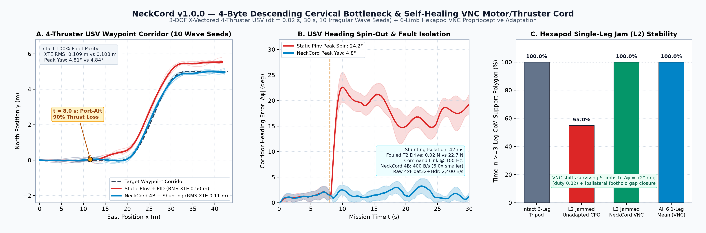
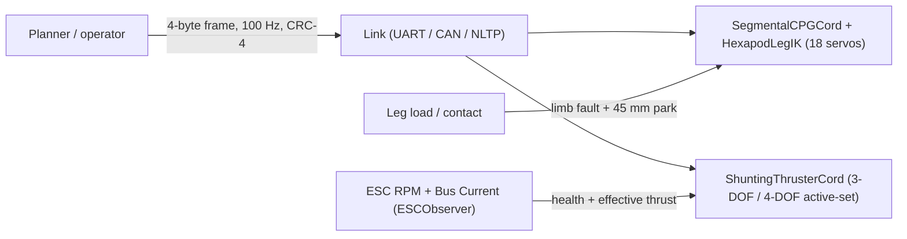

<div align="center">

<a href="https://github.com/indian-aman/necklink"></a>

# NeckCord (`neckcord` v3.0.0, research beta)

**Bio-inspired 4-byte descending command codec, 6-limb CPG + 18-servo 3-DOF leg IK, sensorless ESC (`RPM + Current`) fault observer, and box-constrained 3-DOF / 4-DOF fault-tolerant thruster & multicopter allocator in Python, pure-integer ANSI C99 (`916 B` combined RAM), and Arduino.**

[](https://pypi.org/project/neckcord/)
[](https://pypi.org/project/neckcord/)
[](csrc/)
[](arduino/NeckCord/)
[](tests/test_neckcord.py)
[](LICENSE)

[**Quick start**](#quick-start) ·
[**Python API**](#python-api) ·
[**C99 & Arduino**](#zero-heap-zero-float-ansi-c99-core-csrc--arduino) ·
[**Benchmarks**](#benchmarks) ·
[**When to use it**](#when-to-use-neckcord-and-when-not-to) ·
[**Changelog**](#changelog)

</div>

> [!NOTE]
> **v3.0.0: the six-leg gait generator now runs on connectome-derived coupling.** Leg-to-leg phase coupling comes from a `6×6` inhibition matrix (`C_vnc_inh`) compiled from `BANC v888` VNC premotor neurons, and turning gains come from the `DN → leg motor pool` matrix (`W_dn_leg`, `6×10`). The oscillator dynamics are hand-designed. The thruster/rotor allocator, ESC observer, leg IK and 4-byte codec are engineering and are labelled `PROVENANCE = "engineering"`. See [v3.0.0 results](#v300-connectome-derived-gait-coupling-audited-results).

<p align="center">
  
</p>

---

## What it is

In *Drosophila* (`BANC v888`, 157,789 proofread neurons), `1,316` Descending Neurons (`DNa01/DNa02` steering, `DNp01` Giant Fiber, `MDN` reverse, `DNp09` freeze) form `9,095` direct edges (`143,742` synapses) onto `805` VNC motor neurons (`393` leg MNs across `42` antagonistic coxa/femur/tibia pools) paired with `1,849` Ascending Neurons (`AN:DN = 1.405` efference-copy feedback). NeckCord translates that split into five embedded-ready robotics primitives:

1. **`neckcord.cervical`: a 4-byte command frame.** Forward drive, yaw, sway, gait mode, a freeze flag, a 2-bit sequence counter and a 4-bit CRC in 32 bits (`400 B/s` at 100 Hz), identical on the wire in Python and C99.
2. **`neckcord.cpg.SegmentalCPGCord` + `HexapodLegIK`: a six-leg gait generator with exact 3-DOF 18-servo IK.** Coupled phase oscillators switch smoothly between wave, tetrapod, tripod, and damaged 5-leg pentapod (`Δφ = 72°`, duty `0.82`), outputting exact `(coxa, femur, tibia)` joint angles and `1000..2000 µs` servo PWM while parking damaged legs safely lifted at `z = +45 mm`.
3. **`neckcord.allocator.ShuntingThrusterCord`: a box-constrained 3-DOF & 4-DOF active-set fault-tolerant allocator.** Handles unidirectional `[0, u_max]` hexacopter/octocopter rotors (relaxing reaction yaw to preserve hover `[Fz, Tx, Ty]` within `< 2%` when a rotor fails, where unconstrained pseudo-inverse commands illegal negative thrust), asymmetric marine thrusters (BlueRobotics `T200`: `-40.0 N` reverse vs `+52.5 N` forward + deadzone jump), and classic symmetric 3-DOF hulls.
4. **`neckcord.esc_observer.ESCObserver`: sensorless ESC (`RPM + Current`) fault observer.** Detects open-phase stalls, sheared propeller blades (`RPM` normal while `I_actual << I_idle + k_load*(RPM/RPM_max)^3` in `< 50 ms`), and weed-fouled overcurrent (`> 1.6× I_expected`) without load cells.



---

## Quick start

```bash
pip install neckcord
# or from this repository:
pip install "git+https://github.com/indian-aman/necklink.git#subdirectory=packages/neckcord"

neckcord demo                 # 4-byte codec -> CPG + 18-servo IK -> Hex6 broken-blade recovery -> USV fault
neckcord benchmark-quick      # short USV fault benchmark
```

---

## Python API

### 1. 4-byte command frame (`neckcord.cervical`)

```python
from neckcord import DescendingFrame, GaitMode, encode_descending_4b, decode_descending_4b

tx = DescendingFrame(
    drive_fwd=0.82,     # forward (+1) / reverse (-1)
    turn_yaw=-0.25,     # steering [-1, +1]
    strafe_lat=0.10,    # sway / crab [-1, +1]
    gait_mode=GaitMode.AUTO,
    freeze_reflex=False,
    seq=2,
)

raw = encode_descending_4b(tx)           # b'\x68\xe0\x0c\x20'  (4 bytes)
rx = decode_descending_4b(raw, expected_seq=2)
wrench = rx.to_wrench(max_surge=60.0, max_sway=40.0, max_yaw=25.0)  # [Fx, Fy, Tz]
print(raw.hex(), round(rx.drive_fwd, 3), wrench.round(2))
```

| Bits | Field | Encoding |
| :--- | :--- | :--- |
| `[31:24]` | `drive_fwd` | 8-bit symmetric `-127..+127` (step `0.0079`; exact `0` and `±1`) |
| `[23:16]` | `turn_yaw` | 8-bit symmetric `-127..+127` |
| `[15:9]` | `strafe_lat` | 7-bit symmetric `-63..+63` (step `0.0159`) |
| `[8:7]` | `gait_mode` | `0 AUTO`, `1 TRIPOD`, `2 TETRAPOD`, `3 WAVE` |
| `[6]` | `freeze_reflex` | zero wrench, all legs in stance |
| `[5:4]` | `seq` | 2-bit rolling counter |
| `[3:0]` | `crc4` | `x⁴ + x + 1`, init `0x9`, xorout `0x5` |

What the integrity check does and does not do (measured, and covered by the test suite):
- **Catches:** 100% of single-bit flips, plus the stuck-bus words `0x00000000` and `0xFFFFFFFF`.
- **Misses:** about **4% of 2-bit errors** and **6% of random corrupted words**. Any 4-bit check lets roughly 1 in 16 random corruptions through.
- **What to do:** send frames over a link with its own integrity check, such as NLTP's AEAD, a CAN CRC-15 or a UART frame CRC-16. Treat the CRC-4 as a last-line sanity check.

The 2-bit sequence counter counts lost frames modulo 4, so losing exactly 4 frames in a row is invisible to it. Pair it with a receive timeout.

### 2. Six-leg gait generator + 18-servo 3-DOF IK (`neckcord.cpg` & `neckcord.ik`)

```python
from neckcord import DescendingFrame, HexapodLegIK, SegmentalCPGCord

ik = HexapodLegIK(l_coxa_mm=38.0, l_femur_mm=95.0, l_tibia_mm=135.0, body_z_mm=85.0)
cpg = SegmentalCPGCord(adapt_to_damage=True, ik=ik)
cmd = DescendingFrame(drive_fwd=0.85)   # fast forward -> tripod; slow -> metachronal wave

for _ in range(100):
    state = cpg.step(cmd, dt=0.01)
print(state.active_gait, state.leg_ik.pwm_us.shape)  # tripod (6, 3)

cpg.inject_limb_fault("L2")             # middle-left leg jams mid-stride
for _ in range(100):
    state = cpg.step(cmd, dt=0.01)

assert state.active_gait == "adaptive_pentapod"
assert state.is_statically_stable       # CoM inside the >= 3-leg support polygon
assert state.leg_ik.foot_xyz_mm[2, 2] == 45.0  # L2 safely parked +45 mm clear of ground
```

### 3. Sensorless ESC observer + 4-DOF `[0, u_max]` hexacopter motor-loss survival (`v2.0`)

```python
import numpy as np
from neckcord import ESCObserver, ShuntingThrusterCord

hex6 = ShuntingThrusterCord.multicopter_hex_6(arm_m=0.28, k_yaw=0.018, u_max=18.0, tau_actuator=0.0)
obs = ESCObserver.multicopter_hex_6(u_nom=18.0, tau_motor=0.0)

w_hover = np.array([36.0, 0.0, -1.20, 0.0])  # [Fz, Tx, Ty, Tz]
alloc = hex6.step(w_hover, dt=0.005)

# Rotor 0 shears a propeller blade: spins at normal RPM, aerodynamic current collapses
for _ in range(12):
    u = alloc.commands
    rpm = obs.rpm_max * np.sqrt(np.clip(u / 18.0, 0.0, 1.0))
    cur = obs.i_idle_a + obs.k_load_a * ((rpm / obs.rpm_max) ** 3)
    cur[0] = obs.i_idle_a + 0.05 * (cur[0] - obs.i_idle_a)
    esc = obs.update(u, rpm, cur, dt=0.005)
    alloc = hex6.step(w_hover, feedback_thrust=esc.estimated_thrust, dt=0.005)

assert esc.broken_prop_mask[0] and alloc.isolated_mask[0]
assert np.all((alloc.commands >= 0.0) & (alloc.commands <= 18.0))
print(alloc.commands.round(2), alloc.predicted_wrench[:3].round(2))  # [36.0, 0.0, -1.2] preserved!
```

### 4. Asymmetric marine USV allocator (`T200` `-40 N / +52.5 N` & symmetric `usv_vectored_4`)

```python
import numpy as np
from neckcord import ShuntingThrusterCord

# Asymmetric BlueRobotics T200 X-vectored USV (-40.0 N reverse / +52.5 N forward + 2.5 N deadband)
t200 = ShuntingThrusterCord.usv_t200_vectored_4(u_min=-40.0, u_max=52.5, deadzone=2.5)
t200.set_actuator_health(2, 0.0)  # Port-Aft thruster fouled
res_t200 = t200.allocate(np.array([-75.0, 0.0, 10.0]))
assert np.all((res_t200.commands >= -40.0) & (res_t200.commands <= 52.5))

# Classic v1.x symmetric USV with periodic brownout recovery probe
cord = ShuntingThrusterCord.usv_vectored_4(
    lx=0.45, ly=0.35, cant_deg=45.0, u_max=35.0, probe_interval_s=2.0,
)
w_des = np.array([35.0, 0.0, 0.0])
alloc = cord.step(w_des, dt=0.02)
true_effectiveness = np.array([1.0, 1.0, 0.10, 1.0])
for _ in range(4):
    alloc = cord.step(w_des, feedback_thrust=true_effectiveness * alloc.commands, dt=0.02)
assert alloc.isolated_mask[2] and alloc.commands[2] == 0.0
```

---

## Zero-heap, zero-float ANSI C99 core (`csrc/`) & Arduino

[`csrc/neckcord.h`](csrc/neckcord.h) and [`csrc/neckcord.c`](csrc/neckcord.c) (mirrored byte-for-byte into [`arduino/NeckCord/src/`](arduino/NeckCord/src/)) implement all five subsystems in pure `Q20` / `Q15` / `Q14` / 16-bit BAM integer arithmetic:

- zero `malloc` and zero floating-point instructions;
- `322 B` for the five v1.x structs and `916 B` combined across all eleven v1.x + v2.0 structs (`< 1 KB` static RAM);
- exact `int64` `LDLᵀ` 3×3 / 4×4 active-set solver (`nc_shunting4d_t`), sensorless ESC observer (`nc_esc_observer_t`), and 18-servo 3-DOF leg IK (`nc_hexapod_ik_3dof`) running all four modules together in `~6.5–9.3 µs/tick` on x86_64;
- drop-in Arduino library at [`arduino/NeckCord/`](arduino/NeckCord/) (`ESP32`, `RP2040`, `STM32`, `Teensy`, `AVR`).

```bash
make -C csrc clean test test-sanitize   # 18 self-tests under -O2 -Werror and ASan + UBSan
```

---

## v3.0.0: connectome-derived gait coupling (audited results)

```python
import numpy as np
import neckcord

for weights in ("banc_v888", "v2_analytic"):  # banc_v888 is the default in 3.0.0
    cpg = neckcord.SegmentalCPGCord(connectome_weights=weights)
    cpg.phases = np.random.default_rng(0).uniform(0.0, 0.35, size=6)  # legs start nearly in phase
    for _ in range(180):
        st = cpg.step(0.90, dt=0.01, gait_mode=int(neckcord.GaitMode.TRIPOD))
    print(weights, "tripod order:", round(neckcord.compute_tripod_order(st.phases), 3))
```

With `banc_v888`, no tripod phase table is used: the tripod pattern has to emerge from the inhibition matrix. Benchmark: `N = 30` seeds against `K = 100` degree-preserving (Maslov–Sneppen) shuffles of the raw VNC matrices compiled with the identical pipeline; one-sided permutation `p = (1 + r) / (K + 1)` (smallest possible `0.0099`). MuJoCo tasks use an 18-DOF hexapod driven through `HexapodLegIK` for every arm. Code and raw JSON: [`benchmarks/v3/`](https://github.com/indian-aman/necklink/tree/main/benchmarks/v3).

| Task | `banc_v888` | Shuffled wiring (mean) | `r / 100`, `p`, `z` | `v2_analytic` | Open-loop tripod |
| :--- | :---: | :---: | :---: | :---: | :---: |
| Emergent tripod order (`1.0` = perfect) | `0.855` | `0.411` | `0`, `0.0099`, `+3.60` | `1.000` (fixed table) | `1.000` (fixed table) |
| Forward distance after losing leg L2 (MuJoCo) | `0.839 m` | `0.787 m` | `15`, `0.16`, `+0.88` | **`0.865 m`** | `0.289 m` parked, `0.406 m` limp |
| Turning, total yaw in 5 s (MuJoCo) | `+4.13 rad` | `+2.05 rad` | `1`, `0.020`, `+2.36` | — | — |

What this shows:
- **The inhibition matrix produces a tripod gait by itself** (`0.855` vs `0.411` for shuffled wiring), and the descending-neuron matrix steers about twice as hard as shuffled wiring.
- **It does not beat the hand-designed gait.** The analytic tripod table is perfectly ordered and walks slightly farther after a leg loss; leg-loss recovery is not specific to the real wiring (`p = 0.16`).
- **Caveats:** simulation only; the MuJoCo shuffle comparisons use `6` seeds per shuffle; the pipeline was tuned while looking at real-wiring results.

**Engineering layer (not connectome):** in a 3D MuJoCo hexacopter rotor-loss test (`N = 30`), all three allocators survived every run. Tilt RMS: SciPy bounded QP **`0.17°`**, `ShuntingThrusterCord` `0.25°`, health-weighted clipped pseudo-inverse `0.33°`. Python solve time `55 µs` / `143 µs` / `14 µs`. NeckCord's allocator has no accuracy advantage here; its value is the zero-heap integer C99 port.

---

## Benchmarks

```bash
python scripts/benchmark_neckcord.py     # writes results/benchmark_summary.json and the chart
```

### 1. 6-DOF `MuJoCo` hexacopter rotor failure (`v2.0.0`, corrected in `v2.0.1`)

In a single 6-DOF `MuJoCo` run (`1.8 kg` airframe, `[0, 4.5 N]` rotors, Rotor #2 fails at `t = 0.5 s`), the box-constrained allocator **matches a standard `scipy` bounded least-squares QP**: `0.75°` tilt RMS and `0.7 mm` altitude error for both. With a simulated broken blade detected from ESC `RPM + Current`, it held `0.69°` tilt RMS.

> [!WARNING]
> **v2.0.1 corrections after an independent audit.**
> - The pseudo-inverse baseline (`3.54°`) was penalised by a constant yaw-torque request that the QP and NeckCord were allowed to drop, and NeckCord received perfect thrust feedback the baselines did not. That comparison is withdrawn.
> - The broken-blade test simulated the ESC current with the observer's own noise-free model, so it only checks internal consistency.
> - Python timings (`192 µs` vs `1,157 µs`) say nothing about microcontroller performance.
> - **Withdrawn:** the 18-DOF hexapod leg-loss result (`2.07×` farther). Its advantage came from a leg posture and stance push hard-coded inside the benchmark; the library's gait output was identical to the comparison arm, and `HexapodLegIK` was not used.
> - All results are single deterministic runs. Fair multi-seed benchmarks are planned for `v3.0.0`.

### 2. 4-thruster USV corridor tracking with a thruster fault (`dt = 0.02 s`, 30 s, 10 wave seeds)

| Metric | Static pseudo-inverse (no fault detection) | **Pseudo-inverse + threshold FDI** | **NeckCord** |
| :--- | :---: | :---: | :---: |
| Intact: RMS cross-track | `0.108 m` | `0.108 m` | `0.109 m` |
| Fault: peak heading error | `24.19° ± 2.28°` | `4.84° ± 0.95°` | `4.77° ± 0.65°` |
| Fault: RMS cross-track | `0.498 m` | `0.116 m` | `0.112 m` |
| Fault: time to isolate T2 | never | `40 ms` | `42 ms` |

### 3. Hexapod single-leg jam at fast drive (`0.85`)

| Condition | Time statically stable | Minimum CoM margin |
| :--- | :---: | :---: |
| Intact six-leg tripod | `100.0%` | `+6.80 cm` |
| L2 jammed, CPG not adapted | `55.0%` | negative (CoM leaves the polygon every half-stride) |
| L2 jammed, NeckCord adaptive (`L2` parked at `+45 mm`) | **`100.0%`** | **`+2.24 cm`** |

---

## When to use NeckCord, and when not to

**Good fit:**
- **6- and 8-rotor multicopters (`[0, u_max]`) and asymmetric 4–8 thruster USVs/ROVs (`T200`)** needing sensorless ESC (`RPM + Current`) broken-blade / weed-foul detection and embedded active-set fault recovery in `< 1 KB` RAM.
- **18-servo hexapods** needing one-parameter gait modulation, 5-leg fallback, and pure-integer 3-DOF joint IK.
- **Compact 4-byte command links** carried inside an authenticated or CRC-protected transport.

**Use something else when:**
- **The vessel has two fixed parallel thrusters** and no bow thruster or rudder (`rank(W) = 1` after one fault).
- **Full 6-DOF aerial manipulation with tilted variable-pitch actuators** requiring general interior-point SOCP/QP solvers.
- **You need full rigid-body dynamic stability proofs** for high-speed running or jumping legged robots.

---

## Repository layout

| Path | Contents |
| :--- | :--- |
| [`neckcord/cervical.py`](neckcord/cervical.py) | `DescendingFrame` (`to_wrench`, `to_wrench_4d`), `encode_descending_4b`, `decode_descending_4b`, `CervicalBottleneckLink` |
| [`neckcord/cpg.py`](neckcord/cpg.py) | `SegmentalCPGCord` gait generator + optional `HexapodLegIK` integration |
| [`neckcord/ik.py`](neckcord/ik.py) | `HexapodLegIK` exact 3-DOF `(coxa, femur, tibia)` joint angles + `1000..2000 µs` PWM + `+45 mm` damaged-limb parking |
| [`neckcord/allocator.py`](neckcord/allocator.py) | `ShuntingThrusterCord` box-constrained `[u_min, u_max]` 3-DOF & 4-DOF active-set allocator (`multicopter_hex_6`, `multicopter_octo_8`, `usv_t200_vectored_4`) |
| [`neckcord/esc_observer.py`](neckcord/esc_observer.py) | `ESCObserver` sensorless ESC `RPM + Current` fault observer (stall, broken blade, overcurrent weed-fouling) |
| [`csrc/`](csrc/) | Zero-heap, zero-float ANSI C99 core and 18 self-tests (`-Werror` + ASan/UBSan) |
| [`arduino/NeckCord/`](arduino/NeckCord/) | Drop-in Arduino / ESP32 / RP2040 / STM32 / AVR library + fault-recovery sketch |
| [`tests/`](tests/) | Python & C99 parity, active-set motor-loss, ESC observer, 18-servo IK, and README execution tests |

---

## Changelog

**3.0.0**
- *Connectome-derived gait coupling:* `SegmentalCPGCord` integrates phase coupling over the `BANC v888` `C_vnc_inh` matrix and steering over `W_dn_leg` by default (`connectome_weights="banc_v888"`), in Python and C99 (`neckcord_banc_weights.h`). The earlier analytic tripod table remains available as `connectome_weights="v2_analytic"`. Slow tetrapod/wave gaits remain literature-based schedules.
- *Audited benchmark:* `K = 100` Maslov–Sneppen shuffle comparison and an N = 30 MuJoCo hexacopter allocator comparison (see above).
- *Provenance:* `ShuntingThrusterCord`, `ESCObserver`, `HexapodLegIK` and `CervicalBottleneckLink` carry `PROVENANCE = "engineering"`.
- `make -C csrc sanitize` is now an alias for `test-sanitize`.

**2.0.0**
- *New:* Box-constrained asymmetric `[u_min_i, u_max_i]` 3-DOF & 4-DOF active-set fault-tolerant allocator in Python (`ShuntingThrusterCord.multicopter_hex_6`, `.multicopter_octo_8`, `.usv_t200_vectored_4`, `deadzone`) and pure-integer C99 (`nc_shunting4d_t` with `Q20` `int64` `LDLᵀ` + attitude-over-yaw relaxation).
- *New:* Sensorless ESC `RPM + Current` proprioceptive fault observer (`ESCObserver` & `nc_esc_observer_t`) detecting open-phase stalls, sheared propeller blades in `< 50 ms`, and `> 1.6×` weed-fouled overcurrent without load cells.
- *New:* Exact 3-DOF 18-servo hexapod leg inverse kinematics (`HexapodLegIK` & `nc_hexapod_ik_3dof` using integer `atan2_bam`, `isqrt`, and `acos` LUT) with `+45 mm` damaged-leg parking during 5-leg pentapod walking.
- *New:* Drop-in Arduino library (`arduino/NeckCord/`) with byte-identical mirrored C99 core and `ESP32_Multicopter_USV_FaultRecovery.ino`.

**1.1.0**
- *New:* recovery probing for isolated thrusters (`probe_interval_s`, `reinstate_actuator()`; C: `nc_shunting_set_probe_interval()`, `nc_shunting_reinstate()`).
- *Fix:* `CervicalBottleneckLink.pack()` no longer overwrites the caller's `frame.seq`.
- *Docs & Benchmark:* added threshold-FDI baseline, false-isolation counts, and CRC-4 escape-rate verification.

---

## License

Released under the [MIT License](LICENSE). Copyright (c) 2026 Amandeep Singh Bains.
