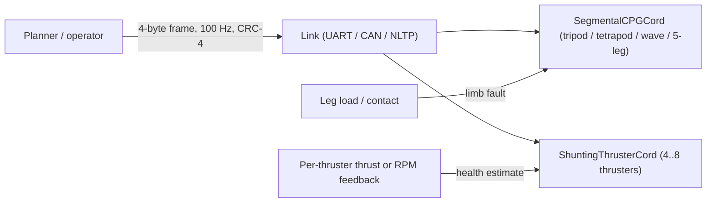

<div align="center">

<a href="https://github.com/indian-aman/necklink"></a>

# NeckCord (`neckcord` v1.1.0)

**A 4-byte motor-command frame, a self-healing six-leg gait generator and a fault-tolerant thruster allocator, modelled on the fruit-fly neck and ventral nerve cord, in Python and zero-heap, zero-float ANSI C99 (`322 B` of state).**

[](https://pypi.org/project/neckcord/)
[](https://pypi.org/project/neckcord/)
[](csrc/)
[](tests/test_neckcord.py)
[](LICENSE)

[**Quick start**](#quick-start) ·
[**Python API**](#python-api) ·
[**C99 core**](#zero-heap-zero-float-ansi-c99-core-csrc) ·
[**Benchmarks**](#benchmarks) ·
[**When to use it**](#when-to-use-neckcord-and-when-not-to) ·
[**Changelog**](#changelog)

</div>

<p align="center">
  
</p>

---

## What it is

In the fruit fly, about 1,300 descending neurons cross the neck and carry compact *intent*: steer, go forward, reverse, freeze. The ventral nerve cord (VNC) turns that intent into rhythm, load monitoring and injury compensation (`BANC` / `MANC` connectomes). NeckCord copies that split for robots:

1. **`neckcord.cervical`: a 4-byte command frame.** Forward drive, yaw, sway, gait mode, a freeze flag, a 2-bit sequence counter and a 4-bit CRC in 32 bits. That is `400 B/s` at 100 Hz, and it decodes identically in Python and C.
2. **`neckcord.cpg.SegmentalCPGCord`: a six-leg gait generator.** Coupled phase oscillators switch between wave, tetrapod and tripod gaits from one drive value. When a leg fails it re-forms a five-leg rhythm (`Δφ = 72°`, duty `0.82`) that keeps the centre of mass inside the support polygon.
3. **`neckcord.allocator.ShuntingThrusterCord`: a fault-tolerant allocator** for 4–8 thrusters. It compares commanded against measured per-thruster thrust to estimate each thruster's health. It cuts drive to a failed thruster (≈ 40 ms in our simulation) and re-solves `W H Wᵀ + λI` so surge, sway and yaw are kept on the survivors.



---

## Quick start

```bash
pip install neckcord
# or from this repository:
pip install "git+https://github.com/indian-aman/necklink.git#subdirectory=packages/neckcord"

neckcord demo                 # codec -> CPG with a jammed leg -> thruster fault isolation
neckcord benchmark-quick      # short USV fault benchmark
```

---

## Python API

### 1. 4-byte command frame (`neckcord.cervical`)

```python
from neckcord import DescendingFrame, GaitMode, encode_descending_4b, decode_descending_4b

tx = DescendingFrame(
    drive_fwd=0.82,     # forward (+1) / reverse (-1)
    turn_yaw=-0.25,     # steering [-1, +1]
    strafe_lat=0.10,    # sway / crab [-1, +1]
    gait_mode=GaitMode.AUTO,
    freeze_reflex=False,
    seq=2,
)

raw = encode_descending_4b(tx)           # b'\x68\xe0\x0c\x20'  (4 bytes)
rx = decode_descending_4b(raw, expected_seq=2)
wrench = rx.to_wrench(max_surge=60.0, max_sway=40.0, max_yaw=25.0)  # [Fx, Fy, Tz]
print(raw.hex(), round(rx.drive_fwd, 3), wrench.round(2))
```

| Bits | Field | Encoding |
| :--- | :--- | :--- |
| `[31:24]` | `drive_fwd` | 8-bit symmetric `-127..+127` (step `0.0079`; exact `0` and `±1`) |
| `[23:16]` | `turn_yaw` | 8-bit symmetric `-127..+127` |
| `[15:9]` | `strafe_lat` | 7-bit symmetric `-63..+63` (step `0.0159`) |
| `[8:7]` | `gait_mode` | `0 AUTO`, `1 TRIPOD`, `2 TETRAPOD`, `3 WAVE` |
| `[6]` | `freeze_reflex` | zero wrench, all legs in stance |
| `[5:4]` | `seq` | 2-bit rolling counter |
| `[3:0]` | `crc4` | `x⁴ + x + 1`, init `0x9`, xorout `0x5` |

What the integrity check does and does not do (measured, and covered by the test suite):
- **Catches:** 100% of single-bit flips, plus the stuck-bus words `0x00000000` and `0xFFFFFFFF`.
- **Misses:** about **4% of 2-bit errors** and **6% of random corrupted words**. Any 4-bit check lets roughly 1 in 16 random corruptions through.
- **What to do:** send frames over a link with its own integrity check, such as NLTP's AEAD, a CAN CRC-15 or a UART frame CRC-16. Treat the CRC-4 as a last-line sanity check.

The 2-bit sequence counter counts lost frames modulo 4, so losing exactly 4 frames in a row is invisible to it. Pair it with a receive timeout.

### 2. Six-leg gait generator (`neckcord.cpg`)

```python
from neckcord import DescendingFrame, SegmentalCPGCord

cpg = SegmentalCPGCord(adapt_to_damage=True)
cmd = DescendingFrame(drive_fwd=0.85)   # fast forward -> tripod; slow -> metachronal wave

for _ in range(100):
    state = cpg.step(cmd, dt=0.01)
print(state.active_gait)                 # tripod

cpg.inject_limb_fault("L2")             # middle-left leg jams mid-stride
for _ in range(100):
    state = cpg.step(cmd, dt=0.01)

assert state.active_gait == "adaptive_pentapod"
assert state.is_statically_stable       # CoM inside the >= 3-leg support polygon
```

### 3. Fault-tolerant thruster allocator (`neckcord.allocator`)

```python
import numpy as np
from neckcord import ShuntingThrusterCord

# 4-thruster X-vectored USV / ROV (0 Port-Fore, 1 Stbd-Fore, 2 Port-Aft, 3 Stbd-Aft)
cord = ShuntingThrusterCord.usv_vectored_4(
    lx=0.45, ly=0.35, cant_deg=45.0, u_max=35.0,
    probe_interval_s=2.0,       # re-test an isolated thruster every 2 s (default: never)
)

w_des = np.array([35.0, 0.0, 0.0])            # pure surge [Fx, Fy, Tz]
alloc = cord.step(w_des, dt=0.02)

# Port-Aft thruster fouled by kelp: it now delivers only 10% of what it is commanded.
# feedback_thrust is per-thruster measured thrust (load cell, or an RPM/current-based estimate).
true_effectiveness = np.array([1.0, 1.0, 0.10, 1.0])
for _ in range(4):
    alloc = cord.step(w_des, feedback_thrust=true_effectiveness * alloc.commands, dt=0.02)

assert alloc.isolated_mask[2] and alloc.commands[2] == 0.0
print(alloc.commands.round(2), alloc.predicted_wrench.round(2))  # surge from the two fore thrusters, no sway or yaw

# Once the prop is cleared, the probe (or cord.reinstate_actuator(2)) returns T2 to service.
```

> [!IMPORTANT]
> Fault detection needs **per-thruster feedback** (`feedback_thrust`: a load cell, or thrust estimated from ESC RPM or current), or a measured body wrench (`measured_wrench`). Without feedback the allocator cannot see a fault; it behaves like a damped pseudo-inverse with manual `set_actuator_health()`.

An isolated thruster is commanded 0 N, so feedback alone can never show that it has recovered. Either:
- set `probe_interval_s` to re-test it periodically. A still-dead thruster is re-isolated within a couple of ticks; in the C self-test it was isolated 489 of 500 ticks with a 2 s probe.
- or call `reinstate_actuator(i)` once you know the fault is cleared.

---

## Zero-heap, zero-float ANSI C99 core (`csrc/`)

[`csrc/neckcord.h`](csrc/neckcord.h) and [`csrc/neckcord.c`](csrc/neckcord.c) implement the codec, the CPG and the allocator in `Q15` / `Q14` / 16-bit BAM integer arithmetic:

- no `malloc` or floating point;
- a 65-entry `Q15` sine table and an exact `int64` 3×3 solver;
- `322 bytes` for all five state and result structs together (`sizeof`, self-test 1);
- byte-identical frames with Python (golden vector `0x68E00C20`);
- the recovery probe: `nc_shunting_set_probe_interval()` and `nc_shunting_reinstate()`.

```bash
make -C csrc clean all test     # gcc -O2 -std=c99 -Wall -Wextra -pedantic -Werror; 11 self-tests
```

---

## Benchmarks

```bash
python scripts/benchmark_neckcord.py     # ~10 s; writes results/benchmark_summary.json and the chart
```

### 1. 4-thruster USV corridor tracking with a thruster fault (`dt = 0.02 s`, 30 s, 10 wave seeds)

A 3-DOF Fossen-style hull follows a waypoint corridor under irregular waves, with the same LOS + PID outer loop for every allocator. At `t = 8 s` the Port-Aft thruster (T2) loses 90% of its thrust. Thrust feedback carries `0.4 N` of noise.

| Metric | Static pseudo-inverse (no fault detection) | **Pseudo-inverse + threshold FDI** (same feedback as NeckCord) | **NeckCord** |
| :--- | :---: | :---: | :---: |
| Intact: RMS cross-track | `0.108 m` | `0.108 m` | `0.109 m` |
| Intact: peak heading error | `4.84° ± 0.94°` | `4.84° ± 0.94°` | `4.81° ± 0.79°` |
| Intact: runs with a false isolation | `0 / 10` | `0 / 10` | `0 / 10` |
| Fault: peak heading error | `24.19° ± 2.28°` | `4.84° ± 0.95°` | `4.77° ± 0.65°` |
| Fault: RMS cross-track | `0.498 m` | `0.116 m` | `0.112 m` |
| Fault: time to isolate T2 | never | `40 ms` | `42 ms` |
| Fault: mean drive sent to dead T2 | `22.70 N` | `0.03 N` | `0.02 N` |

The "threshold FDI" baseline drops a thruster when measured/commanded thrust stays below 0.5 for 3 ticks, then recomputes the pseudo-inverse: about 15 lines of code. **It performs the same as NeckCord.** The 5× heading improvement is real only against an allocator with no fault detection at all. NeckCord's value is a packaged, tested allocator that has:
- graded health, not just on/off;
- yaw/sway-priority desaturation;
- recovery probing;
- a zero-float C99 port.

### 2. Hexapod single-leg jam at fast drive (`0.85`)

Kinematic support-polygon simulation (no rigid-body dynamics): the share of time the centre of mass lies inside the polygon of ≥ 3 grounded feet.

| Condition | Time statically stable | Minimum CoM margin |
| :--- | :---: | :---: |
| Intact six-leg tripod | `100.0%` | `+6.80 cm` |
| L2 jammed, CPG not adapted | `55.0%` | negative (CoM leaves the polygon every half-stride) |
| L2 jammed, NeckCord adaptive | **`100.0%`** | **`+2.24 cm`** |
| Each of the 6 single-leg faults, adaptive | **`100.0%`** | `+1.89 cm` (front legs) to `+2.24 cm` |

### 3. Bandwidth

At 100 Hz the frame is `400 B/s`. That is 6× smaller than sending four `float32` values plus an 8-byte header (`2,400 B/s`). But quantising the same three axes to `int8` would also fit in about 4 bytes. The frame's value is its fixed layout, flags, sequence counter and integrity check, not compression.

---

## When to use NeckCord, and when not to

**Good fit:**
- **4–8 thruster vectored USVs and ROVs with per-thruster feedback** (thrust, RPM or current) that need a fault-tolerant allocator, with a tested C99 port for the flight controller.
- **Compact fixed-format command links**, carried inside an authenticated or CRC-protected transport.
- **Hexapods** that need one-parameter gait changes and a five-leg fallback.

**Use something else when:**
- **You already have FDI plus re-allocation.** As the benchmark shows, a simple threshold detector with a pseudo-inverse performs the same.
- **You have no per-thruster feedback.** No allocator can detect a thruster fault it cannot see.
- **The vessel has two fixed parallel thrusters** and no bow thruster or rudder. Losing one leaves `rank(W) = 1`, and no allocator can produce surge without yaw.
- **Thrusters are unidirectional, or the problem is 6-DOF** with tight actuator bounds. NeckCord assumes bidirectional `[-u_max, +u_max]` thrust in 3-DOF; use a QP allocator (OSQP, proxqp).
- **You need dynamic stability guarantees for a legged robot.** The hexapod results are kinematic support-polygon checks only.

---

## Repository layout

| Path | Contents |
| :--- | :--- |
| [`neckcord/cervical.py`](neckcord/cervical.py) | `DescendingFrame`, `encode_descending_4b`, `decode_descending_4b`, `compute_crc4`, `CervicalBottleneckLink` |
| [`neckcord/cpg.py`](neckcord/cpg.py) | `SegmentalCPGCord` gait generator with five-leg fallback |
| [`neckcord/allocator.py`](neckcord/allocator.py) | `ShuntingThrusterCord` health estimation, shunting, recovery probe, `W H Wᵀ + λI` allocation |
| [`neckcord/cli.py`](neckcord/cli.py) | `neckcord demo`, `neckcord benchmark-quick` |
| [`csrc/`](csrc/) | C99 core and 11 self-tests |
| [`scripts/benchmark_neckcord.py`](scripts/benchmark_neckcord.py) | USV and hexapod benchmark, chart generator |
| [`tests/`](tests/) | 31 tests, including every README example, the probe, the CRC escape rate and C source checks |

---

## Changelog

**1.1.0**
- *New:* recovery probing for isolated thrusters (`probe_interval_s`, `reinstate_actuator()`; C: `nc_shunting_set_probe_interval()`, `nc_shunting_reinstate()`). Before this, a thruster isolated by a transient brownout stayed off for the rest of the mission.
- *Fix:* `CervicalBottleneckLink.pack()` no longer overwrites the caller's `frame.seq`.
- *Benchmark:* added the pseudo-inverse + threshold-FDI baseline and false-isolation counts. 1.0.0 compared only against an allocator with no fault detection. Added the intact hexapod margin (`6.80 cm`; 1.0.0 listed `3.90 cm`, a value from a faulted demo run).
- *Docs:* the CRC-4's multi-bit escape rate, the need for thrust feedback, and the sequence-counter limit are now stated. Every Python example runs as written.

---

## License

Released under the [MIT License](LICENSE). Copyright (c) 2026 Amandeep Singh Bains.
