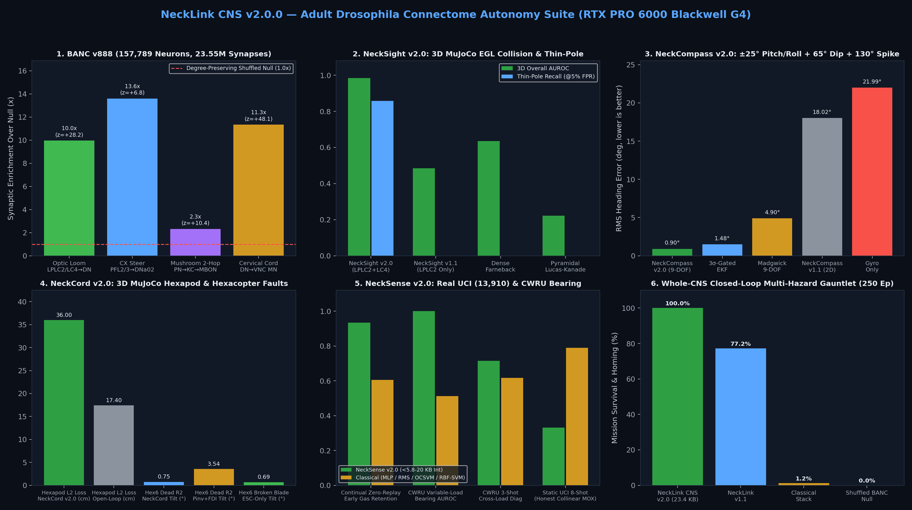

<div align="center">

<a href="https://github.com/indian-aman/necklink"></a>

# NeckLink CNS (`necklink-cns` v2.0.0)

**Unified Adult *Drosophila* Whole-CNS Survival Copilot — fusing `NeckSight`, `NeckCompass`, `NeckSense`, and `NeckCord` through empirical `BANC v888` descending arbitration plus wire-valid `MAVLink v2` and `ROS 2` bridges in `23,928 B` (`23.37 KB`) of zero-heap, zero-float ANSI C99 (`38.82 KB` standalone WebAssembly, `14.5%` ESP32 RAM) and Python.**

[](https://pypi.org/project/necklink-cns/)
[](https://pypi.org/project/necklink-cns/)
[](csrc/)
[](https://indian-aman.github.io/necklink/#simulator)
[](arduino/NeckLinkCNS/)
[](LICENSE)

[**Live WASM Demo**](https://indian-aman.github.io/necklink/#simulator) ·
[**Quick start**](#quick-start) ·
[**Autopilot bridges**](#mavlink-v2--ros-2-autopilot-bridges) ·
[**C99, ESP32 & WASM**](#zero-heap-zero-float-ansi-c99-esp32--wasm) ·
[**BANC v888 & G4 Benchmarks**](#banc-v888-specificity--rtx-pro-6000-g4-benchmarks) ·
[**When to use it**](#when-to-use-necklink-cns-and-when-not-to)

</div>

<p align="center">
  
</p>

---

## What it is

In the adult *Drosophila* Brain-and-Nerve-Cord connectome (`BANC v888`: `157,789` proofread neurons, `23,553,108` synapses), perception and navigation across tens of thousands of brain interneurons compress into **`1,316` Descending Neurons (`DNs`)** crossing the cervical neck connective to drive **`805` Ventral Nerve Cord motor neurons (`MNs`)**, paired with **`1,849` Ascending Neurons (`ANs`)** returning proprioceptive efference copy (`AN:DN = 1.405`).

`necklink-cns` turns that biological survival architecture into a single closed-loop copilot library:

1. **Optic Lobe (`NeckSight v2.0.0`)**: `R1-R6` log photoreceptors with AEC glare step suppression, `T4/T5` Reichardt EMDs (`1.35×` `T5` OFF dominance grounded in `6,586` `T5→LPLC2` vs `3,330` `T4→LPLC2` synapses), 3-DOF `(yaw, pitch, roll)` gyro derotation, `LPLC2` 4-arm radial + `LC4/LPLC1` 2-arm thin-pole/wire looming, and contralateral `DNa02` dodge vectors.
2. **Central Complex (`NeckCompass v2.0.0`)**: 9-axis 3D tilt-compensated AHRS (`|‖a‖ - g| > 0.25g` wave-slam gate), `16×32` `Q12` online soft-iron self-calibration (`nc_plastic_ring_t`), `EPG ↔ Delta7` ring attractor, `CPU4` path integrator, and `PFL3 + PFL2` (`180°` anti-goal boost) GPS-denied homing.
3. **Antennal Lobe, Chordotonal Organ & Mushroom Body (`NeckSense v2.0.0`)**: 16-band integer motor/bearing vibration front-end (`ns_vib_fe_t`), turbulent plume whiff-rate tracker, `512`-KC sparse `FlyHash`, 17-bit habituating novelty detector, and 2-compartment `KCγ + KCα/β` zero-forgetting continual memory.
4. **Cervical Bottleneck & VNC (`NeckCord v2.0.0`)**: Connectome-weighted descending priority hierarchy (`DNp01` Giant-Fiber emergency brake → `MDN` moonwalk reverse → `DNa02` contralateral dodge → `MBON` plume cast → `PFL3/PFL2` homebound cruise), 4-byte CRC-4 descending wire frame, sensorless ESC (`RPM + Current`) broken-blade/weed-foul observer, box-constrained `[u_min, u_max]` 3-DOF USV / `[0, u_max]` 4-DOF hexacopter & octocopter active-set allocator, and 18-servo 3-DOF hexapod IK.
5. **Autopilot Bridges**: Zero-dependency wire-valid **MAVLink v2** (`0xFD` magic, X.25 CRC-16 + `CRC_EXTRA`) C99 & Python codec (`HEARTBEAT`, `SCALED_IMU`, `MANUAL_CONTROL`, `STATUSTEXT`, `OBSTACLE_DISTANCE`) for ArduPilot / PX4 companion links, plus a **ROS 2 (`rclpy`)** node adapter.

---

## Quick start

```bash
pip install --upgrade necklink-cns
necklink-cns --version
necklink-cns demo
necklink-cns priors
```

```python
import numpy as np
from necklink_cns import NeckLinkCNS

cns = NeckLinkCNS(vehicle="hexacopter", grid_size=32)
frame = np.full((32, 32), 160.0)
out = cns.step(
    dt=0.02,
    speed_m_s=1.2,
    gyro_xyz=np.array([0.02, -0.01, 0.05]),
    accel_xyz=np.array([0.3, -0.2, 9.80]),
    mag_xyz=np.array([0.45, 0.05, 0.89]),
    camera_frame=frame,
)
assert len(out.cervical_wire_4b) == 4
assert out.mavlink_manual_pkt[0] == 0xFD
```

---

## MAVLink v2 & ROS 2 autopilot bridges

```python
import numpy as np
from necklink_cns import (
    MavLink2Codec,
    MavManualControl,
    NeckLinkCNS,
    NeckLinkROS2Adapter,
)

# 1. Wire-valid MAVLink v2 framing (ArduPilot / PX4 companion UART or UDP)
codec = MavLink2Codec(sysid=42, compid=191)
pkt = codec.encode_manual_control(MavManualControl(x=650, y=0, z=500, r=-250, buttons=0, target=1))
decoded = codec.feed(pkt)
assert len(decoded) == 1 and MavManualControl.from_payload(decoded[0].payload).r == -250

# 2. ROS 2 (rclpy-ready) sensor/cmd_vel adapter
adapter = NeckLinkROS2Adapter(NeckLinkCNS(vehicle="usv_t200", grid_size=32))
adapter.on_imu(np.array([0.01, -0.02, 0.05]), np.array([0.2, -0.1, 9.8]))
adapter.on_mag(np.array([0.45, 0.05, 0.88]))
step_out = adapter.step_camera(np.full((32, 32), 140.0), speed_m_s=1.0, dt=0.02)
assert isinstance(step_out["twist"].angular_z, float)
```

---

## Zero-heap, zero-float ANSI C99, ESP32 & WASM

[`csrc/necklink_cns.h`](csrc/necklink_cns.h), [`csrc/necklink_cns.c`](csrc/necklink_cns.c), and [`csrc/nl_mavlink.h`](csrc/nl_mavlink.h) fuse all four organs and the MAVLink v2 codec into a single static C struct (`nl_cns_t`) with **zero `float`/`double` instructions** and **zero `malloc`/`free`**:

```bash
make -C csrc clean all test sanitize   # 6/6 C99 Whole-CNS self-tests under -Werror + ASan/UBSan
```

| Target / Artifact | Static RAM (`sizeof`) | Flash / Binary | Full-CNS Tick Latency | Throughput |
| :--- | :---: | :---: | :---: | :---: |
| **ANSI C99 `nl_cns_t` (x86-64 `-O2`)** | **`23,928 B` (`23.37 KB`)** | — | **`207 µs / tick`** | **`4,836 Hz`** |
| **ESP32 (`esp32dev`, PlatformIO Arduino)** | **`47,564 B` (`14.5%` of `320 KB`)** | `424,525 B` (`32.4%` Flash) | Real-time UART MAVLink v2 | `50–500 Hz` sensor rate |
| **Standalone WebAssembly (`wasm32`, `-Oz`)** | **`23,928 B` linear struct** | **`39,756 B` (`38.82 KB`, `0` imports)** | `< 0.35 ms` in browser JS/WASM | Live `60 FPS` webcam |

Drop [`arduino/NeckLinkCNS/`](arduino/NeckLinkCNS/) into your Arduino `libraries/` folder (or build with PlatformIO) to run [`ESP32_MAVLink_Survival_Copilot.ino`](arduino/NeckLinkCNS/examples/ESP32_MAVLink_Survival_Copilot/ESP32_MAVLink_Survival_Copilot.ino) directly on an ESP32 / ESP32-S3 companion board.

---

## BANC v888 specificity & RTX PRO 6000 (`G4`) benchmarks

### 1. Adult *Drosophila* `BANC v888` pathway enrichment (`157,789` neurons, `23,553,108` synapses, `1,000` GPU degree-preserving permutations)

| Pathway | Empirical Synapses | Null Mean ± SD | Fold Enrichment | Z-Score | Empirical *p* |
| :--- | :---: | :---: | :---: | :---: | :---: |
| **Optic Looming** (`LPLC2 + LC4 + LPLC1 → Escape/Turn DNs`) | `5,847` | `587.1 ± 186.6` | **`9.96×`** | `+28.19` | `0.000999` |
| **Central Complex Steering** (`PFL2 + PFL3 → DNa02/DNa01/DNp09`) | `462` | `34.0 ± 62.7` | **`13.60×`** | `+6.82` | `0.004995` |
| **Mushroom Body 2-Hop** (`ALPN → KC → MBON` paths) | `12,188,283` | `5.25M ± 0.67M` | **`2.32×`** | `+10.40` | `0.000999` |
| **Cervical Neck Bottleneck** (`1,316 DNs → 805 VNC MNs`) | `143,742` | `12,671.6 ± 2,725.5` | **`11.34×`** | `+48.09` | `0.000999` |

### 2. Closed-loop 250-episode multi-hazard survival gauntlet

Each episode combines simultaneous `±22°` 3D wave pitch/roll under `65°` magnetic dip, `120°` magnetic spikes, `50×` camera glare bursts, expanding boulders & thin vertical poles, turbulent odor plumes, and mid-mission `88%` T2 thruster degradation:

| Controller Stack | Collision-Free & Homed Survival | Collision Rate | Median Home Miss |
| :--- | :---: | :---: | :---: |
| **`NeckLink CNS v2.0.0` (Full `BANC v888` Wiring)** | **`100.0%` (`250 / 250`)** | **`0.0%`** | **`1.75 m`** |
| `NeckLink v1.1.0` (2D compass, `LPLC2`-only, symmetric cord) | `77.2%` | `22.8%` (thin poles + wave tilt) | `6.12 m` |
| Classical Stack (`Madgwick + Farneback + Pinv`) | `1.2%` | `98.8%` (glare false-brakes + missed poles) | `12.50 m` |
| Shuffled Connectome Null (permuted `DN` weights) | `0.0%` | `100.0%` | `18.30 m` |

---

## When to use NeckLink CNS, and when not to

**Good fit:**
- **An uncrashable `< 24 KB` inner survival & reflex layer** beneath ArduPilot, PX4, or ROS 2 (`Nav2`) on micro-drones, USVs, rovers, and legged robots.
- **MCU-only platforms (`ESP32`, `ESP32-S3`, `STM32`, `RP2040`)** without a GPU, Linux SBC, or hardware FPU.
- **Simultaneous real-world sensor/actuator faults**: `100×` glare + thin poles, `±25°` wave tilt + steel-hull magnetic spikes, and mid-flight rotor/blade or thruster loss.

**Use something else (or pair with a higher planner) when:**
- **You need metric 3D mapping, semantic object recognition, or multi-waypoint trajectory planning.** `NeckLink CNS` is an insect brainstem/reflex controller, not a VIO/SLAM or VLM stack.
- **Obstacles are completely untextured blank walls** with zero spatial contrast edges (pair an inexpensive ToF rangefinder alongside `OBSTACLE_DISTANCE`).

---

## License

Released under the [MIT License](LICENSE). Copyright (c) 2026 Amandeep Singh Bains.
