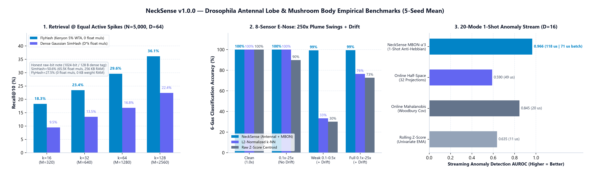

<div align="center">

<a href="https://github.com/indian-aman/necklink"></a>

# NeckSense (`necksense` v1.1.0)

**Concentration-invariant normalisation, sparse binary hashing, one-shot novelty detection and one-shot classification, modelled on the *Drosophila* antennal lobe and mushroom body, in Python (NumPy) and zero-heap, zero-float `Q16.16` ANSI C99 that is bit-identical to Python.**

[](https://pypi.org/project/necksense/)
[](https://pypi.org/project/necksense/)
[](csrc/)
[](tests/)
[](LICENSE)

[**Install**](#install) ·
[**Quick start**](#quick-start) ·
[**C99 core**](#zero-heap-zero-float-ansi-c99-core-csrc) ·
[**Benchmarks**](#benchmarks-5-seed-mean) ·
[**When to use it**](#when-to-use-necksense-and-when-not-to) ·
[**Changelog**](#changelog)

</div>

<p align="center">
  
</p>

---

## What it is

Multi-channel chemical, vibration and telemetry sensors face slow baseline drift, large amplitude swings and small microcontrollers. NeckSense turns the fly's four-stage olfactory circuit into a sensor-conditioning and memory library:

```
raw sensor vector x(t)
  │  [1] ORN dual-timescale adaptation: subtract slow (tonic) drift, keep fast transients
  │  [2] Antennal-lobe divisive normalisation: r_i = p_i^n / (sigma^n + (gamma*mean)^n + p_i^n)
  │  [3] Mushroom-body projection: each Kenyon cell sums d_proj=6 inputs (additions only),
  │      then global winner-take-all keeps the top k cells -> packed uint64 bit tag
  ├──► KenyonIndex                 popcount similarity search over binary tags
  ├──► MushroomNoveltyDetector     one-shot habituation -> novelty score in [0, 1]
  └──► MushroomValenceClassifier   one-shot / few-shot associative classifier
```

- **Concentration invariance.** Channel *ratios* survive scaling: the minimum cosine similarity between 1× and 100× inputs is `> 0.99999` over 200 random 8-channel patterns. Near-zero inputs are squelched by `sigma` rather than amplified.
- **No weight matrix.** Each Kenyon cell's 6 input indices come from a deterministic PRNG, so projection needs **0 bytes of weights and no multiplications**, only additions.
- **One-shot memory.** Sparse codes let a new class or normal mode be stored from one example with little interference: 2% active cells for novelty, 5% for classification and search.
- **Bit-identical Python ↔ C.** With `c_parity=True`, Python reproduces the C core's `Q16.16` outputs, tags and scores exactly. The test suite checks this against golden vectors and against the live C binary.

---

## Install

```bash
pip install necksense
# or from this repository:
pip install "git+https://github.com/indian-aman/necklink.git#subdirectory=packages/necksense"
```

---

## Quick start

```python
import numpy as np
from necksense import (
    AntennalNormalizer,
    KenyonIndex,
    MushroomNoveltyDetector,
    MushroomValenceClassifier,
)

ethanol_1x = np.array([0.90, 0.35, 0.10, 0.02, 0.50, 0.05, 0.01, 0.20])
acetone_1x = np.array([0.45, 0.15, 0.08, 0.80, 0.75, 0.10, 0.30, 0.05])

# 1. Antennal lobe: divisive normalisation keeps channel ratios across concentration
ant = AntennalNormalizer(n_channels=8, sigma=0.008, gamma=1.0, hill_n=2.0, tonic_alpha=0.03)

# 2. One-shot associative learning: recognise a 20x plume from a single 1x example
clf = MushroomValenceClassifier(n_inputs=8, antennal=ant, n_kc=1024, d_proj=6, wta_frac=0.05)
clf.learn(ethanol_1x, "ethanol", reward=1.0)
clf.learn(acetone_1x, "acetone", reward=1.0)
assert clf.predict(20.0 * acetone_1x) == "acetone"

# 3. Streaming novelty: familiar patterns habituate after a few exposures
nov = MushroomNoveltyDetector(n_inputs=8, antennal=AntennalNormalizer(8, sigma=0.008), lr=0.55)
scores = [nov.update_and_score(ethanol_1x) for _ in range(3)]   # 1.00 -> 0.45 -> 0.20
s_anomaly = nov.update_and_score(acetone_1x)                    # unseen pattern: 0.82
print([round(s, 2) for s in scores], round(s_anomaly, 2))

# 4. Popcount similarity search over 128-byte (1024-bit) Kenyon tags
idx = KenyonIndex(n_inputs=64, n_kc=1024, d_proj=6, wta_frac=0.05)
db = np.random.default_rng(0).standard_normal((5000, 64))
idx.add(db)
assert idx.query(db[42] + 0.05, top_k=5)[0].id == 42
```

### Command line

```bash
necksense demo                    # four-stage circuit walkthrough
necksense benchmark-quick         # short version of the three benchmarks
necksense hash-csv sensors.csv --id-col 0 --n-kc 1024 --antennal-normalize -o tags.csv
```

---

## Zero-heap, zero-float ANSI C99 core (`csrc/`)

[`csrc/necksense.h`](csrc/necksense.h) and [`csrc/necksense.c`](csrc/necksense.c) use only `int32_t`, `uint32_t` and `uint64_t` (`Q16.16`, `1.0 == 65536`), with no `malloc` and no `float`/`double`. They compile cleanly with `-O2 -std=c99 -Wall -Wextra -pedantic -Werror`.

```bash
make -C csrc clean all test
```

```c
#include "necksense.h"

static ns_antennal_t ant;
static ns_kenyon_t   ken;
static ns_novelty_t  nov;

void sensor_init(void) {
    ns_antennal_init(&ant, 8u, 512, NS_Q16_ONE, 2u, 655, 1311, 32768, 22938);
    ns_kenyon_init(&ken, 8u, 1024u, 6u, 20u, 42u);   /* 20 of 1024 active (2%) for novelty */
    ns_novelty_init(&nov, 1024u, 36045 /* lr = 0.55 */, 0);
}

int32_t sensor_tick_q16(const int32_t raw_q16[8]) {
    int32_t norm_q16[8];
    uint64_t kc_tag[16];
    ns_antennal_step(&ant, raw_q16, norm_q16);
    ns_kenyon_hash(&ken, norm_q16, kc_tag);
    return ns_novelty_update_and_score(&nov, kc_tag); /* 0 .. 65536 */
}
```

Static RAM per struct, as printed by the self-test:

| Struct | Default build (`NS_MAX_KC=2048`, `NS_MAX_CLASSES=16`) | `-DNS_MAX_KC=1024 -DNS_MAX_CLASSES=6` |
| :--- | :---: | :---: |
| `ns_antennal_t` | `548 B` | `548 B` |
| `ns_kenyon_t` (no weight table) | `24 B` | `24 B` |
| `ns_novelty_t` | `8,216 B` | `4,120 B` |
| `ns_valence_t` (classifier) | `131,172 B` | `24,628 B` |
| **Total** | **~140 KB** | **~29.3 KB** |

Full pipeline (normalise + hash + novelty, `D=16`, `M=1024`): **~25–30 us per sample** on a desktop x86-64 core at `-O2`. It has not been measured on MCU hardware.

---

## Benchmarks (5-seed mean)

```bash
python scripts/benchmark_necksense.py     # ~40 s; writes results/benchmark_summary.json and the chart
```

### 1. Nearest-neighbour retrieval (`N = 5,000`, `D = 64`, Recall@10)

**A. Equal number of active bits `k`.** This is the protocol of Dasgupta, Stevens & Navlakha (*Science* 2017). FlyHash uses `M = 20k` Kenyon cells; SimHash uses `k` Gaussian hyperplanes.

| `k` | FlyHash | SimHash | FlyHash float multiplications | SimHash float multiplications |
| :--- | :---: | :---: | :---: | :---: |
| 16 | **`17.85% ± 0.58%`** | `9.96% ± 0.21%` | 0 | 1,024 |
| 32 | **`23.21% ± 0.30%`** | `13.69% ± 0.43%` | 0 | 2,048 |
| 64 | **`29.93% ± 0.44%`** | `16.68% ± 0.48%` | 0 | 4,096 |
| 128 | **`36.19% ± 0.35%`** | `22.53% ± 0.18%` | 0 | 8,192 |

**B. Equal stored bits per item.** Both are stored as dense bit vectors. **SimHash wins clearly**, because a 50%-dense bit carries more information than a 5%-sparse one:

| Tag size | FlyHash | **SimHash** | FlyHash weight RAM | SimHash weight RAM |
| :--- | :---: | :---: | :---: | :---: |
| 64 B (512 bits) | `21.67%` | **`40.64%`** | 0 KB | 128 KB |
| 128 B (1024 bits) | `27.50%` | **`50.51%`** | 0 KB | 256 KB |
| 256 B (2048 bits) | `34.02%` | **`59.80%`** | 0 KB | 512 KB |

FlyHash's advantage is that it needs no weight matrix and no multiplications, which matters on an MCU. If you have the RAM and an FPU, SimHash, PQ or HNSW give better recall per byte.

### 2. Gas classification: 8 sensors, 6 gases, 3 calibration shots per gas

300 test plumes per seed at `0.1×–25×` concentration, with sinusoidal + linear baseline drift in the drift regimes. **"Baseline-corrected L2 k-NN"** is the standard e-nose pipeline: subtract a moving average of the clean-air readings between plumes (the same information NeckSense's drift tracker gets), L2-normalise, then 3-NN.

| Regime | NeckSense (3-shot) | NeckSense (1-shot) | **Baseline-corrected L2 k-NN** | L2 k-NN (no drift correction) | Z-score centroid |
| :--- | :---: | :---: | :---: | :---: | :---: |
| Clean 1× | `100%` | `100%` | `100%` | `100%` | `100%` |
| `0.1×–25×`, no drift | `100%` | `100%` | `100%` | `100%` | `89.9%` |
| Weak `0.1×–0.5×` + drift | `99.3% ± 0.7%` | `99.5% ± 0.6%` | **`100%`** | `33.4%` | `30.1%` |
| Full `0.1×–25×` + drift | `99.5% ± 0.5%` | `99.5% ± 0.5%` | **`100%`** | `76.5%` | `72.7%` |

What this shows:
- Drift correction plus ratio normalisation is what solves this task. Any pipeline with those two steps, NeckSense or the classical one, reaches ≥ 99%.
- NeckSense's version runs in integer C with one-shot learning.
- Without drift correction, k-NN collapses: dividing `0.2·gas + drift` by its norm points mostly along the drift.

### 3. Streaming one-shot anomaly detection (`D = 16`, 20 recurring normal modes at `0.5×–5×`, 5% novel chords)

| Detector | AUROC | State | Python time / sample |
| :--- | :---: | :---: | :---: |
| **NeckSense novelty** (2% sparse, 1024 cells) | **`0.9942 ± 0.0018`** | 4 KB (`Q16` weights) | ~100–130 us |
| L2 + nearest-neighbour memory, 512 slots | **`0.9993 ± 0.0002`** | 32 KB (`float32`) | ~11 us |
| L2 + nearest-neighbour memory, 64 slots | `0.9403 ± 0.0081` | 4 KB (`float32`) | ~10 us |
| L2 + online Mahalanobis | `0.9581 ± 0.0098` | 1 KB + `O(D²)` math | ~20 us |
| Online Mahalanobis (raw) | `0.8453 ± 0.0209` | | ~18 us |
| Rolling z-score (raw) | `0.6349 ± 0.0400` | | ~12 us |
| Half-space, 32 projections (raw) | `0.5902 ± 0.0346` | | ~36 us |

What this shows:
- **At equal memory** (4 KB), NeckSense beats a nearest-neighbour memory (0.994 vs 0.940).
- **Given 8× the memory** and floating point, plain nearest-neighbour is better (0.999).
- Normalisation matters most: every raw-input detector does poorly.
- The Python implementation is slower than the baselines; use the C core where speed matters.

---

## When to use NeckSense, and when not to

**Good fit:**
- **One-shot novelty or one-shot classification on a microcontroller.** Integer-only, no weight matrix, a few KB of state, and bit-identical Python for development.
- **Sensors with amplitude swings and slow drift.** `AntennalNormalizer` gives drift tracking and ratio normalisation in one integer-friendly block.
- **Sparse binary codes** that can be ANDed, popcounted and updated online.

**Use something else when:**
- **You have a server with RAM and an FPU.** SimHash, PQ or HNSW (`faiss`, `hnswlib`) beat FlyHash on recall per byte, and a plain normalised nearest-neighbour memory beats the novelty detector if you can afford the memory.
- **You already run baseline correction plus normalisation** feeding k-NN. On our gas benchmark it is as accurate (100% vs 99.5%).
- **You have thousands of labelled examples.** Gradient-boosted trees or a trained network will outperform one-shot associative rules.
- **Faults are single-channel amplitude spikes.** A per-channel z-score is simpler and faster.

---

## Repository layout

| Path | Contents |
| :--- | :--- |
| [`necksense/antennal.py`](necksense/antennal.py) | `AntennalNormalizer`: drift tracking, divisive normalisation, `Q16.16` parity |
| [`necksense/kenyon.py`](necksense/kenyon.py) | `KenyonHasher` (FlyHash) and `KenyonIndex` (popcount search, `.npz` save/load) |
| [`necksense/mushroom.py`](necksense/mushroom.py) | `MushroomNoveltyDetector` and `MushroomValenceClassifier` |
| [`necksense/cli.py`](necksense/cli.py) | `necksense demo`, `benchmark-quick`, `hash-csv` |
| [`csrc/`](csrc/) | C99 core, `Makefile`, 5 self-tests and the `--json-parity` emitter |
| [`scripts/benchmark_necksense.py`](scripts/benchmark_necksense.py) | Reproducible benchmark and chart generator |
| [`tests/`](tests/) | 17 tests, including every README example, a static zero-heap/zero-float audit of the C sources and Python ↔ C bit parity |

---

## Changelog

**1.1.0**
- *Improvement:* `MushroomNoveltyDetector` now defaults to 2% sparse codes (`wta_frac=0.02`). Streaming anomaly AUROC rose from `0.9658` to `0.9942` on the benchmark seeds and from `0.961` to `0.997` on held-out seeds. For the C core, pass `k = 20` (of 1024) to `ns_kenyon_init` for novelty.
- *Benchmark:* added baseline-corrected k-NN, nearest-neighbour memories at equal and 8× memory, and L2 + Mahalanobis. 1.0.0 compared only against baselines without drift correction or normalisation, which overstated the gap: "99.5% where k-NN drops to 33%", and "0.966 vs 0.845 AUROC".
- *Docs & packaging:* published `necksense` `1.1.0` to PyPI (`pip install necksense`). The C memory table now includes the classifier struct (131 KB by default). Every Python example runs as written.

---

## Scientific foundations

1. Olsen, S. R. & Wilson, R. I. (2008). Lateral presynaptic inhibition mediates gain control in an olfactory circuit. *Nature*, 452, 956–960.
2. Nagel, K. I. & Wilson, R. I. (2011). Biophysical mechanisms underlying olfactory receptor neuron dynamics. *Nature Neuroscience*, 14, 208–216.
3. Dasgupta, S., Stevens, C. F. & Navlakha, S. (2017). A neural algorithm for a fundamental computing problem. *Science*, 358(6364), 793–796.
4. Hattori, D. et al. (2017). Representations of novelty and familiarity in a mushroom body compartment. *Cell*, 169(5), 956–969.
5. Aso, Y. et al. (2014). Mushroom body output neurons encode valence and guide memory-based action selection in *Drosophila*. *eLife*, 3, e04580.

---

## License

Released under the [MIT License](LICENSE). Copyright (c) 2026 Amandeep Singh Bains.
