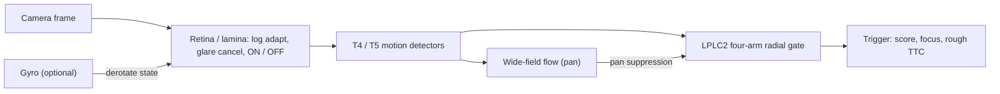

<div align="center">

<a href="https://github.com/indian-aman/necklink"></a>

# NeckSight (`necksight` v1.1.0)

**A collision (looming) reflex for moving cameras, modelled on the *Drosophila* optic lobe (`T4/T5` motion detectors + `LPLC2` looming neurons), in Python (NumPy) and zero-heap, zero-float ANSI C99 (`14.3 KB` state).**

[](https://pypi.org/project/necksight/)
[](https://pypi.org/project/necksight/)
[](csrc/)
[](tests/test_necksight.py)
[](LICENSE)

[**Quick start**](#quick-start) ·
[**Turning platforms**](#turning-platforms-feed-the-gyro) ·
[**C99 core**](#zero-heap-zero-float-ansi-c99-core-csrc) ·
[**Benchmarks**](#benchmarks) ·
[**When to use it**](#when-to-use-necksight-and-when-not-to) ·
[**Changelog**](#changelog)

</div>

<p align="center">
  
</p>

---

## What it is

Cheap collision triggers on moving robots fail in two ways:
- **Brightness changes:** frame differencing fires on every sunlight step.
- **Camera rotation:** optical-flow divergence fires on every fast camera turn.

NeckSight copies how the fly separates *something is coming at me* from *I am turning*:

1. **`RetinaLaminaPreproc`.** Downsamples any `H×W` (or RGB) frame to a 32×32 or 64×64 grid. It applies log photoreceptor adaptation, cancels global brightness steps (median of the log change), and splits the signal into ON (brightening) and OFF (darkening) channels.
2. **`T4T5MotionEngine`.** Four-direction elementary motion detectors (correlation with null-direction inhibition) on the ON and OFF channels, plus wide-field flow summaries (`vx`, `vy`, yaw, divergence).
3. **`LPLC2LoomingReflex`.** At each location and scale, it takes the geometric mean of outward motion in the four arms of a cross: `(Q_L·Q_R·Q_U·Q_D)^¼`. A pan or passing object leaves at least one arm empty; an expanding object fills all four. Wide-field pan suppression and a leaky "giant fiber" integrator give the trigger, a focus of expansion and a rough time-to-contact.
4. **Gyro derotation (new in 1.1.0).** Give the pipeline the image shift caused by camera rotation, and it keeps detecting obstacles *while* the platform turns. See below.



---

## Quick start

```bash
pip install necksight
# or from this repository:
pip install "git+https://github.com/indian-aman/necklink.git#subdirectory=packages/necksight"
```

```python
import numpy as np
from necksight import NeckSightPipeline, gyro_to_shift_px

pipe = NeckSightPipeline(grid_size=64, threshold=0.045)

# Synthetic stand-in for a camera: textured background with a dark disc approaching.
rng = np.random.default_rng(0)
background = rng.uniform(60, 200, size=(240, 320)).astype(np.float32)
yy, xx = np.mgrid[0:240, 0:320]
for t in range(36):
    radius = 10.0 / max((36 - t) / 60.0, 0.025)           # hyperbolic growth toward impact
    frame = np.where(np.hypot(xx - 160, yy - 120) < radius, 15.0, background)

    # From your IMU: body yaw/pitch rates (rad/s). Here the camera is not rotating.
    shift = gyro_to_shift_px(yaw_rate_rad_s=0.0, pitch_rate_rad_s=0.0, dt=1 / 60,
                             hfov_deg=70.0, grid_width=64)
    trig = pipe.step(frame, dt=1 / 60, ego_shift_px=shift)
    if trig.triggered:
        print(f"collision warning at frame {t}: score={trig.looming_score:.3f}, "
              f"ttc~{trig.est_ttc_s:.2f}s, focus={tuple(round(v, 1) for v in trig.focus_xy)}")
        break
```

Stage by stage, with an out-of-line reflex message (for example `pynltp`'s `send_reflex`):

```python
import numpy as np
from necksight import RetinaLaminaPreproc, T4T5MotionEngine, LPLC2LoomingReflex, attach_nltp_reflex

retina = RetinaLaminaPreproc(grid_size=64)
emd = T4T5MotionEngine(grid_size=64)
lplc2 = LPLC2LoomingReflex(grid_size=64)

class PrintClient:  # stands in for a pynltp client: anything with .send_reflex(msg)
    def send_reflex(self, msg):
        print("reflex sent:", msg)

attach_nltp_reflex(PrintClient(), msg="LOOM_ESTOP", detector=lplc2)

frame = np.random.default_rng(1).uniform(0, 255, size=(120, 160))
lamina_out = retina.step(frame, dt=1 / 60)
motion_out = emd.step(lamina_out)
vx, vy, yaw_pan, radial_div = motion_out.lptc   # wide-field flow summary
trigger = lplc2.step(motion_out, dt=1 / 60)
```

```bash
necksight demo                     # grating, fast yaw pan, 100x glare, looming
necksight benchmark-quick --json
```

### Turning platforms: feed the gyro

Without rotation information, NeckSight avoids false alarms during turns by suppressing looming responses while the whole image is moving. That also suppresses **real** obstacles. On our yaw-oscillation benchmark (below), plain NeckSight detects:
- **81%** of approaching obstacles at 3 px/frame peak yaw;
- **56%** at 4 px/frame.

Passing `ego_shift_px` from a gyro (`gyro_to_shift_px(yaw_rate, pitch_rate, dt, hfov_deg, grid_width)`) shifts the internal state to cancel the rotation. Detection is then **100%** at every yaw rate tested, still with no false alarms. If your platform turns quickly, feed the gyro.

Don't try to estimate the shift from the images instead (for example by phase correlation). We tried it: the approaching obstacle itself biases the estimate.

---

## Zero-heap, zero-float ANSI C99 core (`csrc/`)

[`csrc/necksight.h`](csrc/necksight.h) and [`csrc/necksight.c`](csrc/necksight.c) run the 32×32 pipeline in integers only:
- a `Q8` log lookup and a lattice-median glare filter;
- an integer summed-area table and integer square roots;
- no `malloc` and no floating point;
- `sizeof(necksight_state_t) = 14,616 B`, checked at compile time to stay under 16 KB.

`necksight_step_frame_u8()` box-downsamples a QVGA or VGA `uint8_t` camera buffer in the same call.

```c
#include "necksight.h"

static necksight_state_t optic_lobe;

/* 90 deg lens on the 32-px grid: focal = 16 / tan(45 deg) = 16 px = 256 in Q4 */
#define FOCAL_PX_Q4 256U

void setup_vision(void) {
    necksight_init(&optic_lobe);
}

/* Returns 1 when a looming obstacle is detected. yaw/pitch rates in mrad/s from the IMU. */
int on_camera_frame(const uint8_t *fb, uint16_t h, uint16_t w,
                    int32_t yaw_mrad_s, int32_t pitch_mrad_s, uint16_t dt_ms) {
    necksight_result_t res;
    necksight_shift_state(&optic_lobe,
                          necksight_gyro_to_shift_q4(yaw_mrad_s, dt_ms, FOCAL_PX_Q4),
                          necksight_gyro_to_shift_q4(pitch_mrad_s, dt_ms, FOCAL_PX_Q4));
    necksight_step_frame_u8(&optic_lobe, fb, h, w, w, dt_ms, &res);
    return res.triggered; /* also: res.focus_x, res.focus_y, res.est_ttc_ms */
}
```

```bash
make -C csrc clean all test        # -O2 -std=c99 -Wall -Wextra -pedantic -Werror
```

The self-test covers a translating grating, a fast pan, 20× brightness steps, dark and bright looming discs, a QVGA buffer, throughput, and test (g). In (g) an obstacle approaches during ±3 px/frame yaw: it is **missed without derotation and caught with it**, with no false triggers on the pan alone. Measured throughput is ~11,000–13,000 frames/s on a desktop x86-64 core at `-O2`. It has not been measured on an ESP32 or other MCU.

---

## Benchmarks

```bash
python scripts/benchmark_necksight.py    # ~45 s; needs matplotlib, make and a C compiler
```

> [!NOTE]
> All benchmark sequences are **synthetic**: procedurally generated clutter, discs and glare (`build_benchmark_dataset()`), not camera footage. NeckSight's thresholds were developed on this generator. On four freshly seeded datasets from the same generator it still scored AUROC 1.0, but real footage may differ.

### 1. Looming vs. hard negatives (64×64, 60 Hz, 60 sequences)

24 approaching obstacles (dark, bright, textured, off-centre) against 36 hard negatives:
- 12 fast camera pans (1.8–4.2 px/frame);
- 12 glare steps (15–100×);
- 12 receding or crossing objects.

"FAR @ 95% TPR" uses, for each detector, the threshold that catches 95% of the obstacles.

| Detector | AUROC | FAR @ 95% TPR | Yaw/glare FAR @ 95% TPR | Mean warning before impact | Python FPS (64×64) |
| :--- | :---: | :---: | :---: | :---: | :---: |
| **NeckSight** | **`0.9988`** | **`0.0%`** | **`0.0%`** | **`403 ms`** | ~700 |
| Pyramidal LK (3 levels) + gain normalisation + ego-motion compensation | `0.8750` | `41.7%` | `62.5%` | `199 ms` | ~170–200 |
| Ungated EMD (NeckSight without the LPLC2 gate) | `0.6100` | `55.6%` | `50.0%` | `343 ms` | ~1,200 |
| Single-scale Lucas-Kanade divergence | `0.5220` | `55.6%` | `83.3%` | `186 ms` | ~700 |
| Frame-difference energy | `0.3530` | `66.7%` | `100%` | `215 ms` | ~41,000 |

At NeckSight's fixed default threshold (`0.045`), it caught 24/24 obstacles with 1 false alarm in 36 negatives (2.8%).

### 2. Looming during yaw oscillation (new in 1.1.0)

A camera oscillating in yaw (24-frame period), with an obstacle moving with the scene, `σ = 4` image noise, and 16 sequences per row. The figures are detection and false-alarm rates at the default threshold:

| Peak yaw rate | Detected, no gyro | **Detected, gyro derotation** | False alarms, pan only (both) |
| :---: | :---: | :---: | :---: |
| 0–2 px/frame | `100%` | **`100%`** | `0%` |
| 3 px/frame | `81%` | **`100%`** | `0%` |
| 4 px/frame | `56%` | **`100%`** | `0%` |

### 3. Where NeckSight loses: slow sub-pixel speed

| Task | Lucas-Kanade | NeckSight T4/T5 |
| :--- | :---: | :---: |
| Translational speed MAE, 0.05–0.35 px/frame, varying contrast | **`0.055 px/frame`** | `0.133 px/frame` |

Correlation-type motion detectors mix speed with contrast and spatial frequency. For metric odometry use Lucas-Kanade or a VIO stack.

---

## When to use NeckSight, and when not to

**Good fit:**
- **A cheap, CPU-only collision reflex** for drones, boats, rovers or mast cameras. Brightness steps and camera turns are the main false-alarm sources, and you can feed it a gyro.
- **Microcontrollers** with tens of KB of RAM: 14.3 KB of state, no heap and no floating point.
- **A fast safety layer** in front of heavier perception (stereo, LiDAR, a CNN).

**Use something else, or add something, when:**
- **The platform turns fast and you have no gyro.** Detection drops to 56–81% at 3–4 px/frame of yaw. Feed `ego_shift_px`.
- **You need metric velocity or odometry.** Lucas-Kanade is 2.4× more accurate at slow sub-pixel speeds.
- **The obstacle is static and the camera is too.** With no change in the image there is no signal.
- **The obstacle is thin and only expands in one axis** (a wire). The four-arm gate needs outward motion in all four directions.
- **You need accurate time-to-contact.** The TTC output is a rough estimate (in the quick-start example: 0.22 s reported vs 0.32 s true).
- **It has not been validated on your camera.** All numbers here come from synthetic sequences. Collect your own footage before relying on it for safety.

---

## Repository layout

| Path | Contents |
| :--- | :--- |
| [`necksight/retina.py`](necksight/retina.py) | `RetinaLaminaPreproc` |
| [`necksight/emd.py`](necksight/emd.py) | `T4T5MotionEngine`, `MotionOutput` |
| [`necksight/looming.py`](necksight/looming.py) | `LPLC2LoomingReflex`, `NeckSightPipeline`, `GiantFiberTrigger`, `attach_nltp_reflex` |
| [`necksight/egomotion.py`](necksight/egomotion.py) | `gyro_to_shift_px`, `shift_grid` (derotation) |
| [`necksight/cli.py`](necksight/cli.py) | `necksight demo`, `necksight benchmark-quick` |
| [`csrc/`](csrc/) | C99 core and self-test |
| [`scripts/benchmark_necksight.py`](scripts/benchmark_necksight.py) | Benchmark and chart generator |
| [`tests/test_necksight.py`](tests/test_necksight.py) | 21 tests, including derotation during yaw oscillation |

---

## Changelog

**1.1.0**
- *Safety fix:* gyro derotation (`ego_shift_px`, `gyro_to_shift_px`; C: `necksight_shift_state`, `necksight_gyro_to_shift_q4`). Before this, a fast-turning platform could miss up to half of approaching obstacles, because pan suppression hid them along with the false alarms. The 1.0.0 benchmark never tested a collision during a turn.
- *Benchmark:* added a pyramidal Lucas-Kanade baseline with gain normalisation and ego-motion compensation, and the yaw-oscillation scenario.
  - C99 metrics are now measured locally. The old script only ran the C binary via `wsl.exe` and otherwise fell back to hard-coded numbers.
  - Fixed a crash in the dataset generator for some seeds.
- *Docs:* the synthetic-data caveat, the default-threshold false-alarm rate (2.8%), and runnable examples.

---

## References

1. Maisak, M. S. et al. (2013). A directional tuning map of *Drosophila* elementary motion detectors. *Nature*, 500, 212–216.
2. Haag, J., Mishra, A. & Borst, A. (2017). A common directional tuning mechanism of *Drosophila* motion-sensing neurons in the ON and in the OFF pathway. *eLife*, 6, e29044.
3. Klapoetke, N. C. et al. (2017). Ultra-selective looming detection from radial motion opponency. *Nature*, 551, 237–241.
4. Ache, J. M. et al. (2019). Neural basis for looming size and velocity encoding in the *Drosophila* giant fiber escape pathway. *Current Biology*, 29(6), 1073–1081.

---

## License

Released under the [MIT License](LICENSE). Copyright (c) 2026 Amandeep Singh Bains.
