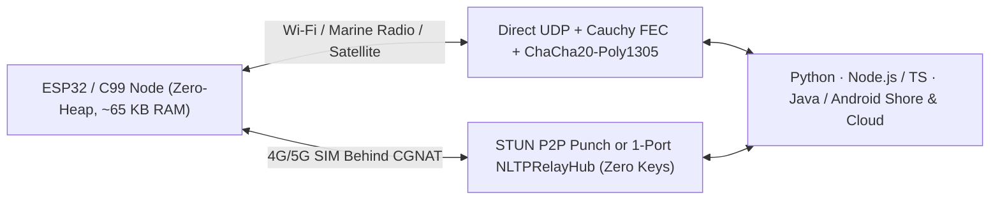

<div align="center">

<a href="https://github.com/indian-aman/necklink"></a>

# NLTP (`pynltp` v1.3.2)

**Loss-resilient, ChaCha20-Poly1305 encrypted file, telemetry and reflex transport with `GF(2^8)` Cauchy FEC: over UDP (including 4G CGNAT traversal) or directly over ESP-NOW between ESP32s, in Python, zero-heap ANSI C99, JavaScript/TypeScript, Java and Arduino/ESP32.**

*The wire protocol of [**NeckLink**](https://github.com/indian-aman/necklink), modelled on the fruit-fly cervical connective: the neck bottleneck that carries every command between brain and body.*

[](https://pypi.org/project/pynltp/)
[-0EA5E9?style=flat-square)](#changelog)
[](scripts/multilang_interop_test.py)
[](arduino/NLTP/)
[](LICENSE)

[**NLTP Wire Protocol**](#why-nltp) ·
[**30-Second Quick Start**](#-30-second-quick-start) ·
[**JavaScript / TS**](#2-javascript--typescript-nodejs--browser--webrtc) ·
[**Java 11+ / Android**](#3-java-11--android-ionecklinknltp) ·
[**Arduino / ESP32**](#4-arduino-ide--platformio-esp32) ·
[**ESP-NOW**](#7-nltp-over-esp-now-esp32-to-esp32-no-router) ·
[**Benchmarks**](#-post-upgrade-benchmarks--hardware-verification) ·
[**All NeckLink products**](https://github.com/indian-aman/necklink#products)

</div>

---

<p align="center">
  
</p>

---

## Why NLTP?

Standard `TCP` and `QUIC` stall on bursty wireless fades, while raw microcontroller protocols like `ESP-NOW` cannot cross routers/SIM cards or reassemble multi-kilobyte files when chunks drop. **NLTP v1.2** bridges embedded hardware, mobile/web gateways, and cloud/shore software with a single encrypted, FEC-protected UDP wire format:

- **Survives `20%` Packet Loss & Bursty Fades**: Systematic `GF(2^8)` Cauchy forward error correction (8-shard generations + incremental Gauss-Jordan decoding) reconstructs lost packets without waiting for round-trip retransmission timeouts.
- **1-RTT Bottleneck Pacing**: Adaptive BBR-style delivery-rate and packet-train probing learns link capacity in a single round trip without overflowing router queues.
- **One Wire Format Across 5 Platforms (`ESP32` / C99 ↔ Python ↔ JavaScript/TS ↔ Java)**: Zero-malloc ANSI C99 (`~65 KB` RAM on `ESP32`) talks two-way (`tx` + `rx` on one UDP port) directly to Python, Node.js/Browser, and Java/Android endpoints, verified by `ChaCha20-Poly1305` (256-bit AEAD), `RFC 6479` replay protection, and end-to-end `SHA-256` receipts (`216/216` cross-language checks verified).
- **Built-In NAT & Carrier CGNAT Traversal**: `RFC 5389` STUN discovery, low-TTL (`TTL=2`) direct UDP hole-punching, keepalives, and automatic 3-second fallback to a zero-knowledge 1-port UDP relay (`NLTPRelayHub`).



---

## ⚡ 30-Second Quick Start

### 1. Python (`pynltp` — `import nltp` / `import pynltp` + `nltp` CLI)

Install on Windows, Linux, or macOS via `pip`:

```bash
pip install "git+https://github.com/indian-aman/necklink.git#subdirectory=packages/nltp"   # 1.3.2 (this repo)
pip install pynltp                                                                           # 1.3.1 on PyPI
```

> [!NOTE]
> 1.3.2 is not published yet. PyPI's 1.3.1 and the v1.2.0 release assets (JS tarball, Java JAR, Arduino zip) work, but lack the 1.3.2 C/ESP32 receive-stall fix and the ESP-NOW transport fixes. Each section below shows how to install 1.3.2 from this repository; [`docs/INSTALL_AND_PYPI.md`](docs/INSTALL_AND_PYPI.md) has the details.

Send an urgent command (`send_reflex`, confirmed with `wait_reflex_ack`) and a `SHA-256`-verified encrypted file in 10 lines:

```python
from nltp import NLTPServer, NLTPClient, generate_nltp_key

key = generate_nltp_key()  # 256-bit ChaCha20-Poly1305 key

with NLTPServer(("0.0.0.0", 9000), save_dir="./inbox", psk=key) as srv:
    with NLTPClient(("127.0.0.1", 9000), psk=key, max_tx_kbps=10_000) as cli:
        seq = cli.send_reflex("ESTOP_CHECK")           # Bypasses the file queue; resent until acked
        assert cli.wait_reflex_ack(seq, timeout=3.0)   # True once the server confirmed it
        receipt = cli.send_file("mission_log.bin")     # Cauchy FEC + SHA-256 verified
        assert receipt["verified_sha256"] is True
```

Or run directly from the terminal:

```bash
nltp gen-key
nltp stun
nltp serve --host 0.0.0.0 --port 9000 --psk "<KEY>" --save-dir ./inbox
nltp send-file --host <SERVER_IP> --port 9000 --psk "<KEY>" --file firmware.bin
```

---

### 2. JavaScript & TypeScript (Node.js / Browser / WebRTC)

Zero external dependencies (`ESM` + `CommonJS` + `.d.ts` TypeScript types + `nltp/core` for WebRTC / WebTransport):

```bash
npm install /path/to/necklink/packages/nltp/js      # 1.3.2 from a clone of this repository
```

```javascript
import { NLTPServer, NLTPClient, generateNltpKey } from 'nltp';

const key = generateNltpKey();
const srv = await NLTPServer.listen({ host: '0.0.0.0', port: 9000, psk: key, saveDir: './inbox' });
const cli = await NLTPClient.connect({ host: '127.0.0.1', port: 9000, psk: key, maxTxKbps: 10_000 });

await cli.sendReflex('ESTOP_CHECK');
const receipt = await cli.sendFile('mission_log.bin');
console.log('Verified SHA-256:', receipt.verifiedSha256);

await cli.close();
await srv.close();
```

---

### 3. Java 11+ & Android (`io.necklink:nltp`)

Zero external dependencies — includes portable constant-time `RFC 8439` `ChaCha20-Poly1305` and non-blocking NIO `DatagramChannel` (`--release 11`). Build with `mvn -f java/pom.xml package` (→ `java/target/nltp-1.3.2.jar`) or Gradle:

```java
import io.necklink.nltp.*;
import java.nio.charset.StandardCharsets;
import java.nio.file.Paths;

String key = NLTPWire.generateNltpKey();
try (NLTPServer srv = NLTPServer.builder().bind("0.0.0.0", 9000).psk(key).saveDir(Paths.get("./inbox")).build();
     NLTPClient cli = NLTPClient.builder().server("127.0.0.1", 9000).psk(key).maxTxKbps(10_000.0).build()) {
    cli.sendReflex("ESTOP_CHECK".getBytes(StandardCharsets.UTF_8));
    TransferReceipt receipt = cli.sendFile(Paths.get("mission_log.bin"), 60_000L);
    assert receipt.verifiedSha256();
}
```

---

### 4. Arduino IDE & PlatformIO (`ESP32`)

- **Arduino IDE (`.ZIP`)**: zip the library folder (`cd packages/nltp/arduino && zip -r NLTP-Arduino-1.3.2.zip NLTP`) → **Sketch → Include Library → Add .ZIP Library...** → open **File → Examples → NLTP** (`ESP32_Encrypted_Receiver`, `ESP32_Marine_Buoy_Sender`, `ESP32_Relay_CGNAT_Node`, `ESPNowV2Interop`, and the real-project pair `ESP32_ESPNow_Sensor_Node` + `ESP32_ESPNow_Gateway`).
- **PlatformIO (`platformio.ini`)**, pointing at your clone:
  ```ini
  lib_deps =
      symlink://../necklink/packages/nltp/arduino/NLTP
  ```
- `NLTPWiFiNode` (UDP) works on any Arduino-ESP32 core; `NLTPESPNowNode` (ESP-NOW) needs core 3.x (ESP-IDF 5.x).

Minimal two-way encrypted `ESP32` sketch (`#include <NLTP.h>`):

```cpp
#include <WiFi.h>
#include <NLTP.h>

NLTPWiFiNode nltp;
uint8_t telemetryBatch[2048];

void setup() {
  WiFi.begin("YOUR_WIFI", "YOUR_PASS");
  while (WiFi.status() != WL_CONNECTED) delay(250);

  nltp.begin(9700, "shared-256bit-key-or-passphrase");
  nltp.setPeer(IPAddress(192, 168, 1, 100), 9700);     // Python laptop / shore server
}

void loop() {
  nltp.poll();                                         // Drives both TX pacing & RX FEC decoding

  if (nltp.hasReceivedFile() && nltp.isReceivedShaOk()) {
    // Handle command/config received from Python server (nltp.receivedData(), nltp.receivedLength())
    nltp.clearReceived();
    nltp.sendBytes(telemetryBatch, sizeof(telemetryBatch), "buoy_batch.bin");
  }
}
```

---

### 5. Traverse `4G`/`5G` Carrier CGNAT in 3 Commands

When both sender and receiver sit behind carrier NAT/firewalls with no public IP or port forwarding, run `nltp relay` on any tiny 1-port VPS (holds **zero keys**, sees only `ChaCha20-Poly1305` ciphertext):

```bash
# 1. Public 1-port relay VM:
nltp relay --host 0.0.0.0 --port 9000

# 2. Shore receiver behind Office NAT:
nltp serve --relay <RELAY_IP>:9000 --room buoy-01 --psk "<KEY>" --save-dir ./inbox

# 3. Field / buoy sender behind 4G SIM CGNAT (Python or ESP32 beginRelay()):
nltp send-file --relay <RELAY_IP>:9000 --room buoy-01 --psk "<KEY>" --file sensor_batch.bin
```

---

### 6. Portable Zero-Heap ANSI C99 Core (`csrc/`)

The core (`nltp_core`, `nltp_net`, `nltp_sha256`, `nltp_wire.h`) compiles cleanly under `-std=c99 -Wall -Wextra -pedantic -Werror` with **zero `malloc`** and **zero floating-point operations**. (The optional ESP-NOW helper `nltp_espnow.h` allocates a receive buffer only if you don't pass one.)

```bash
make -C csrc all test          # 14 self-tests: crypto, FEC, loss, tampering, replay, stream takeover, ESP-NOW v1 sizes
make -C csrc espnow-sim        # ESP-NOW hub on a simulated radio (no ESP32 needed)
python scripts/c_interop_test.py
```

Direct STUN hole-punching with automatic 3-second relay fallback from the C CLI:

```bash
./csrc/build/nltp_cli recv 0.0.0.0 0 ./out.bin \
  --psk "<KEY>" --stun stun.cloudflare.com:3478 --punch --relay <RELAY_IP>:9000 --room buoy-01

./csrc/build/nltp_cli send 0.0.0.0 0 ./firmware.bin \
  --psk "<KEY>" --stun stun.cloudflare.com:3478 --punch --relay <RELAY_IP>:9000 --room buoy-01
```

---

### 7. NLTP over ESP-NOW (ESP32 to ESP32, no router)

`csrc/nltp_espnow.h` (C, ESP-IDF 5.x) and `NLTPESPNowNode` (Arduino, core 3.x) carry unmodified NLTP datagrams inside ESP-NOW frames. That gives ESP-NOW what it lacks on its own: multi-KB files, FEC repair, SHA-256 verification and ChaCha20-Poly1305 encryption. The same bytes can be bridged to Python, C or a relay room.

- **ESP-NOW v2 (1,470 B frames):** full 960 B shards; an encrypted shard is 1,010 B on air.
- **ESP-NOW v1 (250 B frames):** call `setEspNowV1Mode(true)` (Arduino) / `nltp_espnow_node_set_v1_mode()` (C) to send 192 B shards (242 B frames). Receivers detect the sender's shard size automatically. A C sender in this mode was verified against the Python, C, JS and Java receivers (48/48 transfers, 0–15% loss, 1 KB–300 KB).

```cpp
#include <NLTP.h>   // Arduino-ESP32 core 3.x

NLTPESPNowNode node;
const uint8_t hubMac[6] = {0x24, 0x0A, 0xC4, 0x00, 0x00, 0x01};
uint8_t batch[4096];

void setup() {
  node.begin(1 /* Wi-Fi channel */, "shared-256bit-key-or-passphrase");
  // node.setEspNowV1Mode(true);  // only if a peer is limited to 250 B ESP-NOW v1 frames
  node.setPeerMac(hubMac);
}

void loop() {
  node.poll();
  // node.sendBytes(batch, sizeof(batch), "batch.bin");  -> FEC-protected, SHA-256-verified delivery
}
```

**Multi-sensor hub (C, `nltp_espnow_hub_t`).** One gateway receives from several ESP32s, one slot per sender MAC:
- Unknown senders must present an authentic frame before they get a slot, so forged frames cannot take one.
- A slot that is mid-transfer is never evicted.
- Idle slots free their ESP-NOW peer entry. ESP-NOW allows only 20 peers in total; NLTP manages the ones it adds.
- **Memory:** each slot embeds a full endpoint.
  - Default build: 2 slots, ~133 KB (`NLTP_RX_SLOTS=8`).
  - Hardware-tested build: `-DNLTP_RX_SLOTS=2 -DNLTP_RX_MAX_GENS=64` → ~20 KB per slot.
  - A compile-time check rejects hubs larger than `NLTP_ESPNOW_HUB_MAX_BYTES` (160 KB).
- For plaintext hubs, also set `allow_cb`: a CRC check only filters corruption, not forgery.

**Measured on two ESP32 boards** ([`results/esp32_complete_v1_v2_stress.json`](results/esp32_complete_v1_v2_stress.json)). This is a 16 KB transfer with frames dropped on purpose at the receiver (3 trials per cell). The "raw ESP-NOW" sender has no retransmission or FEC, only ESP-NOW's own link-layer ACK, so it shows what you get without a transport on top:

| Dropped frames | Raw ESP-NOW v1 | Raw ESP-NOW v2 | **NLTP over ESP-NOW v1** | **NLTP over ESP-NOW v2** |
| :---: | :---: | :---: | :---: | :---: |
| 0% | 3/3, 4.87 Mbps | 3/3, 14.72 Mbps | 3/3, 1.98 Mbps | 3/3, 2.76 Mbps |
| 5% | 0/3 | 2/3 | **3/3**, 1.69 Mbps | **3/3**, 2.52 Mbps |
| 15% | 0/3 | 1/3 | **3/3**, 1.30 Mbps | **3/3**, 2.01 Mbps |
| 25% | 0/3 | 0/3 | **3/3**, 0.86 Mbps | **3/3**, 1.64 Mbps |
| 35% | 0/3 | 0/3 | **3/3**, 0.44 Mbps | **3/3**, 1.24 Mbps |

- **Clean link:** raw ESP-NOW is 2–5× faster, so use it if you can live with lost data.
- **Lossy link:** NLTP delivers every file intact.
- **Tested version:** these runs used the v1.2.3 code. The 1.3.2 hub changes (slot/peer handling) passed the host simulation but have not been re-run on hardware yet.

---

## 📊 Post-Upgrade Benchmarks & Hardware Verification

Results below were measured on the **v1.2.0** codebase (the transport logic they exercise is unchanged in 1.3.2) on `Linux 6.18` network namespaces (`tc netem` + `tbf`, symmetric loss/rate limits in both directions, `iptables` wire-byte accounting including dropped packets) and real `ESP32-D0WDQ6` hardware.

### 1. `1 MB` File / Firmware Transfer vs. 8 Competing Protocols

Median completion time across 3 runs (wire bytes ÷ file size in parentheses):

| Emulated Link (Symmetric) | **`NLTP v1.2`** | `TCP BBR` | `QUIC` (`ngtcp2`) | `KCP` (`w128`) | `kcptun` (`FEC`) | `UDT4` | `SRT` |
| :--- | :--- | :--- | :--- | :--- | :--- | :--- | :--- |
| **Clean** (`20 Mbit`, `20 ms`, `0%`) | `0.58 s` (`1.23x`) | **`0.51 s` (`1.04x`)** | `0.57 s` (`1.05x`) | `0.60 s` (`1.54x`) | `0.74 s` (`2.25x`) | `0.95 s` (`1.15x`) | `0.87 s` (`1.15x`) |
| **Light Loss** (`20 Mbit`, `40 ms`, `2%`) | **`0.60 s` (`1.20x`)** | `0.65 s` (`1.07x`) | `0.67 s` (`1.07x`) | `0.85 s` (`1.25x`) | `0.81 s` (`1.62x`) | `3.02 s` (`1.07x`) | `1.37 s` (`1.05x`) |
| **Moderate Loss** (`10 Mbit`, `100 ms`, `5%`) | **`1.28 s` (`1.30x`)** | `1.49 s` (`1.12x`) | `1.57 s` (`1.07x`) | `1.74 s` (`1.45x`) | `1.52 s` (`1.75x`) | `9.98 s` (`1.19x`) | `6.49 s` (`1.24x`) |
| **Heavy Loss** (`5 Mbit`, `200 ms`, `10%`) | **`2.78 s` (`1.41x`)** | `3.45 s` (`1.15x`) | `4.42 s` (`1.16x`) | `4.08 s` (`1.61x`) | `3.15 s` (`1.72x`) | `26.47 s` (`1.37x`) | `14.73 s` *(1/3)* |
| **Severe Loss** (`2 Mbit`, `300 ms`, `20%`) | **`6.36 s` (`1.54x`)** | `8.31 s` (`1.32x`) | `11.87 s` (`1.26x`) | `8.98 s` (`2.11x`) | `9.38 s` (`2.25x`) | `FAIL (0/3)` | `FAIL (0/3)` |
| **Bursty Fades** (`10 Mbit`, `100 ms`, `10%` burst) | **`1.84 s` (`1.49x`)** | `13.10 s` *(2/3)* | `3.48 s` (`CUBIC`) | `2.16 s` (`1.63x`) | `2.07 s` (`1.71x`) | `9.55 s` (`1.34x`) | `4.11 s` *(2/3)* |

*(Note: `TCP CUBIC` degraded from `1.80 s` at `2%` loss to `42.50 s` at `10%` loss and `FAIL 0/3` at `20%` loss; `KCP w1024` overflowed router queues on `1 MB`, taking `6.22–70.48 s` and `3.1–6.2x` wire bytes.)*

---

### 2. Satellite, `10 MB` Bursty Fades, Jitter, Reordering & `64 KB` Transfers

| Scenario | Payload | **`NLTP v1.2`** | `TCP BBR` | `QUIC` (`ngtcp2`) | `KCP` (`fast`) | `kcptun` (`FEC`) |
| :--- | :--- | :--- | :--- | :--- | :--- | :--- |
| **GEO Satellite** (`2 Mbit`, `600 ms`, `3%`) | `64 KB` | **`0.91 s` (enc) / `1.02 s`** | `2.77 s` | `2.67 s` | `1.12 s` (`3.25x`) | `1.57 s` (`3.10x`) |
| **GEO Satellite** (`2 Mbit`, `600 ms`, `3%`) | `1 MB` | **`6.05 s` (`1.23x`)** | `8.85 s` | `7.29 s` | `8.56 s` (`1.68x`) | `7.32 s` (`1.67x`) |
| **Large Bursty Fades** (`10 Mbit`, `100 ms`, `10%` burst) | `10 MB` | **`13.79 s` (`3/3` ok)** | `10.86 s` *(1/3 ok)* | `11.25 s` *(1/3 ok)* | — | `21.00 s` (`3/3` ok) |
| **Large Steady Loss** (`10 Mbit`, `100 ms`, `5%`) | `10 MB` | `11.28 s` (`1.28x`) | **`9.81 s` (`1.10x`)** | `9.85 s` (`1.11x`) | — | `14.41 s` (`1.78x`) |
| **Large Clean Link** (`20 Mbit`, `20 ms`, `0%`) | `10 MB` | `5.64 s` (`1.24x`) | **`4.45 s` (`1.04x`)** | `4.78 s` (`1.05x`) | — | `7.13 s` (`2.31x`) |
| **Packet Reordering** (`10 Mbit`, `60 ms`, `2%`, `10%` reorder) | `1 MB` | `1.19 s` (`1.20x`) | **`1.12 s` (`1.08x`)** | `1.22 s` (`1.05x`) | `1.42 s` (`1.32x`) | `1.62 s` (`1.91x`) |
| **Heavy Jitter** (`10 Mbit`, `100 ± 20 ms`, `5%`) | `1 MB` | `3.28 s` (`3/3` ok) | `2.60 s` | `1.52 s` | `2.36 s` | **`1.39 s`** |
| **Short Transfers (`0–20%` loss)** | `64 KB` | `0.08–1.42 s` (**`0.17 s` warm @ 5%**) | `0.09–3.27 s` | `0.17–2.73 s` | **`0.05–0.77 s`** | `0.06–1.37 s` |

---

### 3. `NLTP v1.2` vs. `ESP-NOW` on `ESP32` Hardware

Measured side-by-side on `ESP32-D0WDQ6` (`2.4 GHz` Ch 11, `-47 dBm`, `ESP-NOW v2.0`, 5 runs/cell; [`results/esp32_espnow_vs_nltp.json`](results/esp32_espnow_vs_nltp.json)). **NLTP v1.2** and **TCP** cross **2 Wi-Fi hops (`ESP32 ↔ Router ↔ PC`)** with end-to-end `SHA-256` receipt verification; **ESP-NOW** is **1-hop RF air-time** with IEEE 802.11 hardware `ACK` frames (`100%` ACKed, without receiver-side reassembly overhead):

#### A. Speeds by Payload Size (Clean `-47 dBm` RF)

| Protocol / Mode on `ESP32` | **`250 B`** | **`1.47 KB`** | **`4 KB`** | **`16 KB`** | **`60 KB`** |
| :--- | :--- | :--- | :--- | :--- | :--- |
| **ESP-NOW v1 Default** *(1 Mbps PHY)* | **`0.60 Mbps`** (`73 KB/s`, `3.4 ms`) | `0.53 Mbps` (`65 KB/s`, `22.2 ms`) | `0.53 Mbps` (`64 KB/s`, `62.3 ms`) | `0.47 Mbps` (`57 KB/s`, `279 ms`) | `0.55 Mbps` (`67 KB/s`, `901 ms`) |
| **ESP-NOW v2 Default** *(1 Mbps PHY)* | **`0.60 Mbps`** (`74 KB/s`, `3.3 ms`) | `0.45 Mbps` (`55 KB/s`, `26.3 ms`) | `0.50 Mbps` (`61 KB/s`, `65.4 ms`) | `0.44 Mbps` (`54 KB/s`, `299 ms`) | `0.38 Mbps` (`47 KB/s`, `1282 ms`) |
| **NLTP v1.2 Plain** *(`ESP32 → PC`)* | `0.20 Mbps` (`24 KB/s`, `10.3 ms`) | `0.66 Mbps` (`80 KB/s`, `17.9 ms`) | `0.92 Mbps` (`112 KB/s`, `35.7 ms`) | `1.44 Mbps` (`176 KB/s`, `91.0 ms`) | `2.53 Mbps` (`309 KB/s`, `194 ms`) |
| **NLTP v1.2 Encrypted** *(`ESP32 → PC`)* | `0.24 Mbps` (`29 KB/s`, `8.4 ms`) | **`0.78 Mbps`** (`95 KB/s`, `15.1 ms`) | **`1.86 Mbps`** (`226 KB/s`, `17.7 ms`) | **`2.67 Mbps`** (`326 KB/s`, `49.0 ms`) | `2.57 Mbps` (`314 KB/s`, `191 ms`) |
| **NLTP v1.2 Encrypted** *(`PC → ESP32`)* | `0.14 Mbps` (`17 KB/s`, `14.8 ms`) | **`0.80 Mbps`** (`98 KB/s`, `14.7 ms`) | `1.78 Mbps` (`217 KB/s`, `18.5 ms`) | `2.16 Mbps` (`263 KB/s`, `60.8 ms`) | **`3.04 Mbps`** (`371 KB/s`, `162 ms`) |
| **TCP** *(`PC → ESP32` lwIP)* | `0.07 Mbps` (`9 KB/s`, `27.9 ms`) | `0.38 Mbps` (`47 KB/s`, `30.6 ms`) | `0.71 Mbps` (`86 KB/s`, `46.4 ms`) | `1.60 Mbps` (`195 KB/s`, `82.1 ms`) | `2.33 Mbps` (`284 KB/s`, `211 ms`) |
| **ESP-NOW v1 Tuned `MCS7`** *(1-hop)* | **`3.25 Mbps`** (`394 KB/s`, `0.6 ms`) | `5.22 Mbps` (`637 KB/s`, `2.3 ms`) | `5.40 Mbps` (`659 KB/s`, `6.1 ms`) | `5.41 Mbps` (`660 KB/s`, `24.3 ms`) | `5.79 Mbps` (`707 KB/s`, `84.9 ms`) |
| **ESP-NOW v2 Tuned `MCS7`** *(1-hop)* | `2.01 Mbps` (`246 KB/s`, `1.0 ms`) | **`11.24 Mbps`** (`1.37 MB/s`, `1.1 ms`) | **`19.26 Mbps`** (`2.35 MB/s`, `1.7 ms`) | **`23.52 Mbps`** (`2.87 MB/s`, `5.6 ms`) | **`25.82 Mbps`** (`3.15 MB/s`, `19.0 ms`) |

#### B. Speeds by Link Condition (`58–60 KB` Verified File Transfer on `ESP32`, `48/48` Encrypted)

The NLTP column is measured through `scripts/radio_emulator.py`. The other columns were not measured on these links; for ESP-NOW under frame loss, see the [ESP-NOW section](#7-nltp-over-esp-now-esp32-to-esp32-no-router).

| Link Condition | **`NLTP v1.2` (Encrypted)** | **ESP-NOW Default** *(1 Mbps)* | **ESP-NOW Tuned `MCS7`** *(72 Mbps)* | **`TCP`** *(lwIP)* |
| :--- | :--- | :--- | :--- | :--- |
| **Clean Desk Wi-Fi** (`0%` loss) | `2.57–3.04 Mbps` (`0.16–0.19 s`) | `0.38–0.55 Mbps` (`0.90–1.28 s`) | **`5.79–25.82 Mbps` (`0.02–0.08 s`)** | `2.33 Mbps` (`0.21 s`) |
| **Far Wi-Fi** (`5 Mbit`, `5%` loss) | **`1.90–1.98 Mbps` (`0.24–0.25 s`, `12/12` ok)** | *not measured on this link* | *not measured on this link* | *not measured* |
| **Weak 4G** (`2 Mbit`, `9–13%` loss) | **`0.56–0.75 Mbps` (`0.63–0.85 s`, `12/12` ok)** | *Cannot cross 4G / routers* | *Cannot cross 4G / routers* | *not measured* |
| **Marine Radio** (`1 Mbit`, `6–18%` loss) | **`0.31–0.53 Mbps` (`0.89–1.53 s`, `12/12` ok)** | *Cannot cross IP radio* | *Cannot cross IP radio* | *not measured* |
| **Severe Loss** (`1 Mbit`, `20.8%` loss) | **`0.17–0.28 Mbps` (`1.68–2.80 s`, `12/12` ok)** | *not measured on this link* | *not measured on this link* | *not measured* |

#### C. `ESP-NOW` vs. `NLTP v1.2` Capability Matrix

| Feature | **ESP-NOW** (Espressif) | **NLTP v1.2** (`necklink`) |
| :--- | :--- | :--- |
| **Network Layer & Direction** | Layer 2 raw 802.11 action frames; **two-way** | Layer 4/7 over **UDP/IP** (or byte callback); **two-way** (`tx`+`rx` on one port) |
| **Internet / 4G / Satellite** | **No** — local 2.4 GHz hop only (~100–400 m; cannot cross routers or SIMs) | **Yes** — works over Wi-Fi routers, `4G`/`5G` CGNAT, satellite, and marine IP radios |
| **Direct Laptop / Cloud Link** | **No** — ESP-to-ESP only (needs an extra USB bridge ESP32 on PC) | **Yes** — `ESP32` talks directly to any Python laptop or Linux cloud server |
| **Payload Size & Loss Recovery** | `250 B` (v1) / `1,470 B` (v2) per packet; **no file chunking or FEC** | **Multi-MB files & batches**; `GF(2^8)` Cauchy FEC + `SHA-256` survives **`20%` loss** |
| **Encryption & Peer Limit** | `AES-128 CCMP`, capped at **6–17 encrypted peers** (`20` total MAC peers) | **`ChaCha20-Poly1305` (256-bit)** + `RFC 6479` replay window; no peer cap over UDP (over ESP-NOW it shares the 20-peer table, which NLTP manages) |
| **Deep-Sleep Coin-Cell Use** | **Wins (`~1–3 ms` wake-and-tx, no Wi-Fi router handshake)** | Higher power — requires an active Wi-Fi / cellular IP session (`~65 KB` RAM) |

---

### 4. Cross-Language (`Python ↔ C99 ↔ JavaScript ↔ Java`) & Dual-NAT / CGNAT Verification

- **`216/216` 4-Language Wire & Encryption Interoperability ([`scripts/multilang_interop_test.py`](scripts/multilang_interop_test.py) / [`results/multilang_interop_test.json`](results/multilang_interop_test.json))**:
  - **`192/192` Full 4×4 Directional Matrix**: Every `sender → receiver` pair across **Python**, **ANSI C99**, **JavaScript (Node.js ESM/CJS)**, and **Java (JDK 11+ NIO)** across plaintext, 256-bit Base64 keys, and passphrases at `0%` and `15%` packet loss (`1 KB` short `k=1` generation and `64 KB` multi-generation FEC).
  - **`8/8` `256 KB` Lossy Cross-Language Stress**: Heterogeneous encrypted multi-window streams (`py↔js`, `js↔java`, `java↔c`, `c↔py`) at `15%` packet loss.
  - **`6/6` Cross-Language Zero-Knowledge `NLTPRelayHub`**: Python, JavaScript, and Java relay hubs forwarding encrypted `64 KB` streams across heterogeneous language pairs at `10%` loss.
  - **`4/4` Cross-Language Urgent `send_reflex`**: Out-of-line encrypted `ESTOP` delivery across `Python ↔ JS` and `Python ↔ Java`.
  - **`6/6` Reliable Reflex Lane at `15%` loss**: 5 reflexes per pair across `py↔js`, `py↔java`, `js↔java` (both directions), each delivered exactly once and acknowledged.
- **`14/14` C99 + `9/9` JS + `7/7` Java Security & FEC Self-Tests** (plus the C ESP-NOW hub simulation, `make -C csrc espnow-sim`): Verified cross-SDK key derivation parity, bit-flipped packet rejection + `GF(2^8)` erasure recovery, `RFC 6479` replay rejection, wrong-key rejection, and plaintext-downgrade rejection.
- **`18/18` Dual-NAT & Symmetric-CGNAT Suite ([`scripts/virtual_nat_test.py`](scripts/virtual_nat_test.py))**: `1 MB` encrypted transfers across two separate Linux NAT routers (`40 ms` RTT + `5%` loss on each last mile):
  - Direct STUN + low-TTL UDP hole-punching (`C↔C` and `C↔Python`): **`9/9` direct P2P** (`1.22–2.26 s`).
  - Zero-knowledge `NLTPRelayHub`: **`3/3`** (`1.31–2.19 s`).
  - Symmetric CGNAT (`MASQUERADE --random-fully`): automatic 3-second fallback to `NLTPRelayHub` completed in **`1.80 s`**.
  - `4 s` UDP NAT expiry across an `8 s` idle gap: **`1 s` keepalives** preserved the mapping (`1.59 s` second file).

---

## 🎯 When to Use NLTP — and When Not To

> [!TIP]
> **Reach for NLTP v1.2 when:**
> - Moving **files, sensor batches, logs, images, configs, or OTA firmware (`2 KB – 10 MB`)** across lossy (`2–20%`), bursty-fade, marine radio, `4G`/`5G` cellular-edge, or satellite links.
> - Connecting **`ESP32` / C99 embedded hardware directly to Python laptops or cloud servers**, including behind carrier CGNAT (`NLTPRelayHub` / STUN), or sending zero-head-of-line urgent commands (`send_reflex("ESTOP")`).

> [!NOTE]
> **Stick with standard tools when:**
> - **Clean wired/Wi-Fi links or large (`>= 10 MB`) steady-loss transfers**: Kernel `TCP BBR` and C `QUIC` (`ngtcp2`) are `12–27%` faster and use fewer wire bytes (`1.04–1.32x` vs NLTP's `1.20–1.64x` parity overhead).
> - **Coin-cell / deep-sleep `<= 250 B` sensor pings with no router**: Local `ESP-NOW` wakes and fires in `1–3 ms` without Wi-Fi association (pair `ESP-NOW` leaf sensors with an `NLTP` gateway for the best of both).
> - **Tiny (`<= 64 KB`) isolated messages on private IP links**: `KCP` fast mode is slightly faster on most cells (`0.05–0.77 s`), though at `2.15–2.61x` wire-byte cost under heavy loss.

---

## 🗂️ Package Layout (`packages/nltp`)

| Path | Contents |
| :--- | :--- |
| [`necklink/`](necklink/) & [`nltp/`](nltp/) | Python package & `import nltp` alias (`NLTPServer`, `NLTPClient`, `NLTPRelayHub`, STUN/hole-punch, `ChaCha20-Poly1305` AEAD, `nltp` CLI) |
| [`js/`](js/) | Zero-dependency JavaScript / TypeScript SDK (`ESM` + `CommonJS` + `.d.ts` + Browser/WebRTC `NLTPEndpoint` + Node UDP `NLTPServer`/`NLTPClient`/`NLTPRelayHub` + `nltp-js` CLI) |
| [`java/`](java/) | Zero-dependency Pure Java 11+ / Android SDK (`io.necklink:nltp`, Maven `pom.xml` + Gradle, portable `ChaCha20-Poly1305`, NIO UDP + `NLTPCli` executable JAR) |
| [`arduino/NLTP/`](arduino/NLTP/) | Drop-in Arduino IDE (`.zip`) & PlatformIO library (`#include <NLTP.h>`): `NLTPWiFiNode` (UDP) and `NLTPESPNowNode` (ESP-NOW), with 6 example sketches |
| [`examples/`](examples/) | Runnable Python, JavaScript and Java examples, including the [real-project examples](examples/README.md#0-real-project-examples-start-here) (vessel ↔ shore link with confirmed E-stop, shore web dashboard, ESP32 sensor → ESP-NOW gateway → shore) |
| [`csrc/`](csrc/) | Portable zero-heap, zero-float ANSI C99 core (`nltp_core.{h,c}`, `nltp_net.{h,c}`, `nltp_sha256.{h,c}`, `nltp_wire.h`), ESP-NOW transport (`nltp_espnow.h`), POSIX CLI, `14/14` self-tests and the ESP-NOW radio simulation (`tools/espnow_sim/`) |
| [`esp32/`](esp32/) | PlatformIO `ESP32` hardware firmware (`Arduino-ESP32`), verified bidirectional over encrypted Wi-Fi and emulated radio profiles |
| [`esp32_mesh/`](esp32_mesh/) | ESP-NOW mesh, hub and interop firmware used for the ESP-NOW hardware results |
| [`scripts/`](scripts/) | Live field-trial kit ([`field_test.py`](scripts/field_test.py)), `216/216` 4-language interop ([`multilang_interop_test.py`](scripts/multilang_interop_test.py)), `72/72` C↔Python interop, ESP32 example-sketch end-to-end test ([`esp32_sketch_e2e_test.py`](scripts/esp32_sketch_e2e_test.py)), `18/18` dual-NAT suite, and `netem` harnesses |
| [`tests/`](tests/) | `pytest` unit and integration suite (`23` tests; torch, aioquic and Internet-dependent tests skip when unavailable) |
| [`docs/`](docs/) | Installation & PyPI publishing guide ([`INSTALL_AND_PYPI.md`](docs/INSTALL_AND_PYPI.md)) and GitHub Actions CI workflow ([`github-ci.yml`](docs/github-ci.yml)) |

---

## 🚤 Run Your Own Live Radio / Marine Field Trial

Benchmark NLTP side-by-side against kernel `TCP` between any two reachable hosts over a real vessel, buoy, radio, or cellular link:

```bash
# Shore / receiver host:
python scripts/field_test.py server --port 9700 --psk "<KEY>"

# Vessel / field host:
python scripts/field_test.py client --host <SHORE_IP> --port 9700 --psk "<KEY>" --sizes 64k,256k,1m --runs 5
```

---

## Changelog

**1.3.2** (all components: Python, C, Arduino, JavaScript, Java)
- *New (Python, JS, Java): reliable reflex lane.* Reflexes (e.g. an E-stop) used to be sent twice and never confirmed. Now:
  - The receiver acknowledges every copy (new packet type `0x0A`, `PT_REFLEX_ACK`) and delivers each reflex once.
  - The sender retransmits until acknowledged: first retry after 15–60 ms, backing off to 250 ms, giving up after 3 s.
  - New calls: `wait_reflex_ack(seq)` / `waitReflexAck` on clients and servers, and `NLTPServer.send_reflex(client_addr, msg)` so a shore server can stop a vessel.
  - Measured on localhost with simulated loss: 300/300 reflexes delivered at 15% and at 30% loss each way, in each of Python, JS and Java.
  - Compatible with 1.3.1 peers: they ignore the ACK, so delivery behaves as before and `wait_reflex_ack` returns `False`. The C core does not send or receive reflexes.
- *Fix (Python):* `recv(timeout=0)` now polls once instead of always returning `None`.
- *Examples:* three real-project examples with self-tests that CI runs ([`examples/README.md`](examples/README.md#0-real-project-examples-start-here)): vessel ↔ shore link, Node shore dashboard, and the ESP32 sensor → ESP-NOW gateway → shore sketches. The sketches are tested end to end on the simulated radio against a real Python server.
- *Fix (C / Arduino receiver):* since 1.2.1, a single packet from another `conn_id` reset an unfinished receive, and the sender could never repair it. That packet could be one forged plaintext packet, or one delayed or replayed encrypted packet from the sender's previous session. A different `conn_id` may now take over only after 1 s of silence, or once the current stream is complete, so ESP32 deep-sleep re-wake still works. Self-tests 13–14 cover both cases.
- *Fix (`nltp_espnow.h` hub):*
  - unknown senders are authenticated before they get a slot or a peer-table entry;
  - slots that are mid-transfer are never evicted;
  - idle slots release their ESP-NOW peer, and NLTP evicts its own least-recently-used peers when the 20-entry table is full. Before this, a hub stopped answering after ~20 distinct senders.
  - The in-flight counter is now atomic.
  - The default hub size dropped from 8 slots (~533 KB, more than an ESP32 has) to 2, with a compile-time size check.
  - New host simulation: `make -C csrc espnow-sim`.
- *Fix (Arduino):* `NLTP.h` compiles again on Arduino-ESP32 core 2.x; `NLTPESPNowNode` is only built on core 3.x.
- *Versions:* Python, Arduino, JS and Java all at 1.3.2 (previously 1.3.1 / 1.2.3 / 1.2.0 / 1.2.0).
- *Docs:* ESP-NOW section, unmeasured ESP-NOW "FAIL" cells removed, board MAC addresses redacted from results.
- *Tests:* torch, aioquic and IPv6-dependent tests now skip instead of failing.

**1.2.1 – 1.2.3** (C / Arduino only): ESP-NOW v1/v2 transport (`nltp_espnow.h`, `NLTPESPNowNode`), runtime shard size with automatic detection on receive, ESP-NOW mesh firmware and hardware stress results.

---

## License

Released under the [MIT License](LICENSE).
