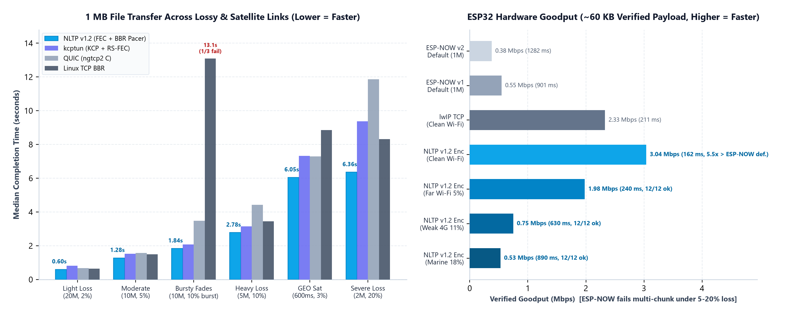
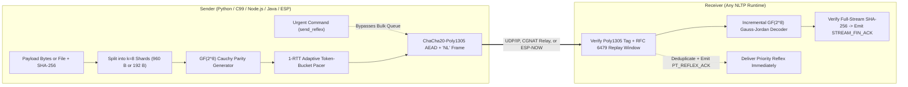
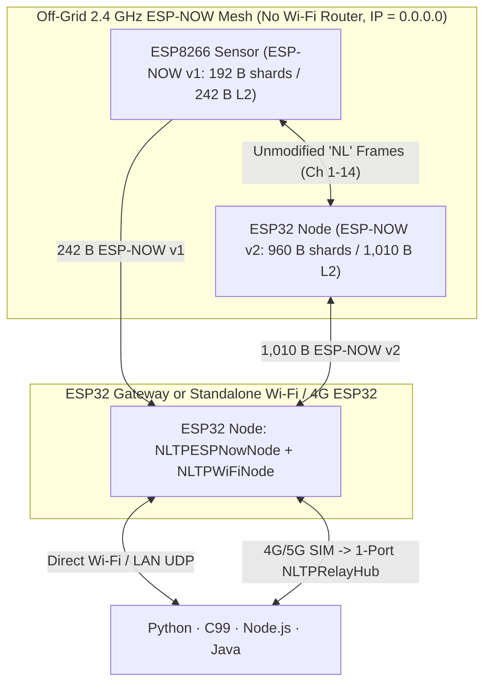

<div align="center">

<a href="https://github.com/indian-aman/necklink"></a>

# NLTP (`pynltp` v1.3.2)

**Loss-resilient, `ChaCha20-Poly1305`-encrypted binary, file, telemetry, and priority-command transport with `GF(2^8)` Cauchy forward error correction — running identically over UDP/IP (LAN, Wi-Fi, 4G/5G CGNAT, satellite) and routerless 2.4 GHz ESP-NOW across Python, ANSI C99, JavaScript/TypeScript (`Node.js`), Java 11+, and `ESP32`/`ESP8266`.**

[](https://pypi.org/project/pynltp/)
[](#8-changelog)
[](scripts/multilang_interop_test.py)
[](#6-benchmarks--hardware-verification)
[](LICENSE)

[**1. Overview**](#1-what-is-nltp) ·
[**2. Architecture**](#2-how-nltp-works--structured-architecture) ·
[**3. ESP UDP & ESP-NOW**](#3-how-nltp-works-on-esp-udp-mode-vs-esp-now-mode-vs-hybrid-bridge) ·
[**4. Platform Guides & Examples**](#4-platform-guides--basic-connection-examples) ·
[**5. NLTP vs. MQTT / TCP / ESP-NOW**](#5-protocol-comparison-nltp-vs-mqtt-vs-raw-esp-now-vs-tcp--quic) ·
[**6. Benchmarks**](#6-benchmarks--hardware-verification) ·
[**7. Repo Layout & Tests**](#7-repository-layout--testing)

</div>

---

<p align="center">
  
</p>

---

## 1. What Is NLTP?

**NLTP (NeckLink Transport Protocol)** is a lightweight, reliable, encrypted datagram transport built for links where standard protocols break down: congested 2.4 GHz RF, weak outdoor Wi-Fi, 4G/5G cellular connections behind carrier CGNAT, long-RTT radio/satellite links, and routerless microcontroller meshes.

- **TCP and QUIC** slow down sharply on bursty wireless loss while waiting on round-trip retransmission timers: in this repo's emulated benchmarks a `1 MB` transfer under `10%` bursty loss took `13.1 s` with `TCP BBR` (2 of 3 runs finished) and `3.5–8.9 s` with `QUIC`, against `1.3–1.8 s` with NLTP. On steady loss up to `5%` they are only `8–23%` slower than NLTP.
- **MQTT** requires a TCP broker, stalls behind head-of-line blocking during drops, and cannot run directly between microcontrollers without a Wi-Fi router.
- **Raw ESP-NOW** fires fast 2.4 GHz frames without a router, but is capped at `250 B` (`v1`) or `1,470 B` (`v2`) per frame, drops multi-kilobyte payloads when a single packet is lost, limits hardware encryption to 6–17 peers, and cannot cross IP routers or cellular networks.

**NLTP unifies embedded boards, laptops, and servers under one unmodified `"NL"` binary wire format:**

- **Forward Error Correction (`GF(2^8)` Cauchy Reed-Solomon)**: Reconstructs lost packets algebraically inside 8-shard generations without waiting for per-packet retransmission timeouts — delivering `100%` `SHA-256`-verified payloads across `0–35%` packet loss.
- **256-Bit Authenticated Encryption (`ChaCha20-Poly1305`)**: Built-in `RFC 8439` AEAD with 20-byte header authentication, `RFC 6479` 64-packet anti-replay window, and end-to-end `SHA-256` stream receipts (`216/216` cross-language tests passed).
- **Priority Out-of-Band Command Lane (`send_reflex`)**: Urgent control frames (`STOP`, `RESET`, `PING_ACTUATOR`) bypass bulk file transfers with zero head-of-line blocking and retransmit until explicitly acknowledged (`PT_REFLEX_ACK`).
- **One Protocol Across 5 Runtimes & 2 Physical Transports**: Identical wire bytes run over **UDP/IP** (including built-in `RFC 5389` STUN hole-punching and zero-knowledge 1-port CGNAT relay) and directly inside **IEEE 802.11 ESP-NOW** frames on `ESP32` and `ESP8266`.

---

## 2. How NLTP Works — Structured Architecture



### 2.1 Wire Frame & Cryptographic Envelope

Every NLTP packet — whether carried inside a UDP datagram, a CGNAT relay envelope, a WebRTC data channel, or a routerless ESP-NOW action frame — starts with magic bytes `"NL"` (`0x4E 0x4C`):

| Mode | Header Size | Wire Layout | Integrity & Replay Protection |
| :--- | :--- | :--- | :--- |
| **Encrypted (`FLAG_ENCRYPTED`)** | `20 B` + `16 B` tag | `"NL"` (`2 B`) \| `ver_type` (`1 B`) \| `flags` (`1 B`) \| `conn_id` (`4 B`) \| `ts_ms` (`4 B`) \| `seq64` (`8 B`) \| `ciphertext` \| `poly1305_tag` (`16 B`) | 256-bit `ChaCha20-Poly1305` (`RFC 8439`) with header AAD + `RFC 6479` 64-packet sliding anti-replay bitmap |
| **Plaintext** | `16 B` | `"NL"` (`2 B`) \| `ver_type` (`1 B`) \| `flags` (`1 B`) \| `conn_id` (`4 B`) \| `ts_ms` (`4 B`) \| `crc32` (`4 B`) \| `payload` | IEEE `CRC-32` over header + payload (rejects RF corruption; encryption endpoints reject plaintext downgrades) |

Key derivation is identical across Python, C99, JS, Java, and Arduino: a 32-byte raw/Base64 key is used directly (`nltp gen-key`), while any human passphrase is hashed with `SHA-256` into a 256-bit key.

### 2.2 `GF(2^8)` Cauchy FEC & Automatic Shard Sizing

1. **Stream Announcement (`PT_STREAM_META`)**: Carries `stream_id`, total byte length, filename, shard size, and expected full-payload `SHA-256` digest.
2. **Generation Slicing (`k = 8` shards per generation)**: Payloads are sliced into sliding generations of up to 8 systematic data shards (`PT_DATA_SHARD`).
3. **Proactive + Reactive Cauchy Parity (`PT_CRYPTIC_PARITY`)**: Over `GF(2^8)` (irreducible polynomial `0x11D`), each parity shard is a linear combination of the `k` data shards using a Cauchy matrix row. Any `k` distinct shards (data or parity, in any order) solve the generation via incremental Gauss-Jordan elimination on the receiver.
4. **Automatic Dual Shard Width**:
   - **Standard Mode (`960 B` data shard → `1,010 B` encrypted frame)**: Fits cleanly inside Internet UDP (`1,500 B` Ethernet / `1,280 B` IPv6 / `4G` tunnels) and **ESP-NOW v2 (`1,470 B` MTU)**.
   - **Compact Mode (`192 B` data shard → `242 B` encrypted frame)**: Fits inside **ESP-NOW v1 (`250 B` MTU)** on `ESP8266` and legacy radios.
   - Receivers read `row_width` directly from each shard header (`12 B`), so `960 B` and `192 B` senders interoperate automatically with zero receiver configuration.
5. **1-RTT Adaptive Rate Pacing & `SHA-256` Completion**: Selective acknowledgements (`PT_PROPRIOCEPTIVE_ACK`) report missing degrees of freedom (`DOF`) per generation plus measured arrival rate, letting the sender pace below bottleneck queue limits. Once all generations solve, the receiver checks the full-stream `SHA-256` and returns `PT_STREAM_FIN_ACK`.

### 2.3 Priority Reflex Lane (`PT_REFLEX_MSG` / `PT_REFLEX_ACK`)

Calling `send_reflex()` / `sendReflex()` emits a standalone encrypted control packet outside the bulk generation queue:
- **Zero head-of-line blocking**: Delivered immediately even while a multi-megabyte file transfer is repairing lost shards.
- **Confirmed exactly-once delivery**: Retransmitted with exponential backoff (`15–60 ms` initial, up to `250 ms`, `3 s` budget) until `PT_REFLEX_ACK` arrives; receivers deduplicate by `(conn_id, seq)`.

### 2.4 NAT, Firewall & 4G/5G CGNAT Traversal

- **Live Socket STUN (`RFC 5389`)**: `discover_wan()` queries public STUN servers from the active NLTP socket to detect Endpoint-Independent vs. Symmetric CGNAT without port races.
- **Low-TTL UDP Hole-Punching (`punch_p2p`)**: Opens local NAT pinholes (`TTL=2`) before full-TTL authenticated `PING`/`PONG` probing.
- **Connection Migration (`0-RTT` Roaming)**: Sessions track peers by authenticated `conn_id`, allowing a client or phone switching between Wi-Fi and cellular (`rebind_socket()`) to continue mid-transfer without dropping state.
- **Zero-Knowledge 1-Port Relay (`NLTPRelayHub`)**: When both peers sit behind symmetric carrier CGNAT, a lightweight UDP relay routes packets by 16-byte hashed room tag (`BLAKE2s`/`SHA-256`) while holding **zero encryption keys**.

---

## 3. How NLTP Works on ESP: UDP Mode vs. ESP-NOW Mode vs. Hybrid Bridge

On `ESP32` (`ESP32-D0WDQ6` / `ESP32-D0WD-V3`) and `ESP8266EX` (`NodeMCU`) — the two microcontroller families tested on hardware — the exact same zero-heap ANSI C99 NLTP state machine (`nltp_endpoint_t`) runs over **two interchangeable physical transports** that can also be bridged together:



### Structured Comparison of ESP Operating Modes

| Aspect | **Mode A: NLTP over UDP (`NLTPWiFiNode`)** | **Mode B1: NLTP over ESP-NOW v2 (`NLTPESPNowNode`)** | **Mode B2: NLTP over ESP-NOW v1 (`ESP8266` / `v1` Flag)** | **Mode C: ESP-NOW ↔ UDP Gateway** |
| :--- | :--- | :--- | :--- | :--- |
| **Hardware Tested** | `ESP32` (`D0WDQ6`); uses Arduino `<WiFiUdp.h>` *(other boards untested)* | `ESP32` (`D0WDQ6` & `D0WD-V3`, Arduino-ESP32 3.x / ESP-IDF 5.x; `S2/S3/C3/C5/C6` untested) | `ESP8266EX` (`NodeMCU`) + `ESP32` with `setEspNowV1Mode(true)` | `ESP32` (runs ESP-NOW + Wi-Fi STA on shared radio channel) |
| **Router / IP Needed?** | **Yes** — Wi-Fi AP, Ethernet, or 4G/5G hotspot | **No** — direct 2.4 GHz L2 action frames (`wifi_sta=0`) | **No** — direct 2.4 GHz L2 action frames (`wifi_sta=0`) | Leaf nodes: **No**; Gateway: **Yes** (Wi-Fi or 4G SIM) |
| **Internet / Cloud Reach** | **Direct** (LAN, WAN, STUN, or `beginRelay()`) | Local 2.4 GHz hop *(bench-tested indoors; outdoor range not measured)* | Local 2.4 GHz hop *(bench-tested indoors; outdoor range not measured)* | **Full end-to-end** from off-grid leaf nodes to cloud/server |
| **Shard / Wire Size** | `960 B` shard → `1,010 B` UDP payload | `960 B` shard → `1,010 B` L2 frame (`<= 1,470 B` MTU) | `192 B` shard → `242 B` L2 frame (`<= 250 B` MTU) | Accepts both `192 B` & `960 B` shards automatically |
| **Measured Goodput** | Up to **`3.04 Mbps`** (`PC ↔ Router ↔ ESP32`) | Typically **`~7 Mbps`** on a clean link (median of 13 runs, range `1.8–17.7 Mbps`); raw ESP-NOW v2 `~15 Mbps` | `NodeMCU → ESP32` (`8 KB` AEAD): **`1.29–1.60 Mbps`** (`2.58–3.88 Mbps` on `1–4 KB`; raw v1 `2.55–2.82 Mbps`); `ESP32 → NodeMCU`: **`4.32–4.49 Mbps`** (raw v1 `3.94–4.13 Mbps`) | Limited by upstream Wi-Fi / 4G link |
| **Loss Survival** | Verified to **`20.8%`** loss (`100%` SHA-256) | Verified **`0–35%`** loss (`100%` SHA-256) | Verified **`0–35%`** cross-chip loss (`100%` SHA-256) | Independent FEC recovery on each hop (or L2 cut-through) |

### Key Engineering Details on ESP

1. **Zero L2 Wrapper Overhead**: `nltp_espnow.h` places the raw `"NL"` datagram directly inside the IEEE 802.11 vendor action payload with zero extra headers. A gateway can either verify-and-forward complete files (`NLTPESPNowNode` → `NLTPWiFiNode`) or forward raw `"NL"` packets byte-for-byte into a UDP socket or `NLTPRelayHub`.
2. **Cross-Chip `ESP8266 ↔ ESP32` Compatibility**: An `ESP8266` (`80 KB` total SRAM) built with `NLTP_SHARD_BYTES=192`, `NLTP_RX_SLOTS=3`, `NLTP_TX_WINDOW=8` and `NLTP_RX_MAX_GENS=128` (the tested settings) transmits `242 B` encrypted shards that any `ESP32` v2 hub (`1,470 B` MTU) decodes natively alongside `1,010 B` v2 shards from other `ESP32` peers.
3. **Hardened Multi-Peer Hub (`nltp_espnow_hub_t`)**:
   - **Pre-Auth Slot Gate**: Unknown sender MACs must pass `ChaCha20-Poly1305` (or `allow_cb` + `CRC-32`) verification *before* any RAM slot or ESP-NOW peer entry is allocated — spoofed MAC floods allocate `0` slots.
   - **Automatic 20-Peer Hardware Table Management**: ESP-NOW hardware supports at most 20 total peers (`6–17` encrypted). NLTP encrypts at the payload layer with 256-bit `ChaCha20-Poly1305` and LRU-evicts idle peer entries automatically, so a single hub can talk to an unlimited population of intermittent field sensors.
   - **Mid-Stream Takeover Guard (`v1.3.2`)**: An active receive stream cannot be reset by a delayed replay or stray `conn_id` packet unless the stream finishes or goes silent for `>= 1,000 ms`, keeping deep-sleep wake re-connections fast (`4.34 ms` median) without mid-transfer stalls.

---

## 4. Platform Guides & Basic Connection Examples

### 4.1 Python (`pynltp` / `import nltp` + `nltp` CLI)

**How it works:** Runs on Python 3.9+ (Windows, Linux, macOS, Raspberry Pi) using only `numpy` and `cryptography` (with a pure-Python `ChaCha20-Poly1305` fallback). `NLTPServer` and `NLTPClient` manage a background non-blocking UDP selector thread for 1-RTT packet pacing, FEC encoding/decoding, keepalives, and reflex acknowledgements.

```bash
# Install v1.3.2 directly from PyPI:
pip install --upgrade pynltp

# Or install directly from GitHub source:
pip install "git+https://github.com/indian-aman/necklink.git#subdirectory=packages/nltp"
```

**Basic Python Connection (Server + Client on LAN or Internet):**

```python
from nltp import NLTPServer, NLTPClient, generate_nltp_key

key = generate_nltp_key()  # 256-bit ChaCha20-Poly1305 shared key

# 1. Start a server listening on UDP port 9000
with NLTPServer(("0.0.0.0", 9000), save_dir="./inbox", psk=key) as server:

    # 2. Connect a client to the server
    with NLTPClient(("127.0.0.1", 9000), psk=key, max_tx_kbps=20_000) as client:

        # Send a priority reflex command (confirmed out-of-band)
        seq = client.send_reflex("STOP")
        assert client.wait_reflex_ack(seq, timeout=3.0)

        # Send raw bytes, JSON, or a file (Cauchy FEC + SHA-256 verified)
        receipt = client.send_bytes(b"hello over loss-resilient UDP")
        assert receipt["verified_sha256"] is True

        # Receive items on the server
        reflex_item = server.recv(timeout=2.0)   # kind == "reflex", data == b"STOP"
        data_item = server.recv(timeout=2.0)     # kind == "bytes", sha256_verified == True

        # Server can also reply two-way to the client over the same UDP port
        server.send_bytes(data_item.peer_addr, b"ack: batch stored")
        reply = client.recv(timeout=2.0)
        print("Client received:", reply.data.decode())
```

**Command-Line Usage & CGNAT Relay:**

```bash
# Generate a 256-bit key and inspect your NAT type via STUN
nltp gen-key
nltp stun

# Direct UDP transfer
nltp serve --host 0.0.0.0 --port 9000 --psk "<KEY>" --save-dir ./inbox
nltp send-file --host <SERVER_IP> --port 9000 --psk "<KEY>" --file firmware.bin

# Behind 4G/5G Carrier CGNAT (run relay on any 1-port cloud VM — holds zero keys)
nltp relay --host 0.0.0.0 --port 9000
nltp serve --relay <RELAY_IP>:9000 --room device-01 --psk "<KEY>" --save-dir ./inbox
nltp send-file --relay <RELAY_IP>:9000 --room device-01 --psk "<KEY>" --file sensor_batch.bin
```

---

### 4.2 JavaScript & TypeScript (`Node.js` UDP + Transport-Agnostic `nltp/core`)

**How it works:** Zero external npm dependencies, tested on **`Node.js >= 18`** (`Node.js 20` in CI). Ships dual `ESM` + `CommonJS` entrypoints and full `.d.ts` TypeScript declarations:
- `import { NLTPServer, NLTPClient, NLTPRelayHub } from 'nltp'` uses `node:dgram` for native UDP networking.
- `import { NLTPEndpoint } from 'nltp/core'` uses only standard `Uint8Array` / `DataView` with zero `node:*` imports so you can attach NLTP to custom datagram callbacks (such as WebRTC `RTCDataChannel` or WebSockets; browser, Deno, and Bun runtimes are not yet tested in CI).

```bash
npm install ./packages/nltp/js
```

**Basic Node.js UDP Connection:**

```javascript
import { NLTPServer, NLTPClient, generateNltpKey } from 'nltp';

const key = generateNltpKey();

const server = await NLTPServer.listen({ host: '0.0.0.0', port: 9000, psk: key, saveDir: './inbox' });
const client = await NLTPClient.connect({ host: '127.0.0.1', port: 9000, psk: key, maxTxKbps: 20_000 });

// Confirmed urgent command + verified binary/JSON transfer
const seq = await client.sendReflex('PING_DEVICE');
await client.waitReflexAck(seq, 3000);

const receipt = await client.sendJson({ deviceId: 'node-01', status: 'ok' });
console.log('SHA-256 verified:', receipt.verifiedSha256);

const msg1 = await server.recv(2000); // 'reflex'
const msg2 = await server.recv(2000); // 'json' -> msg2.asJson()
await server.sendBytes(msg2.peerAddr, 'config-updated');

console.log('Reply from server:', (await client.recv(2000)).asText());
await client.close();
await server.close();
```

**Custom Datagram / WebRTC Callback Example (`nltp/core`, untested in browsers):**

```javascript
import { NLTPEndpoint } from 'nltp/core';

// Attach NLTP to any unreliable/unordered WebRTC RTCDataChannel or custom byte link
const endpoint = new NLTPEndpoint({
  psk: sharedKey,
  sendPacketFn: (packetBytes) => dataChannel.send(packetBytes),
});

dataChannel.binaryType = 'arraybuffer';
dataChannel.onmessage = (ev) => endpoint.onDatagram(new Uint8Array(ev.data), 'peer');
setInterval(() => endpoint.step(), 5); // Drive pacing & FEC timers

endpoint.startTransfer('peer', new Uint8Array(65536), { kind: 'file', filename: 'snapshot.bin' });
const received = await endpoint.waitInbox(5000);
```

---

### 4.3 Java 11+ (`io.necklink:nltp`)

**How it works:** Pure Java 11 (`--release 11`) with **zero external Maven/Gradle dependencies**. Uses a non-blocking `java.nio.channels.DatagramChannel` + `Selector` background loop, portable constant-time `RFC 8439` `ChaCha20-Poly1305`, and thread-safe queues.

```bash
mvn -f packages/nltp/java/pom.xml package   # Produces packages/nltp/java/target/nltp-1.3.2.jar
```

**Basic Java Connection:**

```java
import io.necklink.nltp.*;
import java.nio.charset.StandardCharsets;
import java.nio.file.Paths;

public class Example {
    public static void main(String[] args) throws Exception {
        String key = NLTPWire.generateNltpKey();

        try (NLTPServer server = NLTPServer.builder()
                .bind("0.0.0.0", 9000)
                .psk(key)
                .saveDir(Paths.get("./inbox"))
                .build();
             NLTPClient client = NLTPClient.builder()
                .server("127.0.0.1", 9000)
                .psk(key)
                .maxTxKbps(20_000.0)
                .build()) {

            // 1. Confirmed priority reflex
            int seq = client.sendReflex("RESET_COUNTER");
            boolean acked = client.waitReflexAck(seq, 3000L);

            // 2. FEC-protected, SHA-256 verified transfer
            TransferReceipt receipt = client.sendBytes(
                "telemetry-payload".getBytes(StandardCharsets.UTF_8), "sample.bin", 10_000L);
            System.out.println("Verified: " + receipt.verifiedSha256());

            // 3. Receive on server and reply
            ReceivedItem<?> reflex = server.recv(2000L);
            ReceivedItem<?> file = server.recv(2000L);
            server.sendBytes((java.net.InetSocketAddress) file.peerAddr(),
                "received-ok".getBytes(StandardCharsets.UTF_8), 5_000L);
        }
    }
}
```

---

### 4.4 Android Integration Notes (`io.necklink:nltp` — Untested on Android)

> **Untested on Android hardware/emulator:** `io.necklink:nltp` is built and tested on desktop/server JVMs (Temurin JDK 21 with `--release 11`). Because it compiles to zero-dependency Java 11 bytecode using only `java.nio.channels.DatagramChannel`, `Selector`, `MessageDigest`, `CRC32`, and its own pure-Java `ChaCha20-Poly1305` (APIs present since Android API 26 / Android 8.0, with no JNI `.so` libraries or third-party jars), the snippets below show the intended Gradle/Kotlin wiring, **but Android runtime execution has not been verified yet**.

**1. Gradle & Manifest Setup:**

Copy `nltp-1.3.2.jar` into `app/libs/` and add to `app/build.gradle.kts`:

```kotlin
android {
    defaultConfig { minSdk = 26 }
    compileOptions {
        sourceCompatibility = JavaVersion.VERSION_11
        targetCompatibility = JavaVersion.VERSION_11
    }
}

dependencies {
    implementation(files("libs/nltp-1.3.2.jar"))
}
```

Add network permission in `AndroidManifest.xml`:

```xml
<uses-permission android:name="android.permission.INTERNET" />
```

**2. Basic Android Kotlin Connection (on `Dispatchers.IO`):**

```kotlin
import io.necklink.nltp.NLTPClient
import kotlinx.coroutines.Dispatchers
import kotlinx.coroutines.withContext

suspend fun syncWithDevice(deviceIp: String, sharedKey: String, configBytes: ByteArray): String? =
    withContext(Dispatchers.IO) {
        // For CGNAT relay instead of LAN IP, use: .relay(InetSocketAddress(relayIp, 9000), "device-01")
        NLTPClient.builder()
            .server(deviceIp, 9700)
            .psk(sharedKey)
            .maxTxKbps(10_000.0)
            .build()
            .use { client ->
                // Send urgent command + verified configuration payload to ESP32 or backend server
                val seq = client.sendReflex("SYNC_NOW")
                client.waitReflexAck(seq, 2_000L)

                val receipt = client.sendBytes(configBytes, "config.bin", 15_000L)
                if (!receipt.verifiedSha256()) return@use null

                // Wait for two-way reply from device/server
                client.recv(5_000L)?.asText()
            }
    }
```

---

### 4.5 ESP (`ESP32` & `ESP8266` — Arduino IDE, PlatformIO & ESP-IDF C99)

**How it works:** The C99 engine (`csrc/nltp_core.{h,c}`, `nltp_sha256.{h,c}`, `nltp_net.{h,c}`) uses **zero dynamic heap allocation** inside the protocol core and **zero floating-point math**. On Arduino/PlatformIO, `#include <NLTP.h>` provides two non-blocking classes driven by calling `.poll()` inside `loop()`:
- `NLTPWiFiNode` — UDP over Wi-Fi / Ethernet / 4G router (works on all Arduino-ESP32 cores).
- `NLTPESPNowNode` — Routerless 2.4 GHz ESP-NOW v2/v1 (Arduino-ESP32 core 3.x / ESP-IDF 5.x).
- For `ESP8266EX` (`NodeMCU`) or other C99 targets, wire `nltp_core.c` directly to `esp_now_send` or any byte callback *(hardware-tested on `ESP32` and `ESP8266EX`; other microcontrollers untested on hardware)*.

**Install in PlatformIO (`platformio.ini`) or Arduino IDE (`.ZIP`):**

```ini
; platformio.ini
lib_deps =
    symlink://../necklink/packages/nltp/arduino/NLTP
```
*(For Arduino IDE: zip `packages/nltp/arduino/NLTP` and add via **Sketch → Include Library → Add .ZIP Library...**)*

#### Example A: `ESP32` over Wi-Fi UDP (Connects Directly to Python / C99 / Node.js / Java)

```cpp
#include <WiFi.h>
#include <NLTP.h>

NLTPWiFiNode nltp;
uint8_t samplePayload[2048];

void setup() {
  WiFi.begin("YOUR_WIFI_SSID", "YOUR_WIFI_PASSWORD");
  while (WiFi.status() != WL_CONNECTED) delay(200);

  nltp.begin(9700, "shared-256bit-key-or-passphrase");
  nltp.setPeer(IPAddress(192, 168, 1, 100), 9000); // IP/port of Python, Node.js, or Java peer
}

void loop() {
  nltp.poll(); // Drives TX pacing, Cauchy FEC repairs, and RX decoding

  if (nltp.hasReceivedFile() && nltp.isReceivedShaOk()) {
    // Access verified incoming payload via nltp.receivedData() & nltp.receivedLength()
    nltp.clearReceived();
    nltp.sendBytes(samplePayload, sizeof(samplePayload), "sensor_batch.bin");
  }
}
```

*(Behind a 4G/5G SIM router with no public IP? Replace `begin()` + `setPeer()` with one line:)*

```cpp
nltp.beginRelay(9700, IPAddress(203, 0, 113, 10), 9000, "device-01", "shared-256bit-key-or-passphrase");
```

#### Example B: `ESP32 ↔ ESP32` Routerless `ESP-NOW` (No Wi-Fi Router Needed)

```cpp
#include <NLTP.h> // Requires Arduino-ESP32 core 3.x (ESP-IDF 5.x)

NLTPESPNowNode node;
const uint8_t peerMac[6] = {0xAA, 0xBB, 0xCC, 0x00, 0x00, 0x02}; // Target ESP32 STA MAC
uint8_t dataBatch[8192];

void setup() {
  node.begin(11 /* 2.4 GHz channel 1-14 */, "shared-256bit-key-or-passphrase", NLTP_ESPNOW_RATE_AUTO);
  // node.setEspNowV1Mode(true); // Enable ONLY when sending to an ESP8266 or 250-byte v1 peer
  node.setPeerMac(peerMac);
  node.sendBytes(dataBatch, sizeof(dataBatch), "batch.bin"); // Keep buffer valid until isSendComplete()
}

void loop() {
  node.poll();

  if (node.hasReceivedFile() && node.isReceivedShaOk()) {
    // Verified multi-KB file received over raw 2.4 GHz ESP-NOW!
    node.clearReceived();
  }
}
```

#### Example C: `ESP8266` (`NodeMCU`) Cross-Chip `ESP-NOW v1` (`250 B` MTU)

On `ESP8266` (`80 KB` SRAM), compile the portable C99 core with `192 B` shards (`242 B` encrypted L2 frame `<= 250 B` v1 limit) — any `ESP32` running `NLTPESPNowNode` or `nltp_espnow_hub_t` decodes its packets automatically:

```cpp
// The same four settings must also be applied where nltp_core.c is compiled (the full sketch does this
// in nltp_core_8266.c); if the sketch and the core disagree, the endpoint struct sizes differ.
#define NLTP_SHARD_BYTES 192
#define NLTP_RX_SLOTS    3
#define NLTP_TX_WINDOW   8
#define NLTP_RX_MAX_GENS 128
#include <espnow.h>
#include "nltp_core.h"

static void sendFrame(void * /*user*/, const uint8_t *pkt, size_t len) {
  esp_now_send(peerMac, (uint8_t *)pkt, (int)len); // Sends 242 B encrypted frame to ESP32 or ESP8266
}
```
*(Full working sketch: [`esp32_mesh/mesh3_nodemcu8266/mesh3_nodemcu8266.ino`](esp32_mesh/mesh3_nodemcu8266/mesh3_nodemcu8266.ino).)*

#### Example D: `ESP-NOW → Wi-Fi UDP` Gateway Bridge

Run both classes on one `ESP32` (setting `espNow.begin(0, ...)` so ESP-NOW stays locked to the Wi-Fi router's channel):

```cpp
// Inside loop(): receive verified batches from off-Wi-Fi ESP-NOW sensors and forward over UDP/4G
espNow.poll();
wifiUdp.poll();

if (espNow.hasReceivedFile() && espNow.isReceivedShaOk() && wifiUdp.isSendComplete()) {
  memcpy(forwardBuf, espNow.receivedData(), espNow.receivedLength());
  wifiUdp.sendBytes(forwardBuf, espNow.receivedLength(), espNow.receivedFilename());
  espNow.clearReceived();
}
```
*(See [`arduino/NLTP/examples/ESP32_ESPNow_Gateway`](arduino/NLTP/examples/ESP32_ESPNow_Gateway/ESP32_ESPNow_Gateway.ino) for a complete gateway sketch with retry handling, and [`esp32_mesh/`](esp32_mesh/) for multi-peer C99 `nltp_espnow_hub_t` firmware.)*

---

## 5. Protocol Comparison: NLTP vs. MQTT vs. Raw ESP-NOW vs. TCP / QUIC

| Capability | **NLTP (`v1.3.2`)** | **MQTT (over TCP/TLS)** | **Raw ESP-NOW (`v1` / `v2`)** | **TCP BBR / QUIC** |
| :--- | :--- | :--- | :--- | :--- |
| **Underlying Transport** | UDP/IP, CGNAT Relay, L2 ESP-NOW, or custom byte callbacks | TCP/IP (or QUIC in niche brokers) | IEEE 802.11 L2 vendor action frames only | TCP/IP or UDP/IP (`QUIC`) |
| **Central Broker Needed?** | **No** — direct P2P, hub, or optional 1-port relay | **Yes** — requires an MQTT broker (Mosquitto, EMQX, AWS IoT) | **No** — direct peer MAC to MAC | **No** — direct client/server |
| **Works Without Wi-Fi Router?** | **Yes** (`ESP32` & `ESP8266` via ESP-NOW) | **No** — requires full IP + TCP stack | **Yes** (`ESP32` & `ESP8266`) | **No** — requires IP stack |
| **Crosses Internet & 4G CGNAT?** | **Yes** (built-in STUN punch + zero-key relay) | **Yes** (if broker is hosted on a public IP) | **No** — single 2.4 GHz RF hop only | **Yes** (requires public IP or separate TURN/VPN) |
| **10–35% Packet Loss Behaviour** | **Forward heals via `GF(2^8)` Cauchy FEC** (`100%` SHA-256 @ `35%` loss) | TCP head-of-line stalls, broker keepalive drops & reconnect storms | **`0%` multi-KB file delivery** from `10%+` loss (no chunk repair) | Retransmission backoff (`2–7×` slower on bursty fades) |
| **Urgent Command During Upload** | **`send_reflex()` bypasses queue (`0` HOL blocking)** | Blocked behind in-flight TCP socket send buffer | Immediate single frame (unconfirmed at app layer) | TCP: blocked; QUIC: multi-stream capable |
| **Payload Size & Integrity** | Multi-MB files & batches + mandatory `SHA-256` receipt | Up to `256 MB` messages (broker-limited, no built-in file hash) | Single `250 B` (`v1`) or `1,470 B` (`v2`) frame only | Arbitrary byte stream (TLS MAC, no file receipt) |
| **Encryption & Peer Limit** | `ChaCha20-Poly1305` (256-bit) — **unlimited peers** | TLS 1.2/1.3 (`~40–60 KB` RAM on MCU) | `AES-128 CCMP` capped at **6–17 encrypted peers** | TLS 1.3 (`QUIC` too heavy for `80–320 KB` MCUs) |
| **Pub/Sub Topic Routing (`a/+/c`)** | **No** (transport layer, not a message bus) | **Yes — MQTT's core superpower** (1-to-10,000 fan-out, QoS, retained state) | **No** | **No** |

### When to Use NLTP — and When Not To

> **Use NLTP when:**
> - Transferring **binary batches, sensor logs, audio/image snapshots, configs, or OTA firmware (`1 KB – 10 MB`)** across lossy (`2–35%`), bursty, long-RTT, cellular-edge, or congested 2.4 GHz links.
> - Building **routerless `ESP32` / `ESP8266` meshes** that need encrypted multi-KB transfers, cross-chip `v1 ↔ v2` compatibility, or seamless bridging to Python, C99, Node.js, or Java.
> - Connecting field devices and mobile apps **across 4G/5G carrier CGNAT** without setting up VPNs, TLS certificates, or heavyweight cloud brokers.
> - **Combining NLTP + MQTT**: Use NLTP on the **lossy wireless edge** (`ESP8266/ESP32 → Gateway/Cloud Ingest`) and publish verified payloads into **MQTT** inside your cloud backend for dashboard and microservice fan-out.

> **Stick with standard protocols when:**
> - **Cloud pub/sub fan-out & smart-home JSON topics on clean Wi-Fi**: Use **MQTT** — its topic wildcards, retained messages, and managed brokers are purpose-built for thousands of clean-network subscribers.
> - **Clean wired/Wi-Fi links or large (`>= 10 MB`) steady-loss transfers between servers**: Kernel **`TCP BBR`** and **`QUIC`** are `12–27%` faster on clean links and send fewer wire bytes (`1.04–1.12x` vs. NLTP's `1.20–1.54x` FEC parity overhead).
> - **Coin-cell `<= 250 B` fire-and-forget sensor pings**: Raw **`ESP-NOW`** wakes and transmits a single frame in `~1–3 ms` with zero session state when occasional dropped readings are acceptable.

---

## 6. Benchmarks & Hardware Verification

All raw JSON logs and reproducible test harnesses live in [`results/`](results/) and [`scripts/`](scripts/).

### 6.1 Off-Wi-Fi `ESP32 ↔ ESP32` Hardware: `NLTP 1.3.2 ESP-NOW v2` vs. `Raw ESP-NOW v2`

Measured live on two physical boards (`ESP32-D0WDQ6` ↔ `ESP32-D0WD-V3`, Channel 11, `wifi_sta=0`, `ip=0.0.0.0`, `1,470 B` ESP-NOW v2 MTU; [`results/esp32_mesh3_v2_vs_raw_v2.json`](results/esp32_mesh3_v2_vs_raw_v2.json)):

#### A. `16 KB` File Delivery Under Controlled Packet Loss (3 Trials / Level)

| Receiver Frame Loss | **Raw ESP-NOW v2** (`1,470 B` chunks, 802.11 L2 ACK only) | **NLTP `1.3.2` over ESP-NOW v2** (`ChaCha20-Poly1305` + `GF(2^8)` FEC + `SHA-256`) |
| :---: | :---: | :---: |
| **`0%`** | `3/3` (`100%`) · `15.11 Mbps` | **`3/3` (`100%` SHA-256)** · **`15.88 Mbps`** (`8.26 ms`) |
| **`5%`** | `3/3` (`100%`) · `14.98 Mbps` *(L2 retry limit border)* | **`3/3` (`100%` SHA-256)** · **`14.87 Mbps`** (`8.81 ms`) |
| **`10%`** | `0/3` (`0%` intact — missing chunks) | **`3/3` (`100%` SHA-256)** · **`14.49 Mbps`** (`9.05 ms`) |
| **`15%`** | `0/3` (`0%` intact) | **`3/3` (`100%` SHA-256)** · **`2.55 Mbps`** (`51.44 ms`) |
| **`25%`** | `0/3` (`0%` intact) | **`3/3` (`100%` SHA-256)** · **`4.79 Mbps`** (`27.39 ms`) |
| **`35%`** | `0/3` (`0%` intact) | **`3/3` (`100%` SHA-256)** · **`2.27 Mbps`** (`57.82 ms`) |

Medians of 3 trials; individual trials vary widely (at `15%` loss they took `8.5`, `51.4` and `59.3 ms`), so the speed column is not monotonic in loss.

#### B. Throughput, PHY Modes, Full-Duplex, Soak & Security Highlights (`v1.3.2`)

- **Clean-Link Throughput (typical vs. best)**: NLTP's speed varies a lot between runs. Across the 13 clean-link measurements at `11 Mbps` or faster PHY rates (payload, PHY-rate and TX-power sweeps plus the `0%` row above), **NLTP's median is `7.1 Mbps` against `15.0 Mbps` for raw ESP-NOW v2** (about `0.4×`). NLTP matched or beat raw in 5 of the 13, best **`17.75 Mbps`** (`32 KB`, full AEAD + `SHA-256`, vs. `16.96 Mbps` raw in that run). On a clean link raw ESP-NOW is faster; NLTP's advantage is that it still delivers when frames are lost (table A).
- **TX-Power Sweep (`16 KB`, `+2` to `+19.5 dBm`)**: NLTP `1.8–8.7 Mbps` vs. raw ESP-NOW v2 `7.6–15.2 Mbps`, all `3/3` delivered.
- **Small-Payload Latency (`4 B` / `64 B`)**: **`2.72 ms`** (`CRC-32`) / **`3.17 ms`** (`4 B` AEAD) / **`2.62 ms`** (`64 B` AEAD) vs. `3.05–3.06 ms` Raw ESP-NOW v2.
- **All 7 Hardware 2.4 GHz PHY Modes Verified (`8 KB` AEAD, `3/3` SHA-256 each)**:
  - NLTP (raw ESP-NOW v2 in brackets): `802.11b 1M`: `0.45 Mbps` (`0.80`) · `802.11b 11M`: `7.96 Mbps` (`6.66`) · `802.11n MCS4`: `5.82 Mbps` med, `14.90` max (`15.03`) · `MCS7`: `7.11 Mbps` med, `17.24` max (`19.04`) · `AUTO`: `7.19 Mbps` med, `16.16` max (`18.80`) · **Espressif Long-Range `LR 250K`**: `0.10 Mbps` (`0.20`) · **`LR 500K`**: `0.26 Mbps` (`0.42`).
- **Simultaneous Full-Duplex Collision Stress (`32 KB A→B` + `32 KB B→A` at once)**: **`5/5` (`100%`)** at `0%` loss (`3.49 Mbps`; raw v2 `5/5`, `3.18 Mbps`) and **`5/5` (`100%`)** at `10%` loss (`3.05 Mbps`, where raw v2 scored `0/5`).
- **Zero-Leak Endurance & Deep-Sleep Wake**: `50 × 8 KB` back-to-back transfers (`400 KB`, `50/50` SHA-256 in `13.16 s`) with **`+4 B` TX / `0 B` RX heap delta**, plus **`20/20` fresh `conn_id` cold wakes** in **`4.34 ms` median**.
- **Anti-Stall & Adversarial Security (`160/160` Blocked)**:
  - **`3/3` (`100%`)** survival when 3–5 authenticated stray-`conn_id` frames were injected mid-transfer (`16 KB` at the `802.11b 1 Mbps` rate, no added loss; `v1.3.2` 1-second takeover guard).
  - **`80/80` forged frames** from spoofed MACs rejected pre-auth with **`0` hub slots allocated** + **`80/80` bit-flipped, replayed, wrong-key, and plaintext-downgrade frames** dropped (whereas Raw ESP-NOW v2 accepted `40/40` spoofed frames as valid data).

---

### 6.2 Live 3-Board Cross-Chip Off-Wi-Fi Mesh (`ESP32 + ESP8266EX NodeMCU + ESP32`)

Measured across three heterogeneous physical boards on Channel 11 with **zero Wi-Fi router** (`wifi_sta=0`, `ip=0.0.0.0`; [`results/esp32_esp8266_crosschip_mesh.json`](results/esp32_esp8266_crosschip_mesh.json)):
- **Node 0**: `ESP32-D0WDQ6` (`520 KB` SRAM, `ESP-NOW v2` `1,470 B` MTU)
- **Node 1**: `ESP8266EX NodeMCU` (`80 KB` SRAM, `22 KB` free heap, `ESP-NOW v1` `250 B` MTU, `192 B` NLTP shards)
- **Node 2**: `ESP32-D0WD-V3` (`520 KB` SRAM, `ESP-NOW v2` `1,470 B` MTU, 2-slot multi-peer hub)

| Cross-Chip / Multi-Board Test | Payload & Conditions | **Raw ESP-NOW** | **NLTP `1.3.2` Cross-Chip Mesh** |
| :--- | :--- | :---: | :---: |
| **All 6 Pairwise Directional Links** | `16 KB` (`ESP32↔ESP32`) & `8 KB` (`ESP8266↔ESP32`) @ `0%` added loss | `ESP8266↔ESP32`: **`12/12`** (`2.78–4.13 Mbps`)<br>`ESP32↔ESP32`: `3/3` (`8.22 Mbps`, `-71 dBm`) & `0/3` (`-78 dBm`) | **`18/18` (`100%` SHA-256)** · `ESP32↔ESP32`: `7.85` & `12.42 Mbps`; `NodeMCU→ESP32`: `1.56` & `1.60 Mbps`; `ESP32→NodeMCU`: `4.32` & `4.49 Mbps` |
| **Payload Sweep (`NodeMCU → ESP32`)** | `4 B`, `64 B`, `192 B`, `1 KB`, `4 KB`, `8 KB` @ `0%` loss | **`3/3` at every size** (`2.00 ms` @ `4 B`, `2.01–2.76 Mbps` @ `1–8 KB`) | **`3/3` (`100%` SHA-256) at every size** (`2.99 ms` @ `4 B`, `2.58` & `3.88 Mbps` @ `1–4 KB`, `1.45 Mbps` @ `8 KB`) |
| **Cross-Chip Loss Sweep (`NodeMCU → ESP32`)** | `8 KB` encrypted (`242 B` L2 frames) @ `0%, 10%, 25%, 35%` loss | **`0%`: `3/3`** (`2.55 Mbps`, `25.7 ms`)<br>**`10%, 25%, 35%`: `0/3`** (`5.5–7.2 / 8 KB` avg) | **`3/3` (`100%` SHA-256) at all 4 loss levels** (`1.29`, `1.00`, `0.69`, `0.58 Mbps`) |
| **2-Hop Relay via `ESP32`** | `NodeMCU (v1) → ESP32 Relay → ESP32 Hub` (`8 KB`, `0%` & `15%` loss) | `0%`: `0/3` (`2.8 / 8 KB` avg; `-78 dBm` hop + Ch 11 relay collisions)<br>`15%`: `0/3` | **`3/3` (`100%` SHA-256)** · `0.40 Mbps` (`162.6 ms`, `0%`) & `0.023 Mbps` (`2.82 s`, `15%` loss) |
| **2-Hop Relay *Through* `250 B` `ESP8266`** | `ESP32 → NodeMCU 250 B Relay → ESP32 Hub` (`8 KB`, `0%` & `15%` loss) | **`0%`: `3/3` (`100%`, `2.02 Mbps`, `32.5 ms`)**<br>**`15%`: `0/3`** (`7.1 / 8 KB` avg) | **`3/3` (`100%` SHA-256)** · **`3.27 Mbps`** (`20.1 ms`, `0%`) & **`0.66 Mbps`** (`98.9 ms`, `15%` loss) |
| **Simultaneous Dual-Sender Mixed Hub** | `ESP32 (32 KB v2)` + `NodeMCU (8 KB v1)` → `ESP32 Hub` at the same instant | `0/5` *(single-buffer raw receiver; see note)* | **`5/5` (`100%` both SHA-256)** @ `0%` (`417 ms`) & **`5/5`** @ `10%` loss (`387 ms`) |

> **Notes on the 3-board benchmark ([`results/esp32_esp8266_crosschip_mesh.json`](results/esp32_esp8266_crosschip_mesh.json)):**
> - **Clean direct `ESP8266 ↔ ESP32` links (`-41` to `-57 dBm`)**: Raw ESP-NOW v1 (`250 B` frames / `226 B` chunks) delivers `100%` (`12/12` across all 4 directional pairs) and is faster than NLTP on `8 KB` `NodeMCU → ESP32` uploads (`2.55–2.82 Mbps` raw vs. `1.29–1.60 Mbps` NLTP; on `1–4 KB`, NLTP reaches `2.58–3.88 Mbps`), while NLTP is slightly faster on `8 KB` `ESP32 → NodeMCU` (`4.32–4.49 Mbps` vs. `3.94–4.13 Mbps` raw). Once packet loss reaches `10–35%`, raw multi-KB delivery drops to `0/3` while NLTP holds `3/3` (`100%` SHA-256).
> - **Asymmetric bench RSSI & single-channel relay collisions**: On the bench, `Node 1` (`NodeMCU`) sat between `Node 0` and `Node 2` (`-41` to `-57 dBm` to both), so 2-hop Route B through the `250 B` `NodeMCU` relay succeeded `3/3` (`2.02 Mbps`) with raw ESP-NOW at `0%` added loss. By contrast, the direct `Node 0 → Node 2` link was `-78 dBm`, causing natural indoor RF drops (`12,369 / 16,384 B` avg raw direct, and `2,787 / 8,192 B` avg on 2-hop Route A where `Node 0` received and relayed on Channel 11 simultaneously); NLTP's FEC recovered `3/3` (`100%` SHA-256) on both routes.
> - **Simultaneous dual-sender row**: The raw test receiver in `mesh3_v2_main.cpp` tracks one in-flight `run_id` buffer (`g_raw`), so interleaved frames from two concurrent senders overwrite each other (`0/5`). A custom per-MAC raw chunk table could separate two clean-link senders, whereas `nltp_espnow_hub_t` provides pre-authenticated per-MAC slots + FEC recovery out of the box (`5/5` at `0%` and `10%` loss).

---

### 6.3 `ESP32` Wi-Fi UDP (`ESP32 ↔ Router ↔ PC`) Across Degraded Links

Measured over 2 Wi-Fi hops (`ESP32-D0WDQ6 ↔ Router ↔ PC`) on `58–60 KB` encrypted files with `SHA-256` verification ([`results/esp32_espnow_vs_nltp.json`](results/esp32_espnow_vs_nltp.json)):

- **Clean Desk Wi-Fi (`0%` loss)**: **`2.57–3.04 Mbps`** (`162–191 ms`) vs. `2.33 Mbps` (`211 ms`) on lwIP `TCP`.
- **Weak Wi-Fi (`5 Mbit`, `5%` loss)**: **`1.90–1.98 Mbps`** (`12/12` verified).
- **Degraded Cellular Profile (`2 Mbit`, `9–13%` loss)**: **`0.56–0.75 Mbps`** (`12/12` verified).
- **Narrowband IP Radio (`1 Mbit`, `6–18%` loss)**: **`0.31–0.53 Mbps`** (`12/12` verified).
- **Severe Packet Loss (`1 Mbit`, `20.8%` loss)**: **`0.17–0.28 Mbps`** (`12/12` verified).

---

### 6.4 Linux `tc netem` `1 MB`, `10 MB` & Satellite Benchmarks vs. 7 Protocols

Measured on `Linux 6.18` network namespaces (`tc netem` + `tbf`, symmetric loss and rate limits in both directions, `iptables` wire-byte ratio in parentheses):

| Emulated Symmetric Link (`1 MB` File) | **`NLTP`** | `TCP BBR` | `QUIC` (`ngtcp2`) | `KCP` (`w128`) | `kcptun` (`FEC`) | `UDT4` | `SRT` |
| :--- | :--- | :--- | :--- | :--- | :--- | :--- | :--- |
| **Clean** (`20 Mbit`, `20 ms`, `0%`) | `0.58 s` (`1.23x`) | **`0.51 s` (`1.04x`)** | `0.57 s` (`1.05x`) | `0.60 s` (`1.54x`) | `0.74 s` (`2.25x`) | `0.95 s` (`1.15x`) | `0.87 s` (`1.15x`) |
| **Light Loss** (`20 Mbit`, `40 ms`, `2%`) | **`0.60 s` (`1.20x`)** | `0.65 s` (`1.07x`) | `0.67 s` (`1.07x`) | `0.85 s` (`1.25x`) | `0.81 s` (`1.62x`) | `3.02 s` (`1.07x`) | `1.37 s` (`1.05x`) |
| **Moderate Loss** (`10 Mbit`, `100 ms`, `5%`) | **`1.28 s` (`1.30x`)** | `1.49 s` (`1.12x`) | `1.57 s` (`1.07x`) | `1.74 s` (`1.45x`) | `1.52 s` (`1.75x`) | `9.98 s` (`1.19x`) | `6.49 s` (`1.24x`) |
| **Heavy Loss** (`5 Mbit`, `200 ms`, `10%`) | **`2.78 s` (`1.41x`)** | `3.45 s` (`1.15x`) | `4.42 s` (`1.16x`) | `4.08 s` (`1.61x`) | `3.15 s` (`1.72x`) | `26.47 s` (`1.37x`) | `14.73 s` *(1/3)* |
| **Severe Loss** (`2 Mbit`, `300 ms`, `20%`) | **`6.36 s` (`1.54x`)** | `8.31 s` (`1.32x`) | `11.87 s` (`1.26x`) | `8.98 s` (`2.11x`) | `9.38 s` (`2.25x`) | `FAIL (0/3)` | `FAIL (0/3)` |
| **Bursty Fades** (`10 Mbit`, `100 ms`, `10%` burst) | **`1.84 s` (`1.49x`)** | `13.10 s` *(2/3)* | `3.48 s` (`CUBIC`) | `2.16 s` (`1.63x`) | `2.07 s` (`1.71x`) | `9.55 s` (`1.34x`) | `4.11 s` *(2/3)* |

Additional link profiles:
- **GEO Satellite (`2 Mbit`, `600 ms` RTT, `3%` loss)**: **`0.91 s`** on `64 KB` (vs. `2.77 s` `TCP BBR` / `2.67 s` `QUIC`) and **`6.05 s`** on `1 MB` (vs. `8.85 s` `TCP BBR` / `7.29 s` `QUIC`).
- **`10 MB` Bursty Fades (`10 Mbit`, `100 ms`, `10%` burst)**: **`13.79 s` (`3/3` passed)** vs. `TCP BBR` (`1/3` passed) and `QUIC` (`1/3` passed).
- **Where `TCP BBR` / `QUIC` / `kcptun` Win**: On `10 MB` clean (`4.45 s` `TCP BBR` vs. `5.64 s` `NLTP`), `10 MB` steady `5%` loss (`9.81 s` `TCP BBR` vs. `11.28 s` `NLTP`), and heavy `±20 ms` jitter (`1.39 s` `kcptun` / `1.52 s` `QUIC` vs. `3.28 s` `NLTP`).

---

### 6.5 `216/216` 4-Language Wire Interop & `18/18` Dual-NAT / CGNAT Suite

- **`216/216` Cross-Language Matrix ([`scripts/multilang_interop_test.py`](scripts/multilang_interop_test.py))**:
  - `192/192` full 4×4 directional matrix (`Python ↔ C99 ↔ JS ↔ Java`) across plaintext, Base64 256-bit keys, and passphrases at `0%` and `15%` packet loss (`1 KB` and `64 KB`).
  - `8/8` `256 KB` lossy cross-language streams + `6/6` cross-language zero-knowledge `NLTPRelayHub` rooms + `4/4` out-of-band `send_reflex` checks at `0%` loss + `6/6` reliable-reflex pairs at `15%` loss (5 reflexes each, every one delivered once and acknowledged).
  - Separately, during development: `300/300` reflexes delivered at `15%` and at `30%` loss each way in each of Python, JS and Java (not part of the repo's test suites).
- **`18/18` Dual-NAT & Symmetric-CGNAT Suite ([`scripts/virtual_nat_test.py`](scripts/virtual_nat_test.py))**:
  - `9/9` direct STUN + `TTL=2` UDP hole-punching across two separate Linux NAT routers (`1 MB` in `1.22–2.26 s` at `5%` last-mile loss).
  - Automatic 3-second fallback to `NLTPRelayHub` under symmetric CGNAT (`MASQUERADE --random-fully`, `1.80 s`) and NAT mapping preservation across idle gaps.

---

## 7. Repository Layout & Testing

| Path | Contents |
| :--- | :--- |
| [`necklink/`](necklink/) & [`nltp/`](nltp/) | Python SDK & `import nltp` alias (`NLTPServer`, `NLTPClient`, `NLTPEndpoint`, `NLTPRelayHub`, STUN, `nltp` CLI) |
| [`js/`](js/) | Zero-dependency JavaScript / TypeScript SDK (`ESM` + `CommonJS` + `.d.ts` + transport-agnostic `nltp/core` + Node.js UDP + `nltp-js` CLI) |
| [`java/`](java/) | Zero-dependency Java 11+ SDK (`io.necklink:nltp`, Maven `pom.xml`, NIO UDP, portable `ChaCha20-Poly1305`, `NLTPCli`) |
| [`arduino/NLTP/`](arduino/NLTP/) | Arduino IDE & PlatformIO library (`#include <NLTP.h>`): `NLTPWiFiNode` (UDP) & `NLTPESPNowNode` (ESP-NOW), plus 6 example sketches |
| [`csrc/`](csrc/) | Zero-heap, zero-float ANSI C99 core (`nltp_core.{h,c}`, `nltp_net.{h,c}`, `nltp_sha256.{h,c}`, `nltp_espnow.h`), POSIX CLI & host simulator |
| [`esp32/`](esp32/) & [`esp32_mesh/`](esp32_mesh/) | Hardware firmware for `ESP32` Wi-Fi UDP, `ESP32` ESP-NOW v2 multi-peer hubs, and `ESP8266EX` (`NodeMCU`) cross-chip v1 mesh nodes |
| [`examples/`](examples/) | End-to-end runnable Python, Node.js, Java, and Arduino examples ([`examples/README.md`](examples/README.md)) |
| [`scripts/`](scripts/) & [`results/`](results/) | Multi-language interop, live field-test tool, NAT harnesses, and hardware JSON benchmark logs |
| [`tests/`](tests/) | `pytest` unit and integration suite |

### Run Verification Suites Locally

```bash
# Python unit & integration tests
pytest

# C99 self-tests (crypto, FEC, tampering, replay, stream takeover, ESP-NOW v1) + simulated radio hub
make -C csrc all test espnow-sim

# JavaScript & Java self-tests (`mvn test` runs the 7 Java self-tests)
npm --prefix js test
mvn -f java/pom.xml test

# ESP32 example sketches end to end on the simulated ESP-NOW radio (sensor -> gateway -> Python server)
python scripts/esp32_sketch_e2e_test.py

# Full 216/216 4-language interoperability suite
python scripts/multilang_interop_test.py

# Benchmark NLTP vs. kernel TCP over any real Wi-Fi, cellular, or radio link between two hosts
python scripts/field_test.py server --port 9700 --psk "<KEY>"
python scripts/field_test.py client --host <SERVER_IP> --port 9700 --psk "<KEY>" --sizes 64k,256k,1m --runs 5
```

---

## 8. Changelog

**`1.3.2`** *(Python, ANSI C99, Arduino/ESP32/ESP8266, JavaScript/TypeScript, Java 11+)*
- **Confirmed Priority Reflex Lane (`PT_REFLEX_ACK`, `0x0A`)**: `send_reflex` / `sendReflex` now retransmits (`15–250 ms` backoff, `3 s` window) until acknowledged, deduplicates by `(conn_id, seq)`, and adds `wait_reflex_ack` / `waitReflexAck` plus server-to-client `NLTPServer.send_reflex(client_addr, msg)` (`300/300` verified at `15%` and `30%` bidirectional loss across Python, JS, and Java).
- **C99 & ESP Anti-Stall Takeover Guard**: Prevents a delayed replay or stray `conn_id` packet from resetting an in-progress receive stream unless the stream finishes or has been idle for `>= 1,000 ms` (verified `100%` on physical `ESP32` hardware under mid-stream injection while preserving `4.34 ms` deep-sleep cold wakes).
- **Hardened Multi-Peer ESP-NOW Hub (`nltp_espnow.h`)**: Pre-authenticates unknown senders before allocating slots (`80/80` spoofed MAC frames blocked with `0` slots used), protects active transfers from eviction, adds atomic TX in-flight tracking, and LRU-manages the 20-entry ESP-NOW peer table.
- **Hardware Verification (`ESP32` v2 + `ESP8266EX` Cross-Chip Mesh)**: Verified off-Wi-Fi on physical `ESP32` (typically `~7 Mbps` on a clean link, best `17.75 Mbps` on `32 KB` AEAD; `100%` `SHA-256` across `0–35%` packet loss and all 7 PHY modes including `LR 250K/500K`) and across a 3-board `ESP32 + ESP8266EX NodeMCU + ESP32` mesh (`100%` `SHA-256` across all 6 cross-chip links, 2-hop wireless relays through `250 B` `ESP8266`, and simultaneous `v2 + v1` multi-sender hub reception).
- **Fixes & Compatibility**: `recv(timeout=0)` non-blocking poll fix in Python; Arduino-ESP32 core 2.x compile compatibility restored for `NLTPWiFiNode`; unified `1.3.2` version across all five SDKs; `mvn test` now runs the Java self-tests; re-ran the 3-board `ESP32 + ESP8266EX` benchmark with fixed `226 B` / `raw_send … v1` baseline reassembly (section 6.2).

**`1.2.1 – 1.2.3`** *(C99 / Arduino)*: Added `nltp_espnow.h` and `NLTPESPNowNode` (`1,470 B` v2 and `250 B` v1 modes) with automatic per-packet shard-width detection on receive.

---

## License

Released under the [MIT License](LICENSE). Part of the open-source [**NeckLink**](https://github.com/indian-aman/necklink) engineering suite.
